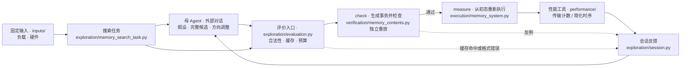

# Agent 驱动的内存系统设计探索

研究 **Agent 能否在有限评价预算下，根据给定负载、硬件与反馈，自主找到更好的内存策略**。Agent 主导候选构造、实验选择与方向调整；传统搜索器作为强对照和可调用工具。探索后提炼启发式是支线。

当前是 Python 初步原型。固定输入与可搜索策略分开：输入 JSON 定义负载和硬件，候选组合 KV 布局、分配/迁移策略、DRAM 地址映射与 NAND 页分布/回收，执行器生成实际请求，评价结果反馈给 Agent。JSON 直接解析成内部对象，不增加另一套文本语言。

## 当前能力与边界

| 状态 | 内容 |
| --- | --- |
| 已接通 | KV 读写与对象生命周期、固定地址轨迹、硬件规格、完整候选、冻结会话、错误反馈、统一预算 |
| 可搜索 | K/V 分块/排列、组拼接/交织、区域选择与条带、空间预留时机、整对象迁移触发/目的区域、DRAM 地址位交换/XOR、NAND 通道/die 条带、前台 GC 阈值与选块 |
| 确定性评价 | 独立布局/事务重放、代次与预留检查；分配/释放、整对象迁移、共享 NAND 引擎、详细 SSD、前台 GC、介质操作及共享链路计时 |
| 有接口、未完成实测 | DRAM 位映射 RTL 导出与可选 Icarus 检查，归档无实际 RTL 仿真结果；Ramulator 只读适配器与 MQSim SSD 接口均未实测、未接入搜索 |
| 尚未实现 | 后台 GC、磨损/坏块、异步 SSD/NVMe、部分对象/并发迁移与布局转换、通用固件与调度搜索、独立性能/验证子 Agent |

**当前重点是完善 DSL 与执行能力。** 历史实验只提供简化任务内的流程和机制证据，不足以判断 Agent 在真实内存系统中是否优于启发式。现有性能结果不能表述为真实 HBM 或推理加速。

<a id="architecture"></a>
## 业务流程与代码

下图展示一次候选评价的先后步骤；母 Agent 由外部对话承担，仓库内没有自动调用模型的服务。



`check` 和 `measure` 都由 `exploration/memory_search_task.py` 调度，都会使用事务生成逻辑；前者核对内容与状态，后者从新状态执行并计时。图中的先后关系不表示验证器直接调用计时器。

<a id="agent-execution-modes"></a>
未来性能/验证子 Agent 放在 `exploration/`，负责调用工具、分析并汇报，需另测收益和协调成本。V3 的独立实验上下文不是这些运行角色。

策略语义集中在 `spaces/` 的 **`*_dsl.py` 文件**，统一定义原语、解析与合法性约束。`kv_layout_dsl.py` 管对象布局与初始放置，`memory_management_dsl.py` 管上层预留与迁移，`dram_dsl.py` 与 `nand_dsl.py` 并列管理两类介质的内部映射。HBM 属于 DRAM 类；SSD 是设备接口，详细模式复用 NAND 层；内部策略仅对显式开放控制器的设备可搜索。JSON 组件名保持不变，详见[运行与开发](docs/development.md)。

## 快速开始

Python 3.10+，核心运行不依赖第三方库。在仓库根目录运行：

```powershell
python -m unittest discover -s tests -v
python -m agent_design_search inspect-task examples/memory_search.json
python -m agent_design_search session-init results/my_session --task examples/memory_search.json
python -m agent_design_search session-step results/my_session --proposal examples/kv_layout_proposal.json
python -m agent_design_search session-finish results/my_session
```

初始化评价一个公共起始设计，计入任务配置的预算。Agent 读取会话中的 `task.json` 与 `feedback.json`，再提交 `hypothesis / expected / dsl`；`dsl` 是完整候选。目录须为新会话。地址轨迹入口用 `examples/address_mapping_search.json`；它引用的 `ramulator_read.json` 仍由 Python FCFS 评价。

替换任务与提案路径即可运行其他场景：

| 场景 | 任务 / 提案 |
| --- | --- |
| 八个 DRAM 模组 | [module_search.json](examples/module_search.json) / [module_layout_proposal.json](examples/module_layout_proposal.json) |
| 两个 DRAM＋裸 NAND 模组 | [hybrid_search.json](examples/hybrid_search.json) / [hybrid_layout_proposal.json](examples/hybrid_layout_proposal.json) |
| NAND 页条带与通道/die 并行 | [nand_mapping_search.json](examples/nand_mapping_search.json) / [nand_mapping_proposal.json](examples/nand_mapping_proposal.json) |
| NAND 持续更新、释放与固定前台 GC | [nand_gc_search.json](examples/nand_gc_search.json) / [复现说明](docs/experiments.md#nand-gc-checks) |
| 可搜索 GC / 详细 SSD | [nand_gc_policy_search.json](examples/nand_gc_policy_search.json) / [ssd_nand_search.json](examples/ssd_nand_search.json)；默认候选即可初始化会话 |
| DRAM＋封装 SSD 池 | [pool_search.json](examples/pool_search.json) / [pool_layout_proposal.json](examples/pool_layout_proposal.json) |
| 创建、失效和重建对象，复用混合资源 | [lifecycle_search.json](examples/lifecycle_search.json) / [lifecycle_layout_proposal.json](examples/lifecycle_layout_proposal.json) |
| 搜索创建时预留或首次访问时分配 | [allocation_search.json](examples/allocation_search.json) / [allocation_proposal.json](examples/allocation_proposal.json) |
| 选择是否及何时将写满对象从 DRAM 迁往 NAND | [migration_search.json](examples/migration_search.json) / [migration_proposal.json](examples/migration_proposal.json) |
| K/V 追加、未满对象与容量压力下的组合验收 | [kv_lifecycle_search.json](examples/kv_lifecycle_search.json) / [运行与结果](docs/experiments.md#kv-lifecycle-checks) |

示例几何和时延仅用于工程验收，未对应实际器件。

## 阅读入口

| 你想了解什么 | 入口 |
| --- | --- |
| 项目定位、研究价值和下一步 | [研究定位](docs/research-direction.md) |
| 配置、运行、调用链与逐批开发验收 | [运行与开发](docs/development.md) · [开发计划](docs/development.md#implementation-plan) |
| 固定 KV 负载与对象分块/排列 | [KV 布局与负载](docs/kv-layout.md) |
| 从零理解张量布局、虚拟地址、页表、64 B 传输与 DRAM 位置 | [一个张量元素怎样到达 DRAM](docs/tensor-to-dram.md)（含可运行例子） |
| 从具体地址理解交换与 XOR | [地址位 DSL 教程](docs/dsl-tutorial.md) |
| 各轮实验及证据边界 | [实验总览](docs/experiments.md) |
| 阅读论文与回查证据 | [文献指南](docs/literature.md) · [精读笔记](docs/reading-notes.md) · [论文库](paper/README.md) |

## 文件结构与职责

```text
agent_design_search/             # 核心代码，不保存实验结果
├── __main__.py                  # 命令行入口
├── inputs/                      # workload.py 固定负载；hardware.py 固定硬件
├── spaces/                      # 按设计层级组织候选 DSL
│   ├── kv_layout_dsl.py         # 对象分块、组合、初始区域及条带
│   ├── memory_management_dsl.py # 上层预留与迁移原语
│   ├── dram_dsl.py              # DRAM/HBM 地址位原语
│   └── nand_dsl.py              # NAND 页分布与前台 GC 原语
├── execution/                   # 如何执行策略、维护状态
│   ├── memory_system.py         # 跨层事务、路由和迁移流程
│   ├── allocation.py            # 上层整组空间预留与释放
│   ├── nand.py                  # NAND 页状态、绑定、读改写与前台 GC
│   └── ssd.py                   # SSD 主机块/读改写；详细模式转接共享 NAND
├── performance/                 # dram.py / nand.py / ssd.py 计时；memory_system.py 组合资源/链路
│   ├── ramulator/               # DRAM/HBM 只读适配器
│   └── mqsim/                   # SSD 原生接口；裸 NAND 定制驱动协议
├── verification/                # memory_contents.py 系统内容；nand.py / ssd.py 独立介质参考；dram_rtl.py 映射电路验证
├── exploration/                 # memory_search_task.py 任务；evaluation.py 评价；session.py 会话；search_algorithms.py 搜索
│   └── dram_mapping_candidates.py # DRAM 专用启发式候选、随机生成与变异
├── contracts.py                 # 共用请求、事件、指标、错误与任务接口
└── json_io.py                   # JSON 读写与摘要；各层 __init__.py 仅为包标记/说明
experiments/                    # benchmark.py 旧对照；layout_study.py 布局诊断
                                # kv_lifecycle_study.py / memory_system_study.py 生命周期与跨层验收
                                # analyze_archives.py 阶段统计/回归/绘图；legacy_cases.py 历史任务
docs/                           # 上表列出的开发、研究、教程、实验及阅读文档
examples/                       # 输入、完整提案与教学 DSL；历史 V3 提示保持冻结
tests/                          # 输入、语义、跨层执行、预算及后端接口测试
results/                        # 集中的冻结证据；新运行默认不进 Git
tools/replay_history.py         # 从固定 Git 版本核验、重放旧实验
paper/                          # README 与 BibTeX 进 Git，PDF 按需恢复
```

`experiments/legacy_cases.py` 维护旧实验的配置、负载生成器、成绩标识和布局流量计数；不作为新任务入口，核心禁止导入它。临时备份与回归运行留在被忽略的 `.local/`。

查策略去 `spaces/`，查状态变化去 `execution/`，查时间计算去 `performance/`，查正确性去 `verification/`，查探索流程去 `exploration/`。逐文件职责见[代码导读](docs/development.md#从一次评价读代码)，建模近似见[能力边界](docs/development.md#model-limits)。

## 下一阶段

本轮 1–4 已完成原型工程交付：GC 策略、详细 SSD、跨层验收，以及来源记录和外部后端接口。结果与边界见[验收报告](docs/experiments.md#cross-layer-checks)。真实模型采集、后端校准与异步执行仍未完成；第 5 步留待讨论，不启动新 Agent 对照。未满对象迁移仍后置，依赖见[开发计划](docs/development.md#implementation-plan)。

近期实验用于语义、执行与接口验收；正式 Agent 优化对照后移，待设计空间、代表性负载和评价后端能够支撑相应结论时再开展。

继续暂停 Ramulator / MQSim 实际运行与环境安装；[第三种地址基础语义](docs/research-direction.md#todo-third-primitive)仍为暂缓 TODO。
