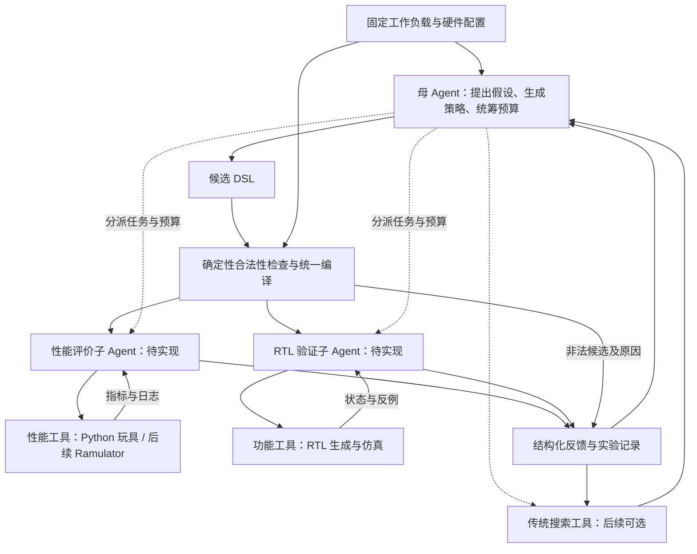

# Agent 探索 HBM 地址交织策略

研究如何用 AI Agent 在有限的性能评价预算内，找到适合特定内存访问负载的地址映射策略。背景是大模型推理中不断变化的 KV cache 布局与访问模式。

**当前是可运行的 Python 玩具原型。** 后端为自写的 `toy-fcfs-v1` 抽象模型，尚未接入 Ramulator。第一版固定布局、单一介质和请求调度，只搜索静态地址映射；真实平台与研究贡献仍在论证中。

## 当前能做什么

| 组件 | 状态 |
| --- | --- |
| JSON DSL | 支持顺序执行 `swap_bits` / `xor_bit`，含可逆性、满秩与编译一致性检查 |
| 性能评价 | 多 channel/bank、行状态、FCFS、有限队列与传输总线的抽象模型 |
| 搜索对照 | 随机、局部、位活动启发式，以及进一步安排 column 的启发式 |
| 母 Agent | 当前对话通过文件读取反馈、提交假设与候选；没有常驻模型服务 |
| RTL | 可生成地址映射模块、testbench 和向量；首轮因缺少仿真工具记为 `not_run` |
| 性能/RTL 子 Agent、Ramulator | 目标架构中的组件，尚未实现或接入 |

## 快速开始

在项目根目录使用 **Python 3.10+**；核心代码无需第三方依赖：

```powershell
python -m unittest discover -s tests -v
python -m hbm_toy evaluate examples/stride_xor.json --workload stride
python -m hbm_toy benchmark --budget 20 --count 768 --seeds 0 1 2
```

最后一条命令创建 `results/run_<时间戳>/`，保存报告和原始结果。matplotlib 为可选绘图依赖；新实验默认被 Git 忽略。模型文件接口、配置、DSL、时序假设和 RTL 命令见 [运行指南](docs/TOY_GUIDE.md)。

## 总体流程（目标架构）



两个子 Agent 是拟定的分析角色，可以并行消费同一份合法 DSL；当前由普通 Python 模块执行工具与整理结果。DSL 的解释和编译始终由确定性程序完成。职责、候选标识和后端语义约定见 [运行指南中的架构说明](docs/TOY_GUIDE.md#architecture)。

## 文件结构与职责

以下列出纳入版本管理的文件。缓存和后续临时实验目录不在表内；`results/` 中的三组实验作为固定快照保留。

```text
.
├── README.md                         # 项目入口、状态、流程与文件导航
├── .gitignore                        # 排除缓存、编译产物及未选入归档的实验
├── .gitattributes                    # 统一文本 LF 换行，图片按二进制保存
├── hbm_toy/                          # 确定性工具实现；不是独立子 Agent
│   ├── __init__.py                   # Python 包说明与版本号
│   ├── __main__.py                   # 命令行、批量基线实验、报告与可选绘图
│   ├── model.py                      # 硬件配置、DSL、位矩阵、请求生成与性能模型
│   ├── experiment.py                 # 搜索器、评价缓存、预算和模型文件协议
│   └── rtl.py                        # RTL/testbench/向量生成与可选仿真
├── tests/                            # 核心行为的自动验证
│   └── test_toy.py                   # 地址语义、手算时序、缓存/预算、协议与 RTL 状态
├── examples/                         # 可直接使用的最小输入
│   ├── identity.json                 # 不改变地址位的空操作策略
│   ├── stride_xor.json               # 固定步长场景的 XOR 映射策略
│   └── proposal.json                 # 模型提案：假设、预测与 DSL 的完整包装
├── docs/                             # 详细说明；按用途分开维护
│   ├── TOY_GUIDE.md                   # 运行方法、DSL/RTL 概念、模型语义与后端契约
│   ├── INITIAL_RESULTS.md            # 首轮实验解读、局限、归档与当时的环境记录
│   ├── RESEARCH.md                   # 文献阅读顺序、逐篇说明与已核验入口
│   └── RESEARCH_POSITIONING.md       # 平台路线、Agent 定位、评价方法与开发阶段
└── results/                          # 支撑首轮结论的选定实验归档
    ├── provenance.json               # 环境、命令、源码哈希、先验信息及归档整理记录
    ├── baseline_v1/                  # 增加 column 启发式之前的基线实验
    │   ├── benchmark.json            # 配置、静态基线及 36 次搜索的完整历史
    │   ├── report.md                 # 自动生成的基线统计报告
    │   └── convergence.png           # 普通搜索器的收敛曲线
    ├── baseline_v2/                  # 增加 column 启发式后的基线实验
    │   ├── benchmark.json            # 配置、静态基线及 48 次搜索的完整历史
    │   ├── report.md                 # 自动生成的基线统计报告
    │   └── convergence.png           # 普通搜索器的收敛曲线
    └── agent_kv_v1/                  # 当前对话驱动的一次 KV 玩具实验
        ├── state.json                # 固定配置、预算与完整会话状态；会话已关闭
        ├── feedback.json             # 模型可见的特征、DSL 规则、预算与历史反馈
        ├── result.json               # 最佳候选、搜索历史与结束后的变体评价
        ├── best_policy.json          # 可单独评价或导出 RTL 的最佳 DSL
        ├── proposals/                # 18 份提案；前两次评价为协议自带的共用起点
        │   ├── 03_channels.json      # 用 stream 位分散 channel
        │   ├── 04_stream_banks.json  # 用剩余 stream 位分 bank
        │   ├── 05_token_bank.json    # 用 token 位增加 bank 并行
        │   ├── 06_permute.json       # 比较纯位交换与 XOR 的表达
        │   ├── 07_column_fill.json   # 填充活跃 column 位，减少换行
        │   ├── 08_bank_row_mix.json  # 将 row 位混入 bank 选择
        │   ├── 09_token_channel.json # 用 token 奇偶参与 channel 选择
        │   ├── 10_alternative_stream.json  # 调换 stream 位的 channel/bank 分工
        │   ├── 11_xor_column.json    # 用 XOR 表达相近的 column 组织
        │   ├── 12_bank_token_high.json     # 更换参与 bank 选择的 token 位
        │   ├── 13_channel_row_mix.json    # 将 row 位混入 channel 选择
        │   ├── 14_channel_token_mix.json  # 将 token/bank 奇偶混入 channel
        │   ├── 15_token_channels.json     # 用两个 token 位选择 channel
        │   ├── 16_mixed_selectors.json    # 混合 stream/token 的层级分工
        │   ├── 17_high_token_bank.json   # 比较低活动 token 位的 bank 选择
        │   ├── 18_bank_phase.json         # 在 column 边界改变 bank 相位
        │   ├── 19_stream_bank_mix.json    # 混入 token/column 位以错开 bank 活动
        │   └── 20_channel_bank_phase.json # 联合改变 channel 与 bank 相位
        └── rtl/                      # 最佳策略生成的硬件实现与验证输入
            ├── address_mapper.sv     # 从物理字节地址得到各介质地址字段
            ├── tb.sv                 # 读取向量并比较输出的测试平台
            ├── vectors.mem           # 2071 组输入地址及参考输出
            └── verification.json     # 验证状态、覆盖方式、DSL 与配置；首轮未仿真
```

每份提案保存 `hypothesis`、`expected` 和 `dsl`；文件名表示探索方向，不表示该候选有收益。基线归档的 `benchmark.json["runs"]` 已完整包含逐次搜索记录，重复的 `runs/*.json` 已核对后移除。归档规则与重新导出方法见 [实验记录说明](docs/INITIAL_RESULTS.md#archive)。

## 从哪里继续阅读

| 想了解什么 | 文档 |
| --- | --- |
| 运行实验、理解 DSL、性能模型和 RTL、接入模型文件接口 | [运行指南](docs/TOY_GUIDE.md) |
| 首轮结果、为何尚不能证明 Agent 更好、如何追溯原始数据 | [实验解读](docs/INITIAL_RESULTS.md) |
| 按优先级读文献、区分全文与题录及发表状态 | [文献阅读指南](docs/RESEARCH.md) |
| 比较硬件/软件路线、确定 Agent 的贡献与公平评价方法 | [研究定位](docs/RESEARCH_POSITIONING.md) |

## 首轮结论与下一步

模拟 KV 多流负载中，identity 为 **18424 玩具周期**，当前对话 Agent 与事后补充的简单启发式均达到 **796 周期**。这说明流程能运行、映射会影响模型结果；**尚未证明 Agent 优于强基线，也不是 HBM 实测或推理加速结论**。本轮只有一次 Agent 实验，并非严格盲测。

下一步先取得真实请求模式，确认合理默认策略和强基线之上的优化余量，再选择平台、接入真实时序后端。工程阶段、验收标准和待确认资源见 [研究定位](docs/RESEARCH_POSITIONING.md#roadmap)。
