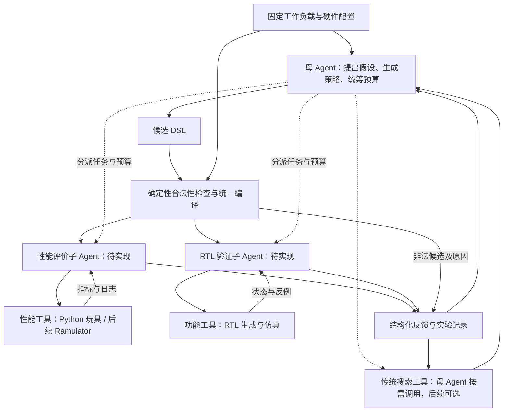

# Agent 探索 HBM 地址交织策略

研究如何用 AI Agent 在有限的性能评价预算内，找到适合特定内存访问负载的地址映射策略。背景是大模型推理中不断变化的 KV cache 布局与访问模式。

**研究主线是 Agent 主导策略探索。** Agent 负责理解负载、提出瓶颈假设、构造候选、选择实验、分配评价预算，并根据反馈修正搜索方向。启发式和传统搜索器作为强对照及可调用工具；探索后提炼可复用规则是有价值的支线。主要证据应来自 Agent 在公平条件下的搜索效果与成本，具体见 [研究定位](docs/RESEARCH_POSITIONING.md#agent-mainline)。

**当前是可运行的 Python 玩具原型。** 后端为自写的 `toy-fcfs-v1` 抽象模型，尚未接入 Ramulator。第一版固定布局、单一介质和请求调度，只搜索静态地址映射；真实平台与具体 Agent 方法仍在论证中。

## 当前能做什么

| 组件 | 状态 |
| --- | --- |
| JSON DSL | 支持顺序执行 `swap_bits` / `xor_bit`，含可逆性、满秩与编译一致性检查 |
| 性能评价 | 多 channel/bank、行状态、FCFS、有限队列与传输总线的抽象模型 |
| 搜索对照 | 随机、局部、位活动启发式，以及进一步安排 column 的启发式 |
| 规则发现诊断 | 联合位分布与 bank 内变化规则、720 种位排列的精确对照、冻结后的验证与反例分析 |
| 母 Agent | 当前对话通过文件读取反馈、提交假设与候选；没有常驻模型服务 |
| Agent V2 对照 | 固定 JSON 请求轨迹、统一预算、冻结无反馈候选、5 个任务的逐轮探索与事后精确参照 |
| RTL | 可生成地址映射模块、testbench 和向量；首轮因缺少仿真工具记为 `not_run` |
| 性能/RTL 子 Agent、Ramulator | 目标架构中的组件，尚未实现或接入 |

## 快速开始

在项目根目录使用 **Python 3.10+**；核心代码无需第三方依赖：

```powershell
python -m unittest discover -s tests -v
python -m hbm_toy evaluate examples/stride_xor.json --workload stride
python -m hbm_toy benchmark --budget 20 --count 768 --seeds 0 1 2
```

最后一条命令创建 `results/run_<时间戳>/`，保存报告和原始结果。matplotlib 为可选绘图依赖；新实验默认被 Git 忽略。模型文件接口、配置、DSL、时序假设和 RTL 命令见 [运行指南](docs/TOY_GUIDE.md)。

支线的规则发现实验另见 [实验报告与复现命令](results/rule_study_v1/report.md)：保持旧启发式与模拟器不变，在缩小的空间里检查新规则的收益和失效条件，为后续 Agent 探索提供开发案例与诊断工具。

主线已完成一轮 [Agent V2 对照实验](results/agent_v2_pilot/report.md)：5 条固定合成轨迹、每方法每任务最多 20 次评价，Agent 相对无反馈提案 1 胜、3 平、1 负，尚未显示稳定优势。可运行 `python -m hbm_toy.agent_v2_report replay results/agent_v2_pilot` 重放全部搜索记录；新轨迹接口见 [运行指南](docs/TOY_GUIDE.md#fixed-trace-v2)。

[阶段切换失败复盘](results/agent_v2_diagnosis/report.md)进一步发现：Agent 放弃的中间方案存在一步改好的机会，最终最好方案却已无法靠单次交换改善；两批请求的排队积压也被总分掩盖。已增加分批诊断工具和下一版提示草案，尚未证明改进后的 Agent 有优势。

随后完成 [Agent V3 四组对照](results/agent_v3_pilot/report.md)：四个独立模型上下文分别组合原/新提示与汇总/分批反馈，在三条新轨迹上各用 20 次评价。密集任务中分批反馈组达到 466 周期，优于汇总组和三次局部搜索的 471；另有加反馈后退步的任务，尚无稳定优势。接口与隔离约定见 [V3 运行说明](docs/TOY_GUIDE.md#factorial-v3)。

## 总体流程（目标架构）



两个子 Agent 是拟定的分析角色，可以并行消费同一份合法 DSL；当前由普通 Python 模块执行工具与整理结果。DSL 的解释和编译始终由确定性程序完成。职责、候选标识和后端语义约定见 [运行指南中的架构说明](docs/TOY_GUIDE.md#architecture)。

## 文件结构与职责

以下列出项目文件与维护者本地论文全文。缓存和后续临时实验目录不在表内；`results/` 保留首轮三组实验、规则发现、Agent V2 与失败复盘、Agent V3 的选定归档。`paper/` 按文献指南的 R 编号管理 20 篇论文，**Git 只跟踪其中的 `README.md` 和 `references.bib`，PDF 被忽略**。下列 PDF 文件名表示下载后的本地结构，刚克隆仓库时没有这些文件；按需恢复方法见 [论文库说明](paper/README.md)。

```text
.
├── README.md                         # 项目入口、状态、流程与文件导航
├── .gitignore                        # 排除本地论文 PDF、缓存、编译产物及临时实验
├── .gitattributes                    # 默认文本 LF；图片/PDF 及按字节核验的实验归档不转换
├── hbm_toy/                          # 确定性工具实现；不是独立子 Agent
│   ├── __init__.py                   # Python 包说明与版本号
│   ├── __main__.py                   # 命令行、批量基线实验、报告与可选绘图
│   ├── model.py                      # 硬件配置、DSL、位矩阵、请求生成与性能模型
│   ├── experiment.py                 # 搜索器、评价缓存、预算和模型文件协议
│   ├── trace_bridge.py               # 固定请求快照、统计、候选反馈与实际调用计数
│   ├── agent_v2.py                   # 冻结新任务/无反馈批次、对照运行与事后精确参照
│   ├── agent_v2_report.py            # 重放完整搜索历史、生成收敛曲线
│   ├── agent_v2_diagnosis.py         # 事后邻域审计、连续运行的分批反馈及冷启动对照
│   ├── agent_v3.py                   # 提示/反馈四组实验、独立会话、冻结与统一预算
│   ├── agent_v3_report.py            # 四组实验完整重放与事后最优差距曲线
│   ├── rule_study.py                 # 规则发现实验、合成反例、精确枚举与冻结后的验证
│   └── rtl.py                        # RTL/testbench/向量生成与可选仿真
├── tests/                            # 核心行为的自动验证
│   ├── test_toy.py                   # 地址语义、手算时序、缓存/预算、协议与 RTL 状态
│   ├── test_rule_study.py            # 全排列编译/逆映射、相关位、操作预算与搜索重放
│   ├── test_trace_bridge.py          # 快照完整性、缓存/失败预算、空间约束与精确参照边界
│   ├── test_agent_v2_diagnosis.py    # 分批统计保留排队/行状态、延迟分解与事件完整性
│   └── test_agent_v3.py              # 同分不同反馈、实际调用数、冻结承诺与提前揭示拦截
├── examples/                         # 可直接使用的最小输入
│   ├── identity.json                 # 不改变地址位的空操作策略
│   ├── stride_xor.json               # 固定步长场景的 XOR 映射策略
│   ├── proposal.json                 # 模型提案：假设、预测与 DSL 的完整包装
│   └── agent_v3_prompt.md            # V3 新提示的冻结原文；改动后需建立新实验
├── docs/                             # 详细说明；按用途分开维护
│   ├── TOY_GUIDE.md                   # 运行方法、DSL/RTL 概念、模型语义与后端契约
│   ├── INITIAL_RESULTS.md            # 首轮实验解读、局限、归档与当时的环境记录
│   ├── LITERATURE_GUIDE.md           # 文献阅读顺序、逐篇说明与已核验入口
│   └── RESEARCH_POSITIONING.md       # 平台路线、Agent 定位、评价方法与开发阶段
├── paper/                            # 仅 README/bib 纳入 Git；下列 PDF 为本地下载件
│   ├── README.md                     # 20 篇全文索引、来源与版本差异
│   ├── references.bib                # 20 条 BibTeX 题录、引用键与本地附件路径
│   ├── R01_Shuhai_FCCM2020.pdf        # 真实 FPGA HBM 的带宽与映射特征
│   ├── R02_SDAM_ASPLOS2022.pdf        # 软件定义、按数据选择地址映射
│   ├── R03_Flatfish_TCAD2022.pdf      # 用强化学习生成应用相关地址映射
│   ├── R04_XOR_Address_Mapping_MEMSYS2025.pdf  # XOR 映射的数学模型与优化
│   ├── R05_AgentDSE_arXiv2606.21836v1.pdf     # Agent 主导体系结构搜索
│   ├── R06_ArchEval_arXiv2607.03601v1.pdf     # 体系结构 Agent 的能力评价
│   ├── R07_DReAM_arXiv1509.03721v1.pdf       # 运行时动态重排地址映射
│   ├── R08_PAE_ISCA2018.pdf           # GPU 地址位熵与 PAE 映射
│   ├── R09_ArchGym_ISCA2023.pdf       # 统一仿真接口与搜索算法比较
│   ├── R10_gem5_CoPilot_arXiv2510.19577v1.pdf # gem5 的 Agent 探索助手
│   ├── R11_ChatNeuroSim_arXiv2603.08745v1.pdf # 存内计算配置与优化 Agent
│   ├── R12_PagedAttention_arXiv2309.06180v1.pdf # KV 分块管理与服务系统
│   ├── R13_vAttention_arXiv2405.04437v1.pdf   # 虚拟连续的动态 KV 管理
│   ├── R14_PFM_arXiv2608.06989v1.pdf         # NPU/PIM 共享数据的双视图
│   ├── R15_PATTON_arXiv2609.11392v1.pdf      # 面向 LLM 服务的 PIM 运行时
│   ├── R16_AlphaEvolve_arXiv2506.13131v1.pdf # 代码生成、评价与演化搜索
│   ├── R17_LLAMBO_ICLR2024.pdf        # 用语言模型增强贝叶斯优化
│   ├── R18_Ramulator2_arXiv2308.11030v1.pdf  # 模块化 DRAM 时序仿真器
│   ├── R19_DRAMSys4_IJPP2022.pdf      # DRAM 仿真框架与系统分析
│   └── R20_UMDAM_ISCAS2026.pdf        # NPU/PIM 的统一数据布局与地址映射
└── results/                          # 支撑实验结论的选定归档
    ├── provenance.json               # 环境、命令、源码哈希、先验信息及归档整理记录
    ├── baseline_v1/                  # 增加 column 启发式之前的基线实验
    │   ├── benchmark.json            # 配置、静态基线及 36 次搜索的完整历史
    │   ├── report.md                 # 自动生成的基线统计报告
    │   └── convergence.png           # 普通搜索器的收敛曲线
    ├── baseline_v2/                  # 增加 column 启发式后的基线实验
    │   ├── benchmark.json            # 配置、静态基线及 48 次搜索的完整历史
    │   ├── report.md                 # 自动生成的基线统计报告
    │   └── convergence.png           # 普通搜索器的收敛曲线
    ├── rule_study_v1/                # 联合统计规则的发现、验证及失败样例
    │   ├── protocol.json             # 预先声明的假设、验证集合、预算与冻结源码哈希
    │   ├── discovery.json            # 两个发现样例的规则、搜索与全部排列评价
    │   ├── validation.json           # 12 个验证变体与原有 8 条轨迹的结果
    │   └── report.md                 # 结果解读：机制、收益、反例与复现步骤
    ├── agent_v2_pilot/               # 固定轨迹上的主线 Agent 对照；运行时副本不重复归档
    │   ├── protocol.json             # 提示、任务、预算与代码/冻结候选哈希
    │   ├── comparison.json           # 45 个运行的完整候选历史及事后 720 排列参照
    │   ├── report.md                 # 比较结果、成功调整、失败路径、成本与复现步骤
    │   ├── convergence.png           # 随允许评价预算变化的最佳完成时间
    │   ├── traces/                   # 固定的请求输入，各 192 个请求
    │   │   ├── T00_sequential.json   # 简单顺序对照
    │   │   ├── T01_regular.json      # 重排地址位后的规则步长
    │   │   ├── T02_correlated.json   # 含三位奇偶相关关系的访问
    │   │   ├── T03_shuffled.json     # 相同相关地址集合，打乱访问顺序
    │   │   └── T04_phases.json       # 两种模式的阶段切换
    │   └── one_shot/                 # 查看任何新任务性能前冻结的提案，各 18 个
    │       ├── T00_sequential.json   # 顺序对照的无反馈候选列表
    │       ├── T01_regular.json      # 规则步长的无反馈候选列表
    │       ├── T02_correlated.json   # 相关位任务的无反馈候选列表
    │       ├── T03_shuffled.json     # 乱序任务的无反馈候选列表
    │       └── T04_phases.json       # 阶段切换的无反馈候选列表
    ├── agent_v2_diagnosis/           # 已知阶段切换样例的失败诊断，独立于原比赛
    │   ├── diagnosis.json            # 决策/邻域审计、37 次补测、分批反馈与来源哈希
    │   └── report.md                 # 失败原因、机制证据与下一轮分因素验证方案
    ├── agent_v3_pilot/               # 独立模型上下文的提示 × 反馈小规模对照
    │   ├── protocol.json             # 配置、两种提示、预算、冻结哈希与解释边界
    │   ├── execution.json            # 独立上下文分配与运行方式记录
    │   ├── comparison.json           # 四组 Agent、补充无反馈及普通搜索的完整历史
    │   ├── report.md                 # 分因素结果、探索过程、成本与局限
    │   ├── convergence.png           # 各方法与事后最优的差距随预算变化
    │   ├── briefings/                # 各组可读的独立简报，不互相透露提示内容
    │   │   ├── old_summary.json      # 原提示 + 汇总反馈
    │   │   ├── new_summary.json      # 新提示 + 汇总反馈
    │   │   ├── old_phase.json        # 原提示 + 分批反馈
    │   │   └── new_phase.json        # 新提示 + 分批反馈
    │   ├── inputs/                   # 共同可见的静态统计、分界及启发式 DSL
    │   │   ├── N01_burst.json        # 密集请求任务的输入信息
    │   │   ├── N02_paced.json        # 较慢请求任务的输入信息
    │   │   └── N03_gap.json          # 批次间隔任务的输入信息
    │   ├── traces/                   # 三条新的固定合成请求流，各 192 请求
    │   │   ├── N01_burst.json        # 每周期最多 8 个请求，持续积压
    │   │   ├── N02_paced.json        # 每 4 周期一个请求，较低注入速率
    │   │   └── N03_gap.json          # 第二批从周期 4096 开始提交
    │   └── one_shot/                 # 母对话在性能揭示前提交的补充无反馈候选
    │       ├── N01_burst.json        # 密集请求的 18 份冻结候选
    │       ├── N02_paced.json        # 较慢请求的 18 份冻结候选
    │       └── N03_gap.json          # 批次间隔的 18 份冻结候选
    └── agent_kv_v1/                  # 当前对话驱动的一次 KV 玩具实验
        ├── state.json                # 固定配置、预算与完整会话状态；会话已关闭
        ├── feedback.json             # 模型可见的特征、DSL 规则、预算与历史反馈
        ├── result.json               # 最佳候选、搜索历史与结束后的变体评价
        ├── best_policy.json          # 可单独评价或导出 RTL 的最佳 DSL
        ├── proposals/                # 18 份提案；前两次评价为协议自带的共用起点
        │   ├── 03_channels.json      # 用 stream 位分散 channel
        │   ├── 04_stream_banks.json  # 用剩余 stream 位分 bank
        │   ├── 05_token_bank.json    # 用 token 位增加 bank 并行
        │   ├── 06_permute.json       # 比较纯位交换与 XOR 的表达
        │   ├── 07_column_fill.json   # 填充活跃 column 位，减少换行
        │   ├── 08_bank_row_mix.json  # 将 row 位混入 bank 选择
        │   ├── 09_token_channel.json # 用 token 奇偶参与 channel 选择
        │   ├── 10_alternative_stream.json  # 调换 stream 位的 channel/bank 分工
        │   ├── 11_xor_column.json    # 用 XOR 表达相近的 column 组织
        │   ├── 12_bank_token_high.json     # 更换参与 bank 选择的 token 位
        │   ├── 13_channel_row_mix.json    # 将 row 位混入 channel 选择
        │   ├── 14_channel_token_mix.json  # 将 token/bank 奇偶混入 channel
        │   ├── 15_token_channels.json     # 用两个 token 位选择 channel
        │   ├── 16_mixed_selectors.json    # 混合 stream/token 的层级分工
        │   ├── 17_high_token_bank.json   # 比较低活动 token 位的 bank 选择
        │   ├── 18_bank_phase.json         # 在 column 边界改变 bank 相位
        │   ├── 19_stream_bank_mix.json    # 混入 token/column 位以错开 bank 活动
        │   └── 20_channel_bank_phase.json # 联合改变 channel 与 bank 相位
        └── rtl/                      # 最佳策略生成的硬件实现与验证输入
            ├── address_mapper.sv     # 从物理字节地址得到各介质地址字段
            ├── tb.sv                 # 读取向量并比较输出的测试平台
            ├── vectors.mem           # 2071 组输入地址及参考输出
            └── verification.json     # 验证状态、覆盖方式、DSL 与配置；首轮未仿真
```

每份提案保存 `hypothesis`、`expected` 和 `dsl`；文件名表示探索方向，不表示该候选有收益。基线归档的 `benchmark.json["runs"]` 已完整包含逐次搜索记录，重复的 `runs/*.json` 已核对后移除。归档规则与重新导出方法见 [实验记录说明](docs/INITIAL_RESULTS.md#archive)。

## 从哪里继续阅读

| 想了解什么 | 文档 |
| --- | --- |
| 运行实验、理解 DSL、性能模型和 RTL、接入模型文件接口 | [运行指南](docs/TOY_GUIDE.md) |
| 首轮结果、为何尚不能证明 Agent 更好、如何追溯原始数据 | [实验解读](docs/INITIAL_RESULTS.md) |
| Agent 如何帮助发现可固化规则，以及新规则为什么仍会失败 | [规则发现实验](results/rule_study_v1/report.md) |
| 反馈 Agent 与无反馈提案、强启发式和普通搜索器的直接比较 | [Agent V2 报告与曲线](results/agent_v2_pilot/report.md) |
| Agent 为什么输，下一轮应具体改什么 | [阶段切换失败复盘](results/agent_v2_diagnosis/report.md) |
| 改提示或增加分批反馈是否有用 | [Agent V3 四组对照](results/agent_v3_pilot/report.md) |
| 按优先级读文献、区分全文与题录及发表状态 | [文献阅读指南](docs/LITERATURE_GUIDE.md) |
| 按需下载 20 篇论文、管理 BibTeX、核对来源与版本 | [论文库](paper/README.md) · [引用文件](paper/references.bib) |
| 比较硬件/软件路线、确定 Agent 的贡献与公平评价方法 | [研究定位](docs/RESEARCH_POSITIONING.md) |

## 首轮结论与下一步

模拟 KV 多流负载中，identity 为 **18424 玩具周期**，当前对话 Agent 与事后补充的简单启发式均达到 **796 周期**。这说明流程能运行、映射会影响模型结果；**尚未证明 Agent 优于强基线，也不是 HBM 实测或推理加速结论**。本轮只有一次 Agent 实验，并非严格盲测。

后续规则发现实验中，联合统计规则在两个诊断样例上达到 720 种位排列中的最优；冻结后的 12 个变体中，相对旧规则 8 胜、3 平、1 负，在原有 KV 变体上也有退化。这是支线诊断结果，可用于研究 Agent 如何识别假设失效并调整探索方向；尚未证明新规则可通用或 Agent 搜索更强。

Agent V2 已完成上述闭环的首轮小试验：Agent 在 5 个任务中有 4 个达到排列空间最优，但阶段切换任务为 574 周期，劣于无反馈的 550 和局部搜索的 540 / 540 / 550。原始搜索共 802 次执行，重放逐项一致；结果尚不支持 Agent 稳定优于传统优化。

下一步用本轮失败案例改进 Agent 的诊断与实验规划，然后冻结新任务做独立比较；不能继续调这 5 条轨迹后仍称其为未见测试。并行取得真实请求模式、确认优化余量，随后用真实时序后端复核。四步流程见 [主线试验安排](docs/RESEARCH_POSITIONING.md#next-agent-study)，工程阶段与资源见 [研究定位](docs/RESEARCH_POSITIONING.md#roadmap)。
