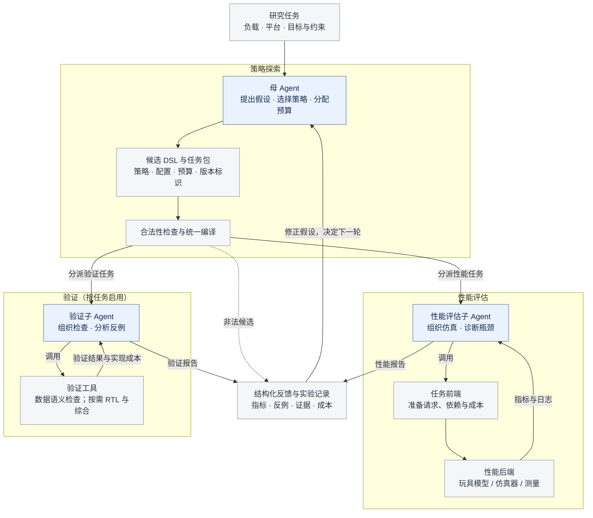

# Agent 驱动的 HBM 内存策略探索

研究 AI Agent 能否在有限评价预算下，根据负载特征、数据生命周期与系统约束，自主探索更好的内存数据组织策略。以 HBM 和大模型 KV cache 为切入场景，优先收敛一个布局、分配、读写访问或必要转换之间具有明确取舍的子问题。

**研究主线是 Agent 主导策略探索。** Agent 负责理解负载、提出瓶颈假设、构造候选、选择实验、分配评价预算，并根据反馈修正搜索方向。启发式和传统搜索器作为强对照及可调用工具；探索后提炼可复用规则是有价值的支线。主要证据应来自 Agent 在公平条件下的搜索效果与成本，具体见 [研究定位](docs/RESEARCH_POSITIONING.md#agent-mainline)。

## 文献与实验形成的研究判断

20 篇工作的有范围精读支持继续研究，但研究价值需要落在具体取舍和可检验的 Agent 能力上：

- **纯地址位搜索保留为基础对照，不再是长期主攻。** 映射有数学结构、等价冗余和强启发式；增加位数或 XOR 不能自动证明任务更难，更不能证明 Agent 更强。
- **优先研究 KV 生命周期中的真实取舍。** 追加写入、后续读取/归约、容量利用与转换开销可能冲突。PFM/PATTON 等既提供机制证据，也已经提出专门方案；下一步要确定剩余优化余量，不能把普通 GPU、定制 NPU/PIM 和不同介质混为同一平台。
- **优化目标必须包含系统代价。** kernel 更快、行命中率更高或更少行激活，不一定意味着服务更快。布局、分配改变流量时，需固定上层逻辑任务，让请求、容量和重计算随策略产生。
- **Agent 的贡献在决策中检验。** 文件循环和工具调用已有先例。比较共享信息、原语和工具的强搜索器，以及匹配模型调用资源的有/无反馈版本，检查假设修正是否带来收益。
- **先定义问题，再扩展工程。** DSL 按机制分层且携带正确性与成本语义；仿真和 RTL 提供不同证据。暂不以多介质、更多 Agent 或完整硬件流程作为默认开发目标。

证据、限制及其开发含义集中见[研究定位中的文献归纳](docs/RESEARCH_POSITIONING.md#literature-to-principles)，逐篇章节和认识演进见[研究笔记](docs/RESEARCH_NOTES.md)。这是当前指导思想，不表示已证明 Agent 优势或已实现新的系统模型。

## 当前能做什么

**当前是可运行的 Python 玩具原型。** 已有实验使用自写的 `toy-fcfs-v1` 抽象模型。Ramulator 2.1 最小只读适配代码已加入，完成配置导出及 Python 接口测试，但 C++ 驱动尚未编译运行，尚无 Ramulator 性能结果。第一版固定布局、单一介质和请求调度，只搜索静态地址映射；真实平台与具体 Agent 方法仍在论证中。

| 组件 | 状态 |
| --- | --- |
| JSON DSL | 支持顺序执行 `swap_bits` / `xor_bit`，含可逆性、满秩与编译一致性检查 |
| 性能评价 | 多 channel/bank、行状态、FCFS、有限队列与传输总线的抽象模型 |
| 搜索对照 | 随机、局部、位活动启发式，以及进一步安排 column 的启发式 |
| 规则发现诊断 | 联合位分布与 bank 内变化规则、720 种位排列的精确对照、冻结后的验证与反例分析 |
| 母 Agent | 当前对话通过文件读取反馈、提交假设与候选；没有常驻模型服务 |
| Agent V2 对照 | 固定 JSON 请求轨迹、统一预算、冻结无反馈候选、5 个任务的逐轮探索与事后精确参照 |
| Agent V3 对照 | 四个独立上下文，原/新提示与汇总/分批反馈交叉比较；三条任务，尚未建立稳定收益 |
| RTL | 可生成地址映射模块、testbench 和向量；首轮因缺少仿真工具记为 `not_run` |
| 性能/RTL 子 Agent | 目标架构中的分析角色，尚未实现 |
| Ramulator 2.1 | 固定源码、只读转换接口及 C++ 驱动初稿；待 Linux/C++ 环境编译运行，见[接入说明](backends/ramulator21/README.md) |

## 快速开始

在项目根目录使用 **Python 3.10+**；核心代码无需第三方依赖：

```powershell
python -m unittest discover -s tests -v
python -m hbm_toy evaluate examples/stride_xor.json --workload stride
python -m hbm_toy benchmark --budget 20 --count 768 --seeds 0 1 2
```

最后一条命令创建 `results/run_<时间戳>/`，保存报告和原始结果。matplotlib 为可选绘图依赖；新实验默认被 Git 忽略。模型文件接口、配置、DSL、时序假设和 RTL 命令见 [运行指南](docs/TOY_GUIDE.md)。

支线的规则发现实验另见 [实验报告与复现命令](results/rule_study_v1/report.md)：保持旧启发式与模拟器不变，在缩小的空间里检查新规则的收益和失效条件，为后续 Agent 探索提供开发案例与诊断工具。

主线已完成一轮 [Agent V2 对照实验](results/agent_v2_pilot/report.md)：5 条固定合成轨迹、每方法每任务最多 20 次评价，Agent 相对无反馈提案 1 胜、3 平、1 负，尚未显示稳定优势。可运行 `python -m hbm_toy.agent_v2_report replay results/agent_v2_pilot` 重放全部搜索记录；新轨迹接口见 [运行指南](docs/TOY_GUIDE.md#fixed-trace-v2)。

[阶段切换失败复盘](results/agent_v2_diagnosis/report.md)进一步发现：Agent 放弃的中间方案存在一步改好的机会，最终最好方案却已无法靠单次交换改善；两批请求的排队积压也被总分掩盖。当时新增的分批诊断与提示随后用于 V3；提示文件保留归档原文及哈希。

随后完成 [Agent V3 四组对照](results/agent_v3_pilot/report.md)：四个独立模型上下文分别组合原/新提示与汇总/分批反馈，在三条新轨迹上各用 20 次评价。密集任务中分批反馈组达到 466 周期，优于汇总组和三次局部搜索的 471；另有加反馈后退步的任务，尚无稳定优势。接口与隔离约定见 [V3 运行说明](docs/TOY_GUIDE.md#factorial-v3)。

## 总体流程（目标架构）

母 Agent 负责提出策略和分配预算；候选经过检查后交给子 Agent，子 Agent 组织工具执行、分析结果并返回报告。下图按“策略探索—分支评估—反馈迭代”组织，蓝色为 Agent，灰色为确定性工具和数据。



性能评估子 Agent 负责准备评估输入、调用任务前端与仿真器、检查执行状态、解释指标；任务前端是其调用的确定性工具，按策略生成请求、依赖与成本。静态映射可直接使用固定轨迹；布局或生命周期策略需要相应前端。验证子 Agent 负责调用适用的正确性检查；涉及硬件改动时，再组织 RTL 验证及必要的实现代价分析。

任务包含候选 DSL、工作负载、配置、预算和版本标识；合法性检查、编译、缓存及原始日志记录由确定性程序执行。子 Agent 不得在评价中改写候选，额外诊断也受预算约束。验证发现的实现延迟与资源成本必须反馈到性能评价；详细约定见[运行指南](docs/TOY_GUIDE.md#architecture)。

**当前采用单对话承担多种职责，加确定性工具执行。** 现有流程是“当前对话提交 DSL → Python 评价器调用玩具模拟器 → 保存反馈 → 当前对话决定下一步”。尚未把性能评估和验证拆成独立的 Agent 执行单元；这不表示当前没有性能评价。独立子 Agent 可以复用同一个模型，关键在于单独的任务上下文、工具调用循环及报告交接，而不是另换一个模型或多开一个窗口。V3 的独立上下文用于隔离实验条件，不是图中的母子分工。Ramulator 适配器仍是独立工具，尚未接入搜索闭环。分工差异及取舍见[运行指南](docs/TOY_GUIDE.md#agent-execution-modes)。

## 文件结构与职责

下面保留主要目录和关键入口，具体运行方法见[运行指南](docs/TOY_GUIDE.md)，各轮实验的报告入口见下一节。

```text
.
├── README.md                     # 项目定位、进展、流程与导航
├── DSL_TUTORIAL.md                # 零基础 DSL 教程：层级定位、位操作实例与运行方法
├── hbm_toy/                      # 玩具模型、搜索工具与实验接口
│   ├── __main__.py               # 命令行与批量基线实验入口
│   ├── model.py                  # 硬件配置、地址 DSL、请求生成与性能模型
│   ├── experiment.py             # 搜索、评价缓存、预算与模型文件协议
│   ├── trace_bridge.py           # 固定请求轨迹、统计与候选反馈
│   ├── ramulator_backend.py      # 外部仿真器的请求转换、执行与结果校验
│   └── rtl.py                    # 地址映射 RTL、测试平台与验证输入生成
├── tests/                        # 模型语义、搜索协议、预算及后端接口测试
├── backends/
│   └── ramulator21/              # 固定版本、构建入口与 C++ 驱动；详见目录内 README
├── examples/                     # DSL、模型提案、只读轨迹示例与 V3 冻结提示词
├── docs/
│   ├── RESEARCH_POSITIONING.md    # 当前研究判断、开发原则、任务选择与推进条件
│   ├── LITERATURE_GUIDE.md        # 文献阅读路线、逐篇介绍与来源链接
│   ├── RESEARCH_NOTES.md          # 精读证据、问题台账与认识演进
│   ├── TOY_GUIDE.md               # 运行方法、模型语义与后续开发契约
│   └── INITIAL_RESULTS.md         # 首轮实验解读、局限与归档说明
├── paper/                        # 文献管理；PDF 仅在本地保存
│   ├── README.md                 # 论文清单、版本、来源与下载恢复方法
│   └── references.bib            # BibTeX 题录、引用键与本地附件路径
└── results/                      # 选定实验归档：协议、输入、提案、结果、报告与曲线
    ├── provenance.json           # 环境、命令、源码哈希与归档来源记录
    ├── baseline_v1/              # 加入 column 启发式前的基线
    ├── baseline_v2/              # 加入 column 启发式后的基线
    ├── agent_kv_v1/              # 首轮对话 Agent 的 KV 玩具实验
    ├── rule_study_v1/            # 规则发现、验证与反例
    ├── agent_v2_pilot/           # 固定轨迹上的反馈探索对照
    ├── agent_v2_diagnosis/       # V2 阶段切换失败复盘
    └── agent_v3_pilot/           # 独立上下文的提示与反馈四组对照
```

`hbm_toy/` 还包含 V2/V3 实验组织、报告重放和规则研究模块，具体命令见[运行指南](docs/TOY_GUIDE.md)。Ramulator 的文件职责与验证边界见[适配器说明](backends/ramulator21/README.md)。

`paper/` **只将 README 和 BibTeX 纳入 Git，PDF 不随仓库分发**；论文清单和按需下载方法统一维护在[论文库说明](paper/README.md)。`results/` 保留支撑结论的选定归档，新实验和临时产物默认忽略；文件详情由各轮报告说明，归档规则见[实验记录说明](docs/INITIAL_RESULTS.md#archive)。根目录的 `.gitignore` 和 `.gitattributes` 分别管理忽略范围与文件换行规则。

## 从哪里继续阅读

| 想了解什么 | 文档 |
| --- | --- |
| 从具体地址看懂当前 DSL 原语，以及它能改哪一层 | [DSL 入门教程](DSL_TUTORIAL.md) |
| 运行实验、理解 DSL、性能模型和 RTL、接入模型文件接口 | [运行指南](docs/TOY_GUIDE.md) |
| 首轮结果、为何尚不能证明 Agent 更好、如何追溯原始数据 | [实验解读](docs/INITIAL_RESULTS.md) |
| Agent 如何帮助发现可固化规则，以及新规则为什么仍会失败 | [规则发现实验](results/rule_study_v1/report.md) |
| 反馈 Agent 与无反馈提案、强启发式和普通搜索器的直接比较 | [Agent V2 报告与曲线](results/agent_v2_pilot/report.md) |
| Agent 为什么输，下一轮应具体改什么 | [阶段切换失败复盘](results/agent_v2_diagnosis/report.md) |
| 改提示或增加分批反馈是否有用 | [Agent V3 四组对照](results/agent_v3_pilot/report.md) |
| 按优先级读文献、区分全文与题录及发表状态 | [文献阅读指南](docs/LITERATURE_GUIDE.md) |
| 追踪历史问题、正文证据、认识修订与待验证假设 | [持续研究笔记](docs/RESEARCH_NOTES.md) |
| 按需下载 20 篇论文、管理 BibTeX、核对来源与版本 | [论文库](paper/README.md) · [引用文件](paper/references.bib) |
| 比较硬件/软件路线、确定 Agent 的贡献与公平评价方法 | [研究定位](docs/RESEARCH_POSITIONING.md) |

## 实验结论与下一步

模拟 KV 多流负载中，identity 为 **18424 玩具周期**，当前对话 Agent 与事后补充的简单启发式均达到 **796 周期**。这说明流程能运行、映射会影响模型结果；**尚未证明 Agent 优于强基线，也不是 HBM 实测或推理加速结论**。本轮只有一次 Agent 实验，并非严格盲测。

后续规则发现实验中，联合统计规则在两个诊断样例上达到 720 种位排列中的最优；冻结后的 12 个变体中，相对旧规则 8 胜、3 平、1 负，在原有 KV 变体上也有退化。这是支线诊断结果，可用于研究 Agent 如何识别假设失效并调整探索方向；尚未证明新规则可通用或 Agent 搜索更强。

Agent V2 已完成上述闭环的首轮小试验：Agent 在 5 个任务中有 4 个达到排列空间最优，但阶段切换任务为 574 周期，劣于无反馈的 550 和局部搜索的 540 / 540 / 550。原始搜索共 802 次执行，重放逐项一致；结果尚不支持 Agent 稳定优于传统优化。

V3 随后检验了提示与反馈粒度，出现局部改善和退步，尚未证明稳定优势。归档审计还发现当前 720 排列可按模型对称性分成 180 组等价分组，任务的近优区域宽度不同，也有单步局部障碍。因此不能把既有失败只解释成“空间太小”，也不能把该离散问题叫作简单凸优化。精确参照仅覆盖旧排列空间，详见[审计](docs/RESEARCH_NOTES.md#archived-space-audit)。

**下一步先形成一个 KV 系统子问题的最小规格。** 比较平台权限，选定读写、生命周期或容量中的一个真实取舍，定义合法原语、正确性、请求生成、完整成本和强基线，再决定如何扩展玩具。随后在新任务上分开测模型先验、逐轮调用与真实反馈的贡献；既有任务只作开发和诊断。继续暂停 Ramulator 实际运行及环境安装。任务选择见[最小系统问题](docs/RESEARCH_POSITIONING.md#minimal-system-task)，实验建议见[下一轮 Agent 证据](docs/RESEARCH_POSITIONING.md#next-agent-study)，推进条件见[研究路线](docs/RESEARCH_POSITIONING.md#roadmap)。
