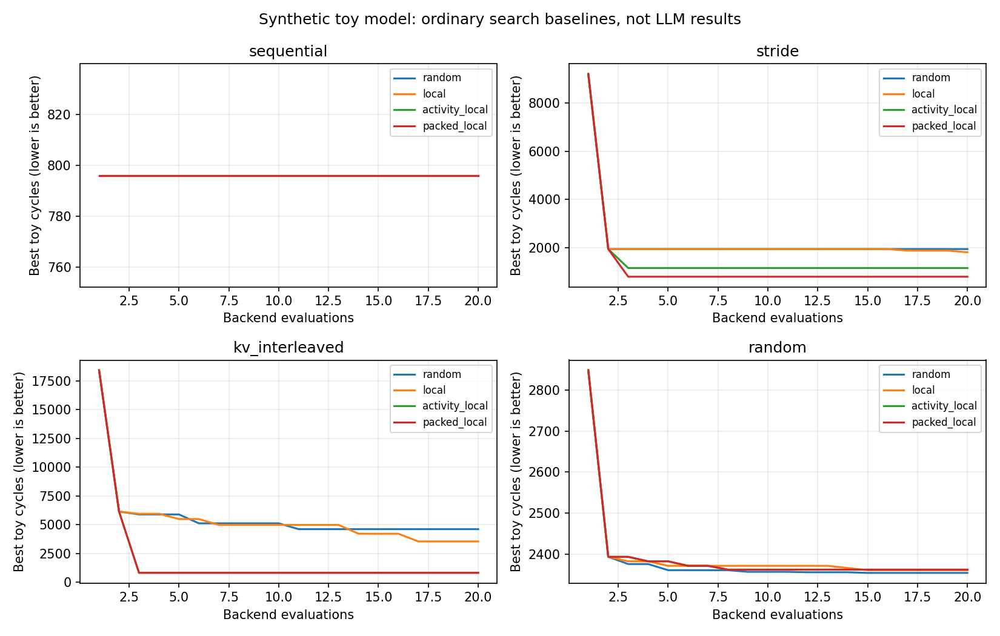

# 首轮玩具实验：映射有效，Agent 优势尚未成立

运行日期：2026-09-29。后端 `toy-fcfs-v1`，Python 3.10.11，Windows。核心检查 11 项通过。模型与实验约定见 [运行指南](TOY_GUIDE.md)。

**本轮结论：最小探索闭环已跑通。规则访问流上的糟糕映射可以被明显改善，但简单启发式也能达到本轮 Agent 的最佳结果。** 以下所有周期均为抽象模型输出，不是 HBM 实测，也不是推理吞吐或 token 延迟。

本文保留首轮的结果、验证范围与当时环境，不表示项目最新进度。后续 V2/V3 和 20 篇文献精读已进一步区分有效空间、Agent 反馈贡献与系统取舍；当前将纯地址位搜索作为基础对照，研究判断及开发方向见[研究定位](RESEARCH_POSITIONING.md#literature-to-principles)。下文当时尚未完成的事项不作为当前待办清单。

## 实验条件与原始记录

- 固定硬件参数：4 个 channel × 每 channel 4 个 bank，64 字节粒度、4 MiB 地址容量；最多 8 个映射操作。
- 每条访问流 768 次请求，固定初始空行/队列和 FCFS 调度。
- 每次搜索上限 20 次后端评价，包括 identity、row-XOR 两个共用起点；搜索种子 0、1、2。
- 合法性、可逆性与编译一致性检查先于性能评价。实际调用、缓存和候选 DSL 保存到 JSON。
- 训练选定候选后，使用一条变体访问流做最后评价，另计候选和 identity 两次调用。
- 基线分别保存在 [baseline_v1](../results/baseline_v1/report.md) 和 [baseline_v2](../results/baseline_v2/report.md)；v2 补充事后的较强启发式，原 v1 保留。
- 当前对话的模型实验保存于 [agent_kv_v1/result.json](../results/agent_kv_v1/result.json)，18 份模型提案见 [proposals](../results/agent_kv_v1/proposals)。
- [环境与来源记录](../results/provenance.json) 保存配置、命令、最终源码哈希和模型实验的先验信息边界；它是结束时的快照，不冒充最初运行时的源码快照。

v2 包含 4 种负载 × 4 种搜索方法 × 3 个种子，即 48 次搜索、960 次训练后端评价；还有单列静态基线和搜索后的变体评价成本。这里的“20 次”是每次搜索预算，不是整个项目总预算。

## 不同负载的映射敏感性

下面是确定性映射的完成周期数，越小越好：

| 合成负载 | identity | row-XOR | 位活动：只安排 channel/bank | 位活动：再安排 column |
| --- | ---: | ---: | ---: | ---: |
| 连续访问 | 796 | 796 | 796 | 796 |
| 固定步长 | 9208 | 1944 | 1156 | 796 |
| 模拟 KV 多流 | 18424 | 6132 | 820 | 796 |
| 均匀随机 | 2849 | 2393 | 2516 | 2516 |

固定步长与多流间隔是刻意设计的冲突样例，identity 把许多请求送入同一个 channel/bank。它们适合调试和讲清机制，但会夸大“相对默认”的倍数，不能用来预测工业控制器的收益。

连续访问下没有改善，说明并非任何负载都有显著余量。随机流的有限样本上可以找到更低周期，但在新随机流上并不稳定，见后面的泛化结果。

## 当前对话 Agent 做了什么

模型通过读取 `feedback.json`、保存假设与预测、提交 JSON 候选来决策。评估程序没有根据反馈自动生成这些 Agent 提案。它只执行模型保存的策略。

| 累计训练后端调用 | 提案逻辑 | 完成周期 | 行命中率 |
| --- | --- | ---: | ---: |
| 1 | 共用起点 identity | 18424 | 0% |
| 2 | 共用起点 row-XOR | 6132 | 0% |
| 3 | 用两个 stream 地址位分散到四个 channel | 4600 | 0% |
| 4 | 用剩余 stream 位分 bank，避免同 bank 交替访问不同流的行 | 860 | 93.75% |
| 5 | 再用 token 位利用更多 bank | 820 | 87.5% |
| 7 | 交换位时保留活跃 column 位，减少不必要的换行 | **796** | 93.75% |
| 8–20 | 尝试 channel/bank 混合、不同位选择和相位变化 | 最佳仍为 **796** | 依候选变化 |

第 6 次调用使用纯交换表达，得到 820 周期。并非每次试验都有改善：例如较高 token 位选择 bank 得到 837 周期，某个混合选择得到 838 周期。行命中率更高也未必更快，第 4、5 次的取舍便是例子。

最佳策略为 [best_policy.json](../results/agent_kv_v1/best_policy.json)，五次顺序交换：`(0,12)`、`(1,13)`、`(2,14)`、`(3,4)`、`(4,8)`。其语义依赖固定字段拆分，不能脱离配置直接搬到真实控制器。

768 次传输，每次 4 周期，四个 channel 的理想均分需要 768 周期；最早首个空行准备还需 12 周期。因此当前模型的一个乐观下界是 780 周期。796 已接近这个带宽下界，继续优化同一条轨迹的潜在空间很小。**这不是全搜索空间最优性证明。**

<a id="agent-rule-discovery"></a>
## 为什么还不能说 Agent 更好

起初只安排 channel/bank 的位活动启发式得到 820 周期。观察到 Agent 的 column 改善后，我们补充一个通用规则：按地址位翻转率排序，依次安排到 channel、bank、column。这个规则在第三次评价（两次共用起点之后）就达到 **796 周期**，无需后续搜索。

所以，本轮 Agent 相对弱基线的改善可以被简单规则解释。补充基线是事后诊断，不是预先注册的独立竞赛；下一轮应冻结两者并换新负载再比较。也不能把“LLM 帮助想到一个规则”混同为“运行时必须依赖 LLM 才能找到策略”。

**这也提示另一种价值：Agent 可以帮助发现规则，再将规则固化为低成本的确定性程序。** 固化后的启发式追平 Agent，不能单独否定其发现贡献，也不能证明这种发现方式更高效。后续应分别评价策略搜索和规则发现，具体定位见 [Agent 帮助发现可固化的规则](RESEARCH_POSITIONING.md#agent-rule-discovery)。

| 搜索方法 | KV 训练最佳周期 | KV 变体周期 | 说明 |
| --- | ---: | ---: | --- |
| identity | 18424 | 15884 | 两条访问流各自的起点 |
| activity_local，seed 0 | 820 | **2461** | 较简单的启发式在变体上反而更好 |
| packed_local，seed 0 | **796** | 2988 | 补充的较强训练基线 |
| 当前对话 Agent，一次实验 | **796** | 2988 | 20 次评价中第 7 次已找到最终最佳 |

训练最好的映射在变体上未必最好。本轮也只有一次 Agent 实验，而普通算法各有三个搜索种子，不能据此进行统计显著性比较。

## 全部搜索与泛化现象

训练最佳周期的三个种子均值：

| 负载 | random | local | activity_local | packed_local |
| --- | ---: | ---: | ---: | ---: |
| sequential | 796.0 | 796.0 | 796.0 | 796.0 |
| stride | 1944.0 | 1812.3 | 1156.0 | 796.0 |
| kv_interleaved | 4600.0 | 3533.7 | 820.0 | 796.0 |
| random | 2353.7 | 2360.3 | 2361.7 | 2361.7 |

均匀随机负载在训练上约有 1.21 倍的相对改善，但换随机种子后，相对 identity 的平均加速比约为：random 1.02、local 0.97、activity_local/packed_local 0.98。小于 1 表示变慢。这提醒我们不能靠训练分数判断搜索成功。



## 完成的验证与尚未完成的部分

测试覆盖运行指南中的地址例子、小域穷举无别名、顺序操作依赖、非法输入、手算行时序、bank 重叠/channel 总线互斥、不同 channel 并行、长空闲与队列排空、语义缓存、各搜索器预算/重放、session 边界，以及缺少 RTL 工具时不得报告通过。

最佳候选已导出 [RTL 与测试平台](../results/agent_kv_v1/rtl/address_mapper.sv)、2071 个向量和 [验证状态](../results/agent_kv_v1/rtl/verification.json)。本机没有 `iverilog`/`vvp`，因此状态为 **`not_run`**；没有 RTL 仿真或综合通过的结论。性能/RTL 独立子 Agent 和 Ramulator 后端均未接入。

此外：

- 当前对话参与了生成器和评价器实现，也看到其他基线报告，包括变体分数。虽然文件协议不在搜索中返回自己的测试结果，首轮整体仍不是严格盲测。
- 文件接口无法测量当前对话的精确模型 token、费用和完整端到端耗时，结果中为 `null`。20 次 Agent 后端执行合计约 0.086 秒，仅是模拟器计时，排除了模型思考、验证、读写和人工交互，不能称为总实验时间。
- 首轮没有真实 GPU 请求流或真实 HBM 测量，没有测试多介质、动态迁移、复杂调度与 KV 生命周期。

首轮当时提出的后续建议是取得真实负载、确认强基线之上的优化余量，并用更真实后端复核候选排序。精读后进一步明确：先选择有系统取舍的子问题及对应评价边界，接入后端不能代替这一步。最新推进条件见[研究路线](RESEARCH_POSITIONING.md#roadmap)，本轮成绩及当时的验证结论保持不变。


<a id="archive"></a>
## 归档范围与重复记录整理

首次提交保留 `baseline_v1`、`baseline_v2` 和 `agent_kv_v1` 三组快照。v1 记录加入较强 column 启发式之前的基线，v2 记录加入之后的基线；二者不是可以互相替换的同一份实验。

两个基线的 `benchmark.json` 均含固定配置、静态基线以及 `runs` 数组。每个数组元素保存该次搜索的候选历史、指标、验证/缓存信息、时间与变体评价。整理时逐项比较了原 `runs/*.json`：v1 的 36 份、v2 的 48 份内容都与对应数组元素完全相同，因此只移除这 84 个副本及绘图库缓存，保留汇总、报告和曲线。整理记录追加到 [provenance.json](../results/provenance.json)，不改写原实验指标。

如需单独查看某次搜索，可直接按 `workload`、`method`、`seed` 筛选数组，或在项目根目录将副本重新导出到新目录：

```python
import json
from pathlib import Path

archive = Path("results/baseline_v2")
data = json.loads((archive / "benchmark.json").read_text(encoding="utf-8"))
output = Path("results/reexported_v2")
output.mkdir(parents=True, exist_ok=False)
for run in data["runs"]:
    name = f"{run['workload']}_{run['method']}_{run['seed']}.json"
    (output / name).write_text(
        json.dumps(run, ensure_ascii=False, indent=2) + "\n", encoding="utf-8"
    )
```

Agent 快照完整保留：`state.json` 是已关闭的会话及固定配置，`feedback.json` 是模型可见输入，`result.json` 包含最终变体评价；共同的历史不表示三者其他字段相同。18 份提案保存假设、预测和 DSL，RTL 目录保存当时的生成产物及 `not_run` 状态。

首次归档时，`.gitignore` 默认排除新实验目录，只放行上述三个快照和来源记录；基线快照仅放行汇总、报告与曲线。此后已加入规则研究、V2/V3 等归档，当前范围见[项目文件结构](../README.md#文件结构与职责)及 `.gitignore`。程序仍可正常生成逐次 JSON；需要归档新的实验时，应显式调整白名单。已有快照不作为后续命令的输出目录。

<a id="environment"></a>
## 首轮本机环境记录

以下来自 2026-09-29 的 Windows 终端检查，不是持续更新的环境检测结果：

| 工具 | 当时状态 |
| --- | --- |
| Python | 3.10.11，可运行 |
| Git | 2.54.0.windows.1，可运行 |
| WSL | 有命令入口，系统提示尚未安装 Windows Subsystem for Linux |
| CMake、G++、Clang++ | 当前终端 PATH 中未找到 |
| Icarus Verilog、Verilator、Yosys | 当前终端 PATH 中未找到 |

PATH 中未找到不等于机器上一定没有安装。首轮未执行依赖安装或环境迁移；后续应重新检查目标环境，依赖规划见 [运行指南](TOY_GUIDE.md)。
