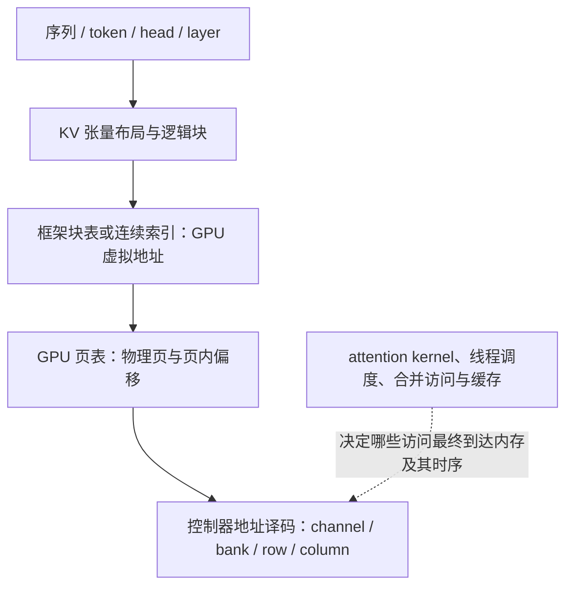

# 研究笔记：问题、证据与认识演进

更新日期：2026-10-08。本文持续保存最初研究问题、开发实验中的疑惑，以及文献带来的新证据与修正。论文入口见[文献阅读指南](LITERATURE_GUIDE.md)，版本见[论文库](../paper/README.md)，阶段定位见[研究定位](RESEARCH_POSITIONING.md)。详细阅读证据只在本文维护，其他文档链接引用。

阅读导航：[当前判断与落地位置](#current-synthesis) · [第一轮：直接相关工作](#close-reading-1) · [第二轮：强基线与 KV 分层](#round-2) · [第三轮：Agent 证据与动态迁移](#round-3) · [第四轮：NPU/PIM 与 KV 生命周期](#round-4) · [第五轮：谁在搜索与成本归因](#round-5) · [第六轮：仿真契约与验证边界](#round-6) · [第七轮：有效空间与反馈贡献](#round-7) · [第七轮形成的下一步](#reading-next)。

<a id="current-synthesis"></a>
## 当前判断与文档中的落地位置

七轮有范围精读后的判断是：保留 Agent 主导探索的主线，将纯地址位搜索放回基础对照的位置，优先从 KV 生命周期中选择一个真实、可验证的系统取舍。复杂度、NP-hard 或巨大空间本身都不是 Agent 优势的证据。新方向必须同时回答“强机制之外有无余量”和“Agent 是否更有效地利用余量”。

| 已吸收的认识 | 正式维护位置 |
| --- | --- |
| 20 篇文献分别支持什么、限制什么，怎样约束开发 | [研究定位：证据到原则](RESEARCH_POSITIONING.md#literature-to-principles) |
| 平台权限、读写/容量/生命周期取舍、最小任务选择 | [研究定位：系统问题](RESEARCH_POSITIONING.md#minimal-system-task) |
| DSL 分层、表达能力与有效空间、状态正确性及完整成本 | [研究定位：DSL 原则](RESEARCH_POSITIONING.md#dsl-design-principles)；[开发说明](TOY_GUIDE.md#future-model-contract) |
| Agent 实际决策权、反馈归因、共享工具、冷启动和总成本 | [研究定位：主线](RESEARCH_POSITIONING.md#agent-mainline)与[下一轮协议建议](RESEARCH_POSITIONING.md#next-agent-study) |
| 按研究证据推进，条件式 RTL 与后端校准 | [研究路线](RESEARCH_POSITIONING.md#roadmap) |

本笔记继续保留各轮当时的判断、下一步和阅读缺口，它们不是今天同时待办的任务清单。后续轮次已完成的阅读不回写成早期已知事实；详细证据在本文维护，当前定位与计划以上表为准。第七轮协议仍是未冻结的建议，不是已执行实验。

## 记录约定

- 区分**论文报告、本项目实测、我们的推论、待验证假设**；推论不能写成论文已证明的事实。
- 以本地 PDF 文件页码（从 1 开始）定位，同时记录章节、图表或算法编号。
- 新证据改变旧判断时，记录“原先理解 → 新证据 → 修正”，保留失败与不确定性。
- 抽取文本不等于精读，读懂不等于复现，功能验证不等于性能/面积验证。逐轮说明实际阅读范围。
- **Agent 自主探索是主线，发现可固化启发式是支线。** 当前暂停 Ramulator 实际运行与环境安装。

## 问题台账

| 编号 | 过去提出的问题与实验疑惑 | 当前认识 | 下一项需要的证据 |
| --- | --- | --- | --- |
| Q01 | 不同负载映射寻优是否是真问题？默认之上有多少余量？ | PFM 展示双访问者冲突，PATTON 展示 KV 读/写/容量冲突；两者已有专门解决方案 | 在同硬件与控制权限下，相对强方案还有多少余量 |
| Q02 | DSL 限制什么？固定语法是否限制 Agent 创意？ | 表达式、映射函数、性能等价类与同分候选不同；现有 masks 只消除相同函数的重复 | 限定操作数会改变可达集合；新原语需增加有效自由度，见[第七轮](#round-7) |
| Q03 | 无优势是否因为空间太小、HBM 太简单？是否凸优化？ | 720 个排列按当前模型的字段重编号对称性可分成 180 组；近优策略密度随任务显著不同；仍非凸优化证明 | 比较有效空间、近优密度、局部障碍与强搜索器，而不是只增加位数 |
| Q04 | 为什么单个位统计和 column 启发式能追平 Agent？遗漏了什么？ | DReAM/PAE 已有统计方法；DRAMSys4 展示平均带宽掩盖突发和时序瓶颈 | 检测联合关系、时间聚集、队列与依赖上的失效；诊断工具对各方法同等开放 |
| Q05 | 为何阶段切换失败，更多反馈有时更差？ | 既有实验是多阶段负载上的静态映射搜索；搜索反馈与运行时切换是两种适应 | 保存反馈前预测，区分诊断错误、局部陷阱和实际迁移成本 |
| Q06 | 怎么证明 Agent 是主力，而非工具包装或初始候选提供者？ | LLAMBO 分解先验、采样与预测，但其无上下文消融仍保留反馈；合法且多样的候选也能带来收益 | 增加匹配模型调用的无新反馈对照，分开测候选与选择质量，见[协议草案](#feedback-protocol-draft) |
| Q07 | 节省仿真次数能否抵消模型成本？20 次预算合理吗？ | 批轮数、候选查询、新仿真和墙钟时间不同；数据库构建、迁移校准也有成本 | 统一计量初始化/诊断/恢复评价；分别报告冷启动与历史复用 |
| Q08 | KV 布局、页分配和 HBM 位映射如何关联？ | Ramulator 接收的是下层请求；现有桥接有队列反压，但没有计算/访存依赖或 KV 生命周期反馈 | 固定流量用请求轨迹；分配/重计算任务固定上层事件并生成下层请求 |
| Q09 | 多对象、多介质、阶段切换策略是否合法？ | PFM 避免反复整张量重排；PATTON 在块填满时搬移一次，先完成再发布新位置 | 共用数据一致性、临时双份空间、共享/回收和搬移净收益 |
| Q10 | RTL 要证明什么？为什么需要分析 Agent？ | Ramulator 命令轨迹对 DDR4 器件模型检查，与 DRAMSys4 嵌入控制器 RTL 是不同验证路径；均不自动证明 KV 内容正确 | 分开检查映射/数据语义、协议时序、控制器实现和综合代价，见[第六轮](#round-6) |

## 开发实验留下的事实

以下是本项目结果，不是文献结论。已看过的任务仅用作开发和诊断数据，不能再次冒充未见测试。

- 初版合成 KV：identity 为 18424 玩具周期，Agent 和事后补充启发式均达 796；流程跑通不等于证明比较优势。[首轮解读](INITIAL_RESULTS.md)
- 规则发现：两个诊断任务达到排列空间最优，冻结后仍有退化，必须保存适用条件与反例。[报告](../results/rule_study_v1/report.md)
- V2：5 个任务中 4 个达到 720 排列最优；阶段切换 Agent 为 574，无反馈 550，局部搜索最好 540。[报告](../results/agent_v2_pilot/report.md)
- 失败复盘：574 的单交换邻域无改善，但存在 574 → 618 → 540 的路径；阶段重叠时前批积压影响解释。[复盘](../results/agent_v2_diagnosis/report.md)
- V3：密集任务分批组 466、汇总组及局部搜索 471；其他任务不稳定改善。每条件每任务仅一次模型运行，普通基线没有专门消费分批反馈，三任务也不是仅改变注入速率的配对。[报告](../results/agent_v3_pilot/report.md)

## 认识修订记录

| 轮次 | 原先容易产生的理解 | 新证据后的修正 |
| --- | --- | --- |
| 第一轮 | 映射敏感就代表寻优余量很大 | 相对坏映射的差距，不代表默认方案之上的余量 |
| 第一轮 | 可逆矩阵表示意味着完整 XOR 搜索 | Flatfish 主体交换位、另有 XOR 扩展；表示与动作分开 |
| 第一轮 | NP-hard 或大空间说明 Agent 应该更好 | 最坏情况困难性不代表具体任务难，也不排除强贪心 |
| 第一轮 | 自主反馈循环、诊断就构成创新 | AgentDSE 已有先例，需具体任务或机制的新证据 |
| 第一轮 | UMDAM 的加速证明 KV 映射已解决 | 它主要处理权重共享和重排，KV 生命周期仍待核查 |
| 第二轮 | 矩阵多，所以一定需要复杂搜索 | PAE 的少量随机合法矩阵已有相近表现；先查策略族和有效难度 |
| 第二轮 | 换上准确 DRAM 仿真器即可复现映射论文 | PAE 同时影响缓存与片上网络；固定 DRAM 轨迹缺少这些反馈 |
| 第二轮 | KV 的物理块就是可控的 HBM 物理地址 | R13 Fig. 2 明确分为框架块表与 GPU 页表两层转换 |
| 第二轮 | kernel 更快、内存请求更快就等于服务更快 | R12 kernel 有额外开销，但减少容量浪费能增加 batch 并提高服务吞吐 |
| 第二轮 | 同为 20 次评价就足以说明公平 | 基线调参、提示开发、离线成本、工具信息和模型重复也影响比较 |
| 第三轮 | 分析写得详细、反馈后分数变好就证明推理有效 | ArchEval 支持记录预测与实际产物；是否因反馈获益仍需同预算对照 |
| 第三轮 | Agent 主导就必须自行搭建后端或发明新机制 | 可以先研究固定契约内的自主决策；流程工程、搜索质量、机制新颖性分开测 |
| 第三轮 | 阶段任务已验证动态映射 | V2/V3 搜索一套静态映射；DReAM 的运行时切换另需迁移和回滚 |
| 第三轮 | 换映射只改译码函数，查表开销很小 | 还要维护数据位置与一致性；DReAM 的迁移假设不可直接套用 HBM |
| 第三轮 | 全局启发式表现弱，说明传统方法不行 | SDAM 的收益还来自对象粒度与分配权限；双方必须获得相同控制范围 |
| 第四轮 | 多种 KV 只是不同访问步长 | Key/Value 归约维度、partial/full 状态、共享和容量压力带来不同约束 |
| 第四轮 | 动态适应必然频繁搬移大张量 | PFM 预选共享布局再调度访问；PATTON 对可摊销的填满块做局部转换 |
| 第四轮 | 二进制矩阵就是 XOR，MILP 意味着简单凸优化 | PFM 矩阵分配地址位到字段，包含整数约束；实际线性化需源码核查 |
| 第四轮 | PATTON 的平均 1.95× 就是完整推理收益 | 其指标只覆盖 attention 与额外 prefill 重计算；主机其他执行被排除 |
| 第四轮 | 小块总能提高整体效率 | PATTON 在容量利用与连续归约间折中；临时区与保留目标也占容量 |
| 第五轮 | 论文名有 Agent，优化收益就来自模型自主搜索 | ChatNeuroSim 的模型主要组织流程，SA/GA/TPE 与人工设计的迁移裁剪执行搜索 |
| 第五轮 | 去掉回顾提示就是没有反馈；最好一次结果代表稳定能力 | gem5 Co-Pilot 的 RR 是提示策略，历史消息仍是框架输入；三次取最佳不等于期望收益 |
| 第五轮 | 20 轮优化、20 次仿真与 20 次数据库查询可以直接比较 | 批大小、去重缓存、初始化校准和离线数据库成本必须分别记录 |
| 第五轮 | 发现暂时变差的候选应直接排除，恢复几个参数就能避免陷阱 | ChatNeuroSim 另设完整空间恢复；单参数验证仍可能遗漏组合关系，恢复空间也不保证有限预算内找到最优 |
| 第六轮 | cycle-accurate 意味着目标 GPU 的内存性能已经准确 | JEDEC 命令合法与目标控制器行为一致是不同要求；队列、时钟比、刷新和仲裁仍需对齐 |
| 第六轮 | 队列满会重试，就已经是完整的闭环负载 | 反压只改变入队；计算/访存依赖、批处理及 KV 分配还会改变后续请求的生成 |
| 第六轮 | 用 Verilog 验过命令，就等于验证了生成的 RTL 和数据正确性 | 器件模型检查命令、控制器 RTL 检查实现、逻辑参考模型检查数据，三者覆盖不同 |
| 第六轮 | 逐周期评价必然很慢，事件驱动必然是近似模型 | DRAMSys4 跳过无状态变化的周期仍保持命令时序；速度收益依赖流量密度与配置 |
| 第七轮 | 720 个排列就是 720 种不同的性能行为 | 当前模型至少有四倍字段重编号冗余；八个已有任务的归档 oracle 均验证组内同分 |
| 第七轮 | 同一个 bank+row 联合 kernel 可以直接合并所有映射 | bank 分流决定前驱；交换 bank/row 可保持联合 kernel 却改变命中，必须保留 bank 划分 |
| 第七轮 | 加 XOR 后所有可逆矩阵都自动成为合法候选 | 无长度限制的生成能力与 max_operations 下的可达集合不同；原 720 排列最优不再是新空间最优 |
| 第七轮 | LLAMBO 无上下文实验已经隔离反馈价值 | 它主要移除元信息或语义名称，仍读取历史；还需同调用预算的真正无新反馈对照 |


<a id="close-reading-1"></a>
## 第一轮：直接相关工作与方法边界

阅读日期：2026-10-08。以下页码均为 **paper/ 本地 PDF 从 1 开始的文件页码**，避免混用出版页码；版本见论文库。主要依据本地正文、算法与图表，另核对了 AgentDSE 的 arXiv 版本/Workshop 状态。未运行论文代码，数学证明未做独立形式化验证。PDF 原件未修改，正文提取和页面图像仅为忽略目录中的本地阅读缓存。

| 阅读范围 | 本轮实际覆盖 | 尚未完成 |
| --- | --- | --- |
| R03 Flatfish | 重点 §III–VI，PDF 5–11 页；核对 Algorithm 1/2、Fig. 10–13 和在线/离线区别 | 原作者代码、完整训练调用成本、独立复现 |
| R04 XOR 数学模型 | §4–8、结论及附录证明文本；重点 PDF 5–15 页，核对 Table 1 | 证明独立复核、求解器及贪心实现复现 |
| R05 AgentDSE | 方法、实验、消融、过程案例与局限，PDF 1–7 页 | 原始搜索日志、基线配置与成本审计 |
| R20 UMDAM | 正式版方法和评价，PDF 1–4 页；核对 Fig. 2、Algorithm 1、Table I | 仿真源码、控制器实际配置接口及完整硬件复现 |
| R01 / R02 | Shuhai §V.C；SDAM §3–7.2，重点 PDF 4–9 页的分配/映射/选择方法 | SDAM 后续性能图表逐项复核 |
| R16 / R17 | AlphaEvolve §2，PDF 3–8 页；LLAMBO 方法与主文评价，重点 PDF 3–9 页 | AlphaEvolve 各应用实验、LLAMBO 完整附录与代码 |
| 其余 12 篇 | 本轮确认本地文件可解析，沿用前面的阅读入口 | 本轮没有完成正文精读；抽取文本不计为已读 |

<a id="close-reading-flatfish"></a>
### 1. Flatfish：与当前问题最直接的学习方法对照

**原文证据。** §III-A（PDF 5 页）中，策略网络输入是展平的当前 BIM 矩阵，输出动作概率；访问轨迹通过评价器产生奖励，并不是把原始长轨迹直接输入这个网络。离线使用 DRAMsim3，优化请求平均响应时间。Algorithm 1/2（PDF 6 页）先连续做 N 次矩阵变换，再评价候选，以负响应时间训练策略/价值网络，保留比当前最好方案更好的结果。

**表示能力与实际搜索范围必须分开。** 主体从单位矩阵开始，采用交换行/列的动作，再缩减为与首行交换及 NOP；由这些动作得到的是位排列。§VI-B6（PDF 11 页、Fig. 13）另做加入行/列 XOR 的扩展，报告性能进一步改善、但动作空间增加且收敛变慢。在线版还有固定列位及固定 XOR 的处理（PDF 7 页）。所以既不能说“Flatfish 已完整搜索所有可逆 XOR 矩阵”，也不能说“它完全没有研究 XOR”。原文把某些 XOR 操作称为 permutation，阅读时应以操作定义为准，避免与纯位排列混淆。

**评价和训练成本。** §III-B 设置 batch size 为 64，并先在 256K 请求子集上测试，有改善才测试全部轨迹。在线版使用硬件中的简化事件估计器，另有按位翻转率的 Quick Learning 提供较好起点；它不是每次都跑完整时钟级仿真。论文没有提供可直接套用到本项目“每任务 20 次调用”的统一总成本，不能将一步 RL 动作、一轮训练和一次完整仿真视为同一个单位。

**实验边界和一处需要谨慎引用的数字。** §VI 使用 DDR4/GDDR5，在线硬件实现为 Zynq-7000 / DDR3，并非当前 HBM/KV 场景。GPU 离线吞吐相对 Hynix 基线平均 1.91×，同一段给出 FAE 为 1.76×（PDF 9 页），因此 1.91× 不是相对最强相关方法的收益。摘要把在线 1.63× 写在 CPU 上，但 §VI-B3（PDF 10 页）写 CPU 平均吞吐提高 6.4%，并把 1.63× 放在类似的 GPU 实验中；Fig. 10（PDF 11 页）也与 CPU 小幅收益一致。本指南保留这处原文不一致，后续引用应指明正文场景，不直接转述摘要数字。

**对项目的推论。** “学习方法 + 可逆矩阵 + 仿真反馈”已有非常接近的先例；真正需要比较的是新负载上的评价效率、迁移能力、搜索质量与总成本。我们的 DSL 已有 swap/XOR，但 V2/V3 实际只搜索 720 个排列；必须把 DSL 能表达的范围、操作长度上限和每轮允许的空间分别写清楚。增加 XOR 有文献依据，同时必须让所有基线获得相同空间。

<a id="close-reading-xor"></a>
### 2. XOR 数学模型：不是简单凸优化，也不是毫无结构的黑盒

**原文模型。** §4（PDF 5–7 页）以 GF(2) 上满秩矩阵 A 映射地址，拆为 bank、row、column 子矩阵。先按 bank 映射分出各 bank 的请求子序列，再比较每个子序列中的相邻地址。固定 bank 映射后，设相邻地址的 XOR 差向量为 d，则同一行的条件是 `A_row d = 0`；各差向量的出现次数可压缩成长轨迹的权重统计。这比只看每个位独立翻转率保留了更多相关信息。

**困难性与可利用结构同时存在。** §6 的 Problem 3 / Theorem 1（PDF 9 页、附录 A 在 15 页）将单 bank 的问题写为固定维数子空间选择，并给出 NP-hard 结论。它不是连续变量的普通凸优化；整数规划的目标形式简单也不代表可行集合是凸的。但这是论文所定义问题族的最坏情况结论，不能证明当前六位玩具很难，更不能证明 Agent 优于传统算法。§6.2 的贪心每次按新增子空间带来的总权重收益选择向量；§7 对多 bank 先固定 bank 映射，再求解对应子问题。

**最有启发的实验对照。** §8.1 / Table 1（PDF 12–13 页）在单 bank、24 位地址、12 row 位与 12 column 位、百万请求的合成交错流上，两个发起者时 Greedy 行命中率为 50%，最优位排列 ConGen2 为 1.562%，RBC 为 0.025%。这说明特定结构中“再努力搜索排列”也弥补不了表示能力限制。相反，§8.2 / Table 2（PDF 13、15 页）的旋转/CNN 规则轨迹中，ConGen2 已超过 90%，且高于该贪心结果。**一般 XOR 有时很有价值，有时排列已经很好；不能预设扩大空间一定有收益。**

**边界。** 上述百分数是行命中率，不是吞吐提升或 LLM 加速比。定义按给定访问顺序计行命中，没有覆盖我们最终关心的所有排队、调度、时序、读写切换因素；若后端会重排访问，需要重新核验代理指标与真实目标的关系。等价类约简也应先在单 bank 或固定 bank 条件下使用，不能只保留一个联合 kernel 就默认所有 bank 分配都等价。论文的矩阵稀疏度是实现复杂度代理，不等于已测量面积/功耗。

**对项目的推论。** 应将差向量统计、合法矩阵构造、等价候选去除和结构化贪心视为可借鉴工具或强对照。Agent 的潜在价值是判断这些结构假设何时适用、哪里失效，以及何时值得付出昂贵评价成本；这一价值还需要与使用相同工具的固定策略比较。

<a id="close-reading-agentdse"></a>
### 3. AgentDSE：我们的基本流程已有直接先例

**原文证据。** §II（PDF 2–3 页）明确使用任务说明、设计空间、候选文件、提交脚本、历史、笔记、最优记录和预算文件；Agent 自主提出假设、编辑候选、运行评价、读取反馈，继续搜索。§V（PDF 6 页）还展示了 Agent 主动移除预取器以归因收益的例子。因而“文件接口闭环”“保留探索理由”乃至“主动做诊断消融”本身，都不能直接作为我们的新贡献。[作者预印本及 Workshop 状态](https://arxiv.org/abs/2606.21836v1)。

**最值得借鉴的验证。** §IV-B / Table III（PDF 5 页）在 ResNet50 的一个层上隐藏参数语义，再与完整物理语义比较：匿名组与完整组得到接近的 EDP，报告调用数分别为 71 和 29。这个实验提出了适合我们的具体问题：Agent 的收益到底来自领域语义，还是一般的数值搜索能力？但作者在局限中承认只覆盖一个层，不能据此作普遍归因。

**成本数字应拆开读。** DOSA 对照的“约 37×”使用包含离线数据摊销的口径：72,701 次离线 Timeloop 样本按 65 种形状摊销，再加每层 7 次真实验证；DOSA 的代理模型推理不是一次真实 Timeloop 调用。网络级比较另有约 165× 的口径，不能与逐层数字混用。MAESTRO 则给 Agent 每形状 100 次、RS/GA 20,000 次、PPO 50,000 次。这些是作者在不同设置下的样本效率比较，不是都采用同预算，也不是同等倍数的墙钟加速。对我们最稳妥的做法，是同时报告同预算质量、达到同质量所需调用数、离线投入和模型成本。

**对项目的推论。** 单纯将已有 AgentDSE 工作区换接 HBM 后端，方法差异还不充分。可继续研究带对象/阶段信息的布局与映射联合决策、跨负载迁移、诊断选择或多级评价，但本轮阅读仅把它们识别为候选问题，尚未证明没有相关先例。

<a id="close-reading-umdam"></a>
### 4. UMDAM 与 SDAM：先选对控制层次，再扩大搜索空间

**UMDAM 原文。** §III（PDF 2–3 页）主要处理 NPU/PIM 共享的权重矩阵：tile 内按列组织，tile 高度与交织粒度相适配，再联合选择 DRAM 字段布局。映射为从高位到低位 `Row–Col_M–Bank–Rank–Channel–Col_L–Offset`。一个设计同时兼顾 NPU 外部交织和 PIM 本地读取，收益来源不只是一组 bank 位更好。

§IV（PDF 3–4 页）采用模拟的 Ascend 310B 风格 NPU 与 LPDDR5-PIM，模型为 OPT、FP16。基线需要重排权重，计入的重排成本只建模内存访问；TTFT 最高 3.0×、TTLT 最高 2.18× 属于这一特定系统与基线。Ascend 310B 上的实机部分验证了采用该布局的自定义 GEMM 算子，不等于完整 NPU-PIM 和 DRAM 映射都已在商业平台实机验证。正文同时谈到扩展控制器和无需硬件改动，其落地前提需结合实际控制器接口或源码再确认。

**SDAM 原文。** §3–6（PDF 4–8 页）展示混合访问中全局单映射的局限，并以数据对象/分配站点为线索，将相近模式的数据分配到采用同一映射的 chunk。其实现使用 2MB chunk，保持 chunk 高位不变，在内部做可逆 bit shuffle，通过 AMU/CMT、修改后的 glibc 分配器和 Linux 管理保持一致性。映射选择包含按位翻转率、K-Means，以及学习表示辅助的聚类；不是任意给每次请求附加不同映射。§7.1（PDF 9 页）给出真实 FPGA/HBM2 与 RISC-V/Linux 原型。

**对项目的推论。** 我们最初设想的“不同 KV 数据形式”更应明确成：数据对象、布局方式、访问算子、执行阶段分别是什么；然后判断一个静态全局映射是否足够。对象粒度映射需要合法分区和分配语义，阶段切换需要考虑已存数据的一致性及迁移成本。UMDAM 是权重共享研究，不能直接作为 KV cache 动态增长、分页、回收问题已解决的证据；SDAM 也不等于普通 GPU 已开放同样接口。

### 5. 三篇补充阅读给出的约束

**Shuhai §V.C（PDF 5 页，Fig. 6 在 6 页）：** 在所测 stride/burst 组合与映射选项中，默认 RGBCG 表现最好；某些点相对 BRC 接近 10×。它证明映射可能非常敏感，却不能证明默认之上还有同样大的余量。后续必须比较合理默认方案，不能只选坏映射当基线。

**AlphaEvolve §2（PDF 3–8 页）：** 它是围绕自动评价组织的程序演化，维护多个历史候选，采用受 MAP-Elites 与岛模型启发的候选库，并支持从便宜检查到昂贵测试的评价级联。搜索对象可以是具体构造，也可以是生成解的程序或搜索算法。可借鉴的是多样候选保留和分级评价；不能把它理解为模型一次推理就跳到好解，也不能由其成功推出“20 次评价足够”。本项目仍以 Agent 自主探索为主线，生成固定规则作为可选支线。

**LLAMBO §2、4–8（PDF 3–9 页）：** 分别测试初始化、代理模型和候选采样。主文端到端实验为 50 个 HPT 任务、每任务 5 次 seeded search；为公平比较，所有方法从相同的 5 个随机点开始，未启用模型 warmstart，再继续 25 次试验。论文报告更好的早期样本效率，同时指出候选多样性可能降低、LLM 不确定性校准不如 GP、推理成本更大，任务主要为较低维超参数优化。它提示我们单独测初始先验、反馈收益和语义贡献，不把这些作用合在一个“Agent 更强”数字中。

### 6. 回答当前项目的五个问题

| 我们的问题 | 本轮阅读支持的回答 | 尚不能下的结论 |
| --- | --- | --- |
| 不同负载是否需要不同映射？ | SDAM 有对象级混合访问的直接证据；Flatfish 在不同应用上选择映射 | 所有真实 KV 工作负载都能超过合理默认方案 |
| 当前只是简单凸优化吗？ | 自然问题是离散组合优化；R04 的特定一般问题有 NP-hard 结论 | 六位玩具必然难、NP-hard 就适合 Agent |
| 是空间太小才没有优势吗？ | 排列与 XOR 存在表达能力差异，但某些规则负载排列已经很好 | 单纯加位数、加原语必然带来 Agent 优势 |
| Agent 能贡献什么？ | 语义先验、候选构造、根据反馈修正、实验与预算选择都有可检验入口 | 基本闭环或主动诊断本身尚无先例 |
| RTL 应研究什么？ | 合法映射实现、位宽/分区边界和组合逻辑代价；部署方案需一致性支持 | 功能仿真通过就代表性能、面积和功耗都好 |

**当前较有依据的研究假设，而非已确认的创新点：** 在多对象、多阶段访问中，Agent 能否利用语义与测量反馈，识别简单映射规则的失效条件，并自主选择有效的候选和诊断，在计入全部评价与推理成本后优于强对照？要回答它，先从正文中提炼任务和基线，不能先构造只利于 Agent 的难例再宣称普遍优势。

**继续阅读的顺序。** 先围绕 R03 与 R04 做逐算法对照，把 RL/贪心的空间、目标和成本写成可复现规格；再精读 R08 PAE 与 R09 ArchGym 补强基线；并沿 R12/R13 与 R14/R15 两条路线核实 KV 软件管理、NPU/PIM 布局的实际可控范围。R06 ArchEval 用于补充 Agent 评价设计。本轮暂停 Ramulator 实际运行，没有新增搜索成绩，也不调整已冻结的 V2/V3 实验。

<a id="round-2"></a>
## 第二轮：强基线、评价边界与 KV 地址层次

阅读日期：2026-10-08。本轮沿 Q03/Q04/Q06/Q07/Q08/Q10 继续阅读，下面是对第一轮认识的补充。仍未运行论文代码或新实验。

| 论文与本地版本 | 本轮实际阅读范围 | 尚未完成 |
| --- | --- | --- |
| [R08 PAE](../paper/R08_PAE_ISCA2018.pdf) | PDF 4–12 页，§III–VII 的统计、映射、评价与相关工作；图像核对 Fig. 11–13、17–19 | 代码、随机矩阵分布、硬件实现复现 |
| [R09 ArchGym](../paper/R09_ArchGym_ISCA2023.pdf) | PDF 6–10 页，§5–7 的设置、算法对照和代理模型数据 | 超参数配置与完整实验日志审计 |
| [R12 PagedAttention](../paper/R12_PagedAttention_arXiv2309.06180v1.pdf) | PDF 3–8 页的背景、内存管理与调度；12 页 §7.1/7.2 消融 | 完整服务实验逐项复核、源码与新版本 |
| [R13 vAttention](../paper/R13_vAttention_arXiv2405.04437v1.pdf) | PDF 4–11 页，§3–7.2 的分层、API、优化及评价；图像核对 Fig. 2 | 后续消融、驱动源码、2025 正式版本差异 |

R12/R13 按本地 arXiv v1 阅读，版本入口已核对：[R12 v1](https://arxiv.org/abs/2309.06180v1)、[R13 v1](https://arxiv.org/abs/2405.04437v1)。以下软件版本、API 限制与性能数字均指论文当时的系统，不能当作当前版本的现状。

<a id="reading-pae"></a>
### 1. PAE：空间巨大，也可能存在一整类容易找到的好解

**对应 Q03/Q04：统计究竟统计什么？** §III（PDF 4–5 页）先对每个线程块（TB）的访问地址计算每个位为 1 的比例 BVR，再按 TB 编号排列，用滑动窗口近似同时执行的线程块。Eq. 2 对窗口内不同 BVR 值的出现概率求熵，随后平均各窗口；不同 kernel 再按请求数加权。因此，这既不是把全轨迹所有地址混在一起计算单个位的 0/1 熵，也不是简单的位翻转率。论文根据 GTO 调度器设窗口大小为 SM 数量，是有执行模型依据的启发式，不是通用常数。

Fig. 3（PDF 5 页）中同一组 TB，窗口从 2 改为 4，计算出的平均熵从 3/7 变为 1。**我们的推论：** 全局比例相同不保证并发窗口内的压力相同；V2/V3 的阶段积压值得继续分析，但不能直接把“第几个阶段”当成真实并发窗口。还要区分边缘分布与联合分布：例如两个 channel 位各自 0/1 均衡、却始终相等，就只使用 00 和 11 两个组合。这个反例是我们的数学说明，不是 PAE 已证明联合统计足以预测性能。

**映射族比论文简称更重要。** §IV-B（PDF 7–8 页、Fig. 9）明确区分：

| 策略 | 输入与改变范围 | 对我们意味着什么 |
| --- | --- | --- |
| RMP | 将跨 benchmark 平均熵最高的位用作 bank/channel，纯位重排 | 接近统计驱动的排列基线，但存在跨任务先验 |
| PM | 将低 row 位 XOR 到 bank/channel | 原文称 permutation-based，实际包含 XOR |
| PAE | 随机选择 page 地址中的 row/bank/channel 位，生成新的 bank/channel 位 | 保留 column 与块内 offset，限制对行局部性的破坏 |
| FAE | 进一步允许 column 位参与 XOR，仍只改变 bank/channel | 更强分散能力可能牺牲行局部性 |
| ALL | 进一步改变 row/column/bank/channel；块内 offset 保持不变 | 自由度更多不等于收益与功耗都更优 |

这些都要满足合法 BIM 约束；不能将“随机位 XOR”理解为允许任意有冲突的矩阵。论文主评估每族随机生成三个合法 BIM，除特别说明外报告其中最好者（PDF 8 页）。Fig. 19（PDF 11 页）显示 FAE/ALL 的三个矩阵平均性能相近，PAE 稍敏感，但最差者仍有收益。

**对“是不是空间不够大”的修正。** 这支持一个待验证解释：部分任务的关键可能是选对约束和策略族，族内许多具体矩阵都不错；总候选数量巨大不代表搜索有效难度很高。但只有三个样本，不能推出所有矩阵都等价、没有局部陷阱或不需要寻优。下一步应比较“固定族内随机采样”“预设族选择流程”和“Agent 自主判断族与修改约束”，而不只增加地址位数。

**对应 Q08/Q10：收益与实现在哪一层？** PAE 在 memory coalescer 之后应用地址变换，改变的不仅是最终 DRAM 坐标，还包括后续 LLC 和片上网络行为；§VI-B 的 Fig. 13（PDF 9–10 页）分析了 LLC miss rate 与 NoC latency 的改善。其后端为 GPGPU-sim 3.2.2，主配置是 GDDR5、FR-FCFS/open-page，并非我们的 HBM 玩具模型。

在主要十个 entropy-valley benchmark 上，Fig. 11/12（PDF 9 页）报告 PAE 相对 BASE 平均加速 1.52×、DRAM 功耗增加 3%；FAE 为 1.56×、功耗增加 35%，ALL 为 1.54×、功耗增加 45%。这组平均不能写成全部 16 个 workload 的结果；另六个非 valley workload 影响较小（PDF 11–12 页）。DRAM 功耗也不能与 GPU+DRAM 总功耗混写。

**我们的推论：** 仅优化完成时间可能选出代价很高的矩阵；将来应把行命中、并行度、能耗和实现代价分开观察。论文 §IV 给出 XOR 树实现思路，但 §V 对非 BASE 变换统一假设单周期延迟；这不是本项目 RTL 已经能达到目标频率的证据。固定映射的组合逻辑和可运行时重配置的映射单元也不是同一实现问题。

<a id="reading-archgym"></a>
### 2. ArchGym：预算一致只是公平比较的一部分

**对应 Q06/Q07：为什么传统方法可能追平？** §5–6（PDF 6–9 页）统一封装 DRAMSys、Timeloop、FARSI、MAESTRO 等环境，比较 ACO、BO、GA、随机搜索与 RL。这里的 agent 泛指搜索算法，不专指今天的 LLM Agent。作者发现超参数选择显著影响排名：经过大量调参，不同方法可以达到接近的目标；普通 GA 也可能超过带领域操作的版本。这是所测任务与配置的实验观察，不能升级成“所有搜索算法本质一样”的定理。

§6.2 / Fig. 7 分样本预算比较，并指出昂贵仿真器限制可收集的样本。其所谓低样本区间包含最多 10,000 次，不能直接外推到我们的 20 次。Fig. 8 的墙钟比较还受实现、并行度、GPU 加速影响，作者明确讨论了这种不公平。因此本项目既应报告性能评价次数，也应单独报告总耗时与资源条件；不能以样本数替代端到端加速。

**我们据此修订评价约定，尚未重新实验：**

1. 把提示修改和传统基线调参都放在开发集；冻结后才进入新任务。不能只反复改 Agent 提示，而让对照始终使用随意选的默认参数。
2. 分开记录离线训练/知识准备、开发调参、在线性能评价、便宜诊断、模型推理和总时间。缓存命中、非法候选、失败评价保留记录，按预先声明的预算规则处理。
3. 在多个预算点与独立模型运行上报告结果分布。V3 每条件每任务一次模型运行，不能把一个差值解释成稳定因果效果。
4. 同工具固定流程也应能读取同样的分批信息。若只有 Agent 得到额外诊断，很难区分工具增益与自主判断增益。

§7（PDF 9–10 页）还提出保存各种算法产生的数据，用多来源样本训练代理模型，并提醒分布外误差。**对项目的推论：** 失败候选也值得保留；若引入便宜预测器，可让 Agent 自主决定什么时候调用昂贵验证，但最终成绩须由冻结的高保真评价器确认，不能只优化一个可被利用的预测分数。

<a id="reading-kv"></a>
### 3. PagedAttention 与 vAttention：KV 的“地址映射”包含多层含义

**对应 Q08/Q09：先统一术语。** R12 §4（PDF 5–8 页）用块表将序列的逻辑 KV 块关联到 GPU 中实际分配的 KV 块，按需增长，结合引用计数与写时复制支持共享。R13 Fig. 2 / §3.2（PDF 4 页）进一步澄清：这些块在 GPU 虚拟地址空间中定位，后面还有 GPU 页表进行虚拟到物理地址的转换。不能因为框架称其为 physical block，就认为框架已经能指定 DRAM bank/row。

下图是我们的概念分层，不表示所有 GPU 都有同一条硬件流水线；缓存、合并访问与转换的位置需按具体架构确认。



**R12 的收益不等于每次访存更快。** 动态分块减少预留和碎片浪费，使更多请求能够同时参与 batch；共享与写时复制减少重复存储/复制。§7.1（PDF 12 页）同时报告，相对 FasterTransformer，所测 attention kernel 有 20–26% 延迟开销，但服务整体仍可获益。这是“局部指标与系统指标可能方向相反”的直接例子。

§7.2 / Fig. 18b（同页）显示 block size 权衡并行效率、碎片和共享机会；ShareGPT 与短序列更多的 Alpaca 对大 block 的敏感性不同。论文当时默认 16 tokens，不能视为所有后续 kernel 的固定最佳值。§4.5（PDF 8 页）还将 CPU 换出与重计算作为恢复被抢占 KV 的两条路径，取舍依赖链路带宽与计算能力。多介质方案不能只计算介质读写本身。

**R13 提供了另一种分层方法。** §5（PDF 6–8 页）预留连续虚拟地址，按需映射物理内存，使 attention kernel 保持连续索引。实现还预先建立物理页池，运行时再映射，并非每次需求到来才从系统重新创建物理页。§6（PDF 8–9 页）通过后台提前映射、延迟回收和复用来隐藏开销。

**这里的系统支持不能省略。** R13 v1 中原 CUDA API 的分配粒度限制促使作者扩展 NVIDIA 开源驱动部分，支持 64/128/256KB 粒度，另修改 PyTorch allocator。不能把其全部功能描述成不改运行时、仅换配置即可获得；这些历史限制也不代表今天 CUDA 的规格。GPU 物理内存 handle 的分配与映射能力，仍不等于能选任意 HBM bank 位。

**强基线会改变对收益的理解。** R13 §7.2 / Fig. 9（PDF 10–11 页）用 vLLM v0.2.7，并比较 FlashAttention 的 paged/vanilla kernel 与不同 block size。vAttention 相对旧 vLLM 有明显提升，但 decode 吞吐与调好 block size 的 FA_Paged 大致相当；论文的重要价值还包括复用未修改 kernel 和降低软件管理负担。因此不能用“最高 1.97×”概括它超过所有分页实现，也不能据此断言收益来自 HBM bank 分布改善。

**对最初 KV 设想的修正。** “多种 KV”应写成可观测差异：增长速度、序列长度分布、共享关系、对象生命周期、kernel 访问布局、批处理和抢占策略。随后明确 Agent 能改的是布局、分配、页映射还是控制器译码，以及改变后需要重新生成哪些请求。到达 DRAM 的固定轨迹只能评价其中一部分，不能直接回答整个服务系统的问题。

<a id="evaluation-boundaries"></a>
### 4. 对照表：文献到底改变什么、测量什么？

| 工作 | 干预层与评价对象 | 主要指标/收益来源 | 不能直接据此声称 |
| --- | --- | --- | --- |
| 本项目 V2/V3 | 固定到达轨迹、静态位排列、玩具 FCFS | 最终完成时间；排队、行状态和总线竞争 | 真实 LLM 服务加速、Agent 稳定优势 |
| R04 XOR 模型 | 给定顺序或固定 bank 子问题上的映射 | 行命中率；差向量结构 | 最低真实时延、最佳服务吞吐 |
| R03 Flatfish 离线 | 应用轨迹、映射与 DRAMsim3 | 平均请求响应时间 | 与我们完成时间指标可直接交换 |
| R08 PAE | GPU 合并访问之后的地址变换 | 执行时间、LLC/NoC、DRAM 行行为与功耗 | 固定 DRAM 轨迹后端可以复现全部收益 |
| R12 PagedAttention | KV 块管理、kernel、共享和服务调度 | 容量利用、批处理、服务延迟/吞吐 | 单次 DRAM 请求更快、HBM 位映射可控 |
| R13 vAttention | GPU 虚拟内存、allocator、driver 与 kernel 接入 | 分配/管理开销、kernel 复用、prefill/decode 吞吐 | 所有分页 kernel 都更慢、任意物理位置可控 |

**据此限定下一轮可证伪假设。** 保持 Agent 为主力，让它自主决定获取何种统计、尝试何种合法映射族、保留哪些候选以及如何使用剩余评价预算。对照应得到相同工具与候选空间。先问“这种自主选择是否优于预设流程”，再问收益是否迁移到真实负载；不能用流程跑通来回答后一个问题。

| 假设 | 可区分解释的对照 | 什么结果会削弱假设 |
| --- | --- | --- |
| H1：窗口/联合信息帮助 Agent 修正错误瓶颈判断 | 全局反馈、细粒度反馈、同信息的固定流程 | 增益完全来自新增工具，固定流程同样好 |
| H2：Agent 能在不同负载间选择适合的映射族 | 每族随机合法采样、预设族轮询、同工具 Agent | 预设族已足够，Agent 主要重复已有答案 |
| H3：Agent 能把昂贵评价花在更有价值的候选上 | 同预算质量与达到同质量的总成本，跨预算/重复 | 只少用仿真，模型与诊断成本使总成本更高 |
| H4：对象/阶段语义有独立作用 | 完整语义与匿名语义，保持数值信息及预算一致 | 匿名后表现相同，或变化无法跨重复稳定出现 |

这些是假设与实验规格草案，尚未实施，也尚未证明新颖。研究主线依然是 Agent 自主探索；强启发式用于界定已有能力，规则沉淀仍作为支线记录。

<a id="reading-queue"></a>
### 5. 当前阅读进度与下一批问题

截至本轮，20 篇中有 **12 篇完成了明确章节范围的正文阅读**，范围见两轮表格；其中多篇仍有未核查章节，不能称为 12 篇均已全文精读。R06/R07/R10/R11/R14/R15/R18/R19 尚未在本笔记中完成对应的正文精读记录。

下一批优先顺序：

1. **R06 ArchEval：** 检查任务隔离、工具条件、重复运行、成本与失败分类，回答 Q05/Q06/Q07。重点区分“会使用工具”和“反馈后决策真的更好”。
2. **R07 DReAM，结合 SDAM 剩余评价：** 检查运行时切换的触发、迁移和一致性成本，回答 Q05/Q09。当前静态候选与动态重映射不能混为一谈。
3. **R14 PFM、R15 PATTON：** 核查 NPU/PIM 的对象、布局与运行时控制边界，回答 Q01/Q08/Q09，区分权重与 KV、仿真与实机。
4. 再补 R10/R11 的 Agent 方法差异，以及 R18/R19 的后端评价语义；不启动 Ramulator 实际仿真。

每轮追加阅读范围和证据后，同时更新开头的问题台账与修订记录。若新证据推翻旧判断，保留原记录并标注修正，不覆盖失败历史；只有形成明确阶段决策时，才同步修改研究定位文档。

<a id="round-3"></a>
## 第三轮：如何验证 Agent 的判断，以及动态映射究竟多了什么

阅读日期：2026-10-08。继续回答 Q04–Q07、Q09/Q10，并补齐 SDAM 的主要评价。以下均依据本地版本，未运行原作者代码、未新增搜索实验，也未启动 Ramulator。

| 论文 | 本轮正文范围与核查 | 尚未完成 |
| --- | --- | --- |
| [R06 ArchEval v1](../paper/R06_ArchEval_arXiv2607.03601v1.pdf) | PDF 1–18 页的协议、方法、结果与局限；附录 20–22 页任务/预算条目、23–24 页成本与预测表；图像核对 Table 23–25 | 原始日志、评判器标签、各任务代码与统一总成本审计；附录轨迹未逐条读完 |
| [R07 DReAM v1](../paper/R07_DReAM_arXiv1509.03721v1.pdf) | PDF 1–11 页，重点 §3–5 的统计、触发、迁移、回滚与评价；图像核对 Fig. 17 | 迁移实现、并发正确性证明与源码复现 |
| [R02 SDAM](../paper/R02_SDAM_ASPLOS2022.pdf) | 补读 PDF 9–12 页 §7–9，复查 5 页分配语义；图像核对 Fig. 12–14 | 训练/测试配置复现，系统与加速器 RTL 审计 |

本轮可访问 [DReAM v1 的 arXiv 页面](https://arxiv.org/abs/1509.03721v1)。ArchEval 的 arXiv 页面本轮抓取失败，因此正文分析以已保存的 PDF 为依据，不把抓取失败解释成论文不存在，也不据此更新发表状态。

<a id="reading-archeval"></a>
### 1. ArchEval：把“能生成、会预测、能优化”拆开测

**它实际测什么？** §2–4（PDF 3–9 页）将预测、优化、生成视为不同能力，并设置三类实验支持。它们不是三个严格递增的难度等级，也不是分别只测一种能力：

| 条件 | 提供的支持 | 应如何解读 |
| --- | --- | --- |
| L1 | 现成接口、起始文件、可重复获得正式仿真反馈 | 在人定义的任务/契约内自主寻优；与我们的文件接口实验最接近 |
| L2 | 仿真器源码与构建环境，自建本地实验流程 | 正式评价首个有效结果即结束，但可先做本地实验；不能称为无反馈 |
| L3 | 静态负载证据、约束与产物接口，无可运行仿真器 | 先建模/判断，再做最终正式评价；不是完全没有工具或任务先验 |

**预算细节。** Appendix A（PDF 20–22 页）的 cap 是正式提交尝试上限，包含构建失败、约束拒绝和超时；L2/L3 首次有效正式结果即终止。DRAMSys 调参任务 cap 为 5/5/1，不能把中间的 5 解释成五次有效反馈，更不能忽略 L2 的本地仿真，把它当作只用一次评价。正文 Fig. 3 的示意图不能代替实际 cap。协议同时改变源码权限、流程支持和反馈，不能将 L1/L2/L3 差值全部归因于是否有反馈。

**可借鉴的成功证据。** §5.3 / Table 11（PDF 10–11 页）中，Agent 先尝试逻辑步骤较少的 halving-doubling，但在物理 ring 上测得明显退步；随后回到 direct AllReduce 并调整分块，最终从基线 15,775 降到 10,188 cycles。原文将调整与长距离通信代价联系起来。对我们有用的是“事前假设—测量反例—具体方案改变”的可追踪记录；这是案例证据，尚不能证明在同预算下比强搜索器好。

**最值得重视的失败证据。** §5.5 / Table 13、24（PDF 12、23 页）区分“产出可运行预测器”和“正确排列候选”：其中一个配置在 20 个任务中产出 18 个可执行模型，但只有 9 个任务具备至少三个有效候选供排名核查，最终 3/20 达到作者规定的完整建模通过标准。该标准包含可执行、对设计变化敏感、至少三个正式测量及 Kendall τ ≥ 0.6；15% 不是最终产物合法率，也不是模型预测精度。总体 80 个 L3 会话中，56 个最终产物合法可运行，其中 31 个低于基线（PDF 13–14 页）。因此 DSL 合法、RTL 功能通过、预测脚本能执行，都不能替代性能判断。

**这篇也有必须保留的局限。** §5.1、§8.3（PDF 9–10、18 页）明确为单次/单种子初步研究；比较的是完整 agent 配置，模型和运行框架同时不同。工作负载分析是否扎实、机制是否新颖等语义标签由模型评判，仍需校准。Table 23（PDF 23 页）某配置的分钟数仅计观察到的仿真时间，因为缺少 Agent 墙钟时间；不能拿它直接与其他行比较端到端效率。Fig. 6（PDF 12 页）只统计首次仿真已有效的固定会话集合，并画 best-so-far，曲线单调改善由定义保证。它展示测过更好的候选，**单凭曲线不能证明“理解反馈”带来了增益**。

**我们对“Agent 是主力”的进一步定义。** 先研究在冻结任务、工具和合法空间下，Agent 是否自主决定诊断、候选、分支与预算，并比同工具的固定流程更有效。工程团队提供可靠后端不削弱这一研究问题；让模型自行安装/编译仿真器则是另一种能力。机制发现也应单独评价：ArchEval 的新颖性标准和单次结果不等于学术新颖性的完整证明，组合已知工具仍可能有价值。当前固定 DSL 中生成更好的表达，不能自动称为发明了新的硬件机制。

<a id="reading-dream"></a>
### 2. DReAM：统计启发式已有先例，动态适应还要偿还迁移成本

**对应 Q04：我们的简单规则并非没有前例。** §3.1（PDF 3、5 页）按窗口统计相邻物理地址每个位的变化次数，倾向将低变化位用于 row、中等用于 bank、高变化用于 column；但本文实际约束不重排 column，以避免 cache-line 粒度迁移。新方案需在连续窗口中超过可编程的改善阈值才启用。其“entropy”主要是位变化率代理，与 PAE 的 TB/BVR 窗口熵不是同一统计量。

§3.1.2 报告位变化改善与性能改善之间的相关系数 0.89。这是所测数据上的相关性，标题中的 Mathematical Insight 不能解读成对所有访问模式的最优性证明。我们的联合相关位、顺序重排、队列积压仍可用于检查其假设边界；比较时应给双方相同 column 限制与合法空间，不能把扩大权限的收益记成 Agent 推理收益。

**对应 Q05/Q09：DReAM 实际包含两个部署场景。** §3.3（PDF 6 页）的 offline 路线先长期监测，再在重启时启用新映射；评价忽略重启成本，前提是长时间/重复运行能够摊销。online 路线则在程序继续运行时按需迁移，并同时保留旧映射 PAMS 与新映射 EAMS：

- 未迁移行先按旧位置服务，再迁往新位置；目标位置已有数据时交换，避免立即触发长串搬移。
- 每行维护 migration/swap 状态；已迁移行按新映射访问，被交换行通过反向映射追踪当前位置。
- 持续监测；新映射失去优势时回滚。第三套映射要等前次回滚完成，不能任意叠加未完成的转换。

这些机制见 §3.3.2–3.4（PDF 6–8 页）。它还依赖 DRAM 内部整行复制、缓冲与子阵列相关硬件支持，不是通用 HBM 控制器中的一个免费配置开关。论文不执行其认为无益的 bank 内搬移；这套受限机制不能直接当成任意 XOR DSL 的通用动态重映射算法。

**成本模型及实验范围。** §3.4.3（PDF 8 页）以每器件 4 Kbit 行、内部 64-bit/cycle 通路估算：搬一次行需 64 memory cycles，交换需两次，最坏 128 memory cycles；CPU 时钟四倍时记作 512 CPU cycles，并采用迁移期间 CPU 停顿的保守估计。这是该结构下的成本假设，不是现代 HBM 的实测迁移延迟。

§4–5（PDF 8–11 页）使用修改后的 USIMM、4GB/单 channel/8 banks、FR-FCFS，覆盖 48 个应用与 20 组混合负载。offline 相对所比较三类静态映射中整体较好的基线，平均改善 5%、最高 28%；online 设置位变化改善超过 7% 的触发阈值，在满足条件的 12 个 workload 上平均改善 4.5%、最高 23%。这不是全部任务的在线平均，更不是对 HBM/KV 的测量。上述 7% 是代理统计阈值，不是预先保证的真实性能收益。

**回滚不是边角问题。** §5.2（PDF 11 页）中 ferret 与 libquantum 出现回滚，分别占其数据重定位的 10% 和 39%；这不是总执行时间占比。它说明“上一阶段测出好映射”不能保证在后续阶段摊回代价，检测迟滞、阶段长度与回滚都应纳入目标。

**一处原文数值待核对。** §5.3 写迁移状态存储开销为 `3 × 10^-5 %`，但 Fig. 17 的 512GB 对应约 16MB。按 Table 1 的 4GB、8×65,536 行与每行两位计算，比例约为 `3.05 × 10^-5`，即 `0.00305%`；与文字百分数相差约百倍。这里记录为可能的百分号/单位问题，不能照抄极小百分数，也不据此推翻论文其余结果。完整实现还需单独审计控制逻辑与访存代价。

**对当前实验最重要的澄清。** V2/V3 的“阶段切换”是请求模式随时间改变，但每个候选在一次运行中使用同一套映射；Agent 在评价之间修改候选，是离线搜索过程的适应。DReAM 则改变一次实际执行中的数据位置。它们是两类问题，不能用目前 574 → 618 → 540 的搜索路径来证明动态迁移策略。

<a id="reading-sdam-evaluation"></a>
### 3. 补读 SDAM：对象粒度的权限和搜索算法要分别比较

**实验如何分层。** §7.3–7.4（PDF 10–12 页）依次比较默认全局映射、全局 bit-shuffle、全局 hashing、每应用映射、按对象聚类后选择映射，以及深度表示辅助聚类。全局 hashing 是重要强对照，不应只比较默认方案。单 stride 时 bit-shuffle 可达到很好的结果；多个模式并发时，全局一套映射受限，而按对象配置的方案能分别安排。

CPU 标准 benchmark 中，全局 bit-shuffle 相对默认平均约 1.01×，hashing 约 1.14×；按对象、32 类的 DL 辅助方案约 1.43×（PDF 11 页）。这几项同时涉及**选择方法、对象信息和分配权限**，不能把全部差值都归功于学习模型。near-data accelerator 上报告的 2.58× 是相对未加入 SDAM 的 accelerator 基线（PDF 12 页），也不是 Agent 搜索加速。

**迁移与泛化的边界。** §4（PDF 5 页）维护不同映射的内存池，在分配/回收等时机配置 chunk；§7（PDF 9–10 页）使用离线 profiling，并用不同输入做评价。结果支持其所测程序在对象/分配结构较稳定时复用 profiling，不意味着任意阶段变化都无需重新验证。它也不同于 DReAM 对存活数据执行整行迁移。论文没有在该原型上评价 DDR/HBM/NVM 混合介质（PDF 9 页），不能替代多介质策略证据。

**成本与实现证据。** Fig. 13（PDF 11 页）及 12 页文字表明简单 K-Means 与 DL 辅助方案的 profiling 成本差异明显；后者更好的运行时表现并非没有前期成本。12 页文字将两组方法都写作 ML，存在标签笔误，解释时应结合图例。硬件实现在 FPGA/HBM2 上测过，AMU/CMT 位于 LLC 与控制器之间；资源比例来自该 FPGA 系统，不是任意 ASIC 工艺下的面积/时序保证。

**我们的推论。** 若后续给 Agent 对象标签、分区映射或 allocator 控制，对照也必须具备这些能力。应拆成“同样全局权限”“同样对象权限”两组问题，才能分辨是 Agent 做了更好决策，还是仅比对照多了一种硬件/软件能力。

<a id="decision-evidence"></a>
### 4. 从 V2/V3 疑惑出发，下一轮应保留什么决策证据？

以下为研究规格草案，不改现有冻结协议或结果。对过去实验只能做事后诊断，不能补写成当时已提出的预测。

| 环节 | 应保存的可审计内容 | 用来排除的混淆 |
| --- | --- | --- |
| 评价前 | 候选 ID、父候选、可执行 DSL、简短可检验假设、预期改善/退化的指标 | 看过结果后再编解释；只写泛泛分析 |
| 评价后 | 实际指标、预测偏差、决定保留/放弃/继续测试的候选 | 有反馈但未使用；新方案与文字理由不一致 |
| 分支选择 | 被放弃候选与理由、剩余预算；是否允许跨越暂时退步 | 只保留当前最好候选造成 V2 式搜索路径丢失 |
| 因果对照 | 同工具固定流程、预先冻结的无反馈批次、语义消融、独立重复 | 把额外信息、更多调用、好起点或偶然性当作自主推理 |
| 评价有效性 | 非法、失败、超时、有效但退步分开；统一后端重评候选 | 只汇总成功提交而隐藏失败；把代理分数当真值 |
| 成本 | 正式评价、本地探测、缓存、模型、数据准备与总时间分列 | L2 式本地仿真漏计；样本节省冒充端到端加速 |

只需可检验的设计说明和操作记录，不要求暴露模型内部思维过程。排名预测可用成对准确率或适合含并列分数的相关指标；候选过少、分数全相同或没有可信区间时，应标为证据不足，不能借一个汇总数字制造确定性。

未来如果研究运行时切换，还要另立协议：固定起始数据与状态，在真实连续时间线上计算“保持旧策略”与“检测、迁移并运行新策略”的差值。概念上要求：

`剩余阶段内的收益 > 检测/切换/搬移/争用/必要回滚的额外成本`

这是我们的成本框架，不是可以把全部时间简单相加的定律；并行搬移与计算的重叠必须由执行模型处理。合法性也需超出矩阵满秩：搬移过程中每个逻辑数据仍可被正确定位、读写结果保持正确、旧策略在途请求不会写错位置。这样的功能性质才会给 RTL/系统验证增加新的具体任务。

<a id="reading-next-round3"></a>
### 5. 更新后的进度与下一步

目前 **14/20 篇有明确范围的正文阅读记录**，不等于 14 篇均完成全文与实现核验；SDAM 本轮补齐了主要实验分析。R10/R11/R14/R15/R18/R19 尚待对应精读，已读论文的源码、重复实验和部分附录也仍未完成。

当前研究判断：保留 **Agent 主导受约束探索**，优先证明它怎样利用反馈改善选择。自建实验流程、发明新机制和运行时自适应，是可分别扩展的能力，不能先捆绑为一个成功故事。位变化率启发式、全局 XOR/hash、对象级选择和迁移阈值都已有文献先例；提出新方法前要将其作为对照或工具核查。

接着读 **R14 PFM 与 R15 PATTON**：分别确认权重/KV 对象、NPU/PIM 的访问视图、可控布局/映射、数据一致性以及端到端收益的实际来源；然后用 R10/R11 补齐 Agent 方法对照。保持暂停 Ramulator 实际运行，详细证据仍追加到本文。

<a id="round-4"></a>
## 第四轮：双访问者与 KV 生命周期，把最初的问题具体化

阅读日期：2026-10-08。本轮聚焦 Q01/Q02/Q03/Q08/Q09/Q10，阅读两篇本地 v1 的主要正文、算法描述与评价。没有运行论文代码，也没有新增性能实验。

| 论文 | 实际阅读与图表核查 | 尚未完成 |
| --- | --- | --- |
| [R14 PFM](../paper/R14_PFM_arXiv2608.06989v1.pdf) | PDF 1–13 页，重点 §IV–VII 的优化、控制器、调度和评价；图像核对 Table I/III 与面积说明 | 求解器线性化、映射一致性实现、完整仿真/RTL 与配置复核 |
| [R15 PATTON](../paper/R15_PATTON_arXiv2609.11392v1.pdf) | PDF 1–12 页的动机、分层分配、Commit Zone、生命周期和评价；图像核对 Fig. 6–9 | 运行时代码、数值正确性、基线移植细节、主机运行时成本与完整服务测量 |

本轮已访问 [PFM v1](https://arxiv.org/abs/2608.06989v1) 和 [PATTON v1](https://arxiv.org/abs/2609.11392v1) 页面，题名、作者与版本相符。PFM 页面注明 MICRO 2026 接收；本地仍是 arXiv v1，不能将其页码视为正式会议版页码。以下性能与硬件描述均以这两个本地版本为准。

<a id="reading-pfm"></a>
### 1. PFM：预先安排一份共享布局，运行时选择访问和执行方式

**它确实涉及 KV，也涉及权重。** §IV-B、§V（PDF 6、9 页）将共享对象明确为 KV cache 与权重，包含 MoE 专家权重。动机是相同张量的访问者可能随 prefill/decode 或专家激活数量改变：NPU 需要跨 channel 的外部带宽，PIM 需要 bank 内操作数连续且多 bank 并行。这比“某种 stride 更适合某组 bank 位”多了计算组织和访问者约束。

**动态的是什么？** PFM 离线求一个联合布局，以 2MB superpage 管理映射描述；运行时通过 ARU 地址转换、FAS 命令调度、返回数据重组及 NPU/PIM 算子选择提供两种访问视图。其目的不是每次设备切换都重排整张量。§IV-A/C（PDF 5–9 页）提到的 relayout buffer 是访问数据流重组；不能与原有数据持久位置的整体迁移混淆。§V 的设备选择还使用 roofline 式预测器，比较计算、带宽与 PIM 启动开销，因此它是“布局 + 控制器 + 算子调度”的系统方案。

**二进制矩阵的含义需要特别区分。** §IV-B（PDF 6–8 页）中 `X[i,j]=1` 表示地址位 j 分配给存储层级 i，约束每位恰好归属一个字段、字段不超过可用位宽。它不是 R04 中一般 GF(2) 满秩 XOR 变换矩阵。其目标是 `NPU(f) + α·PIM(f)`：分别用解析式估计带宽利用和 bank 并行/访问效率，α 由算子特征 profiling 确定。

作者称其为 MILP，用 COIN-OR/PuLP 求解，报告可行空间约 `10^15`、每张量离线求解最长约 30 分钟（PDF 8 页）。这为强对照提供了直接线索：结构化模型与整数求解器已经能利用问题规律。MILP 含整数约束，不是普通连续凸优化；正文目标公式包含指数、比值和 max，完整线性化或离散化未在已读正文展开，不能仅凭公式就声称可复现其求解器或已获得真实时序目标的全局最优。也不能将“30 分钟求解”换算成等量真实仿真调用。

**可控范围与正确性。** §IV-C 需要修改内存控制器、加入 MDT/ARU/FAS，并在请求中传递 MapID/PIM 操作信息；不是给现有普通 GPU 分配器传几个参数就能获得。双视图必须对应同一份逻辑数据：不同访问者的索引、命令和返回顺序需要一致，不能把同一个地址任意套两套位映射就假定能读到同一元素。superpage 的 footprint、分配回收与不同 MapID 的空间复用也有约束（PDF 5–6 页）。这些边界应在复现代码中验证，不能由“每个局部映射单独可逆”代替。

**评价与收益来源。** §VII（PDF 10–13 页）使用 GPGPU-Sim 4.0 与扩展 Ramulator 2.0：前者模拟计算 kernel 并产生访存轨迹，后者评价地址映射、HBM-PIM 时序和控制器；端到端指标由各阶段/kernel 的模拟结果组合。作者与 A100 测量及已有模拟器做校验，不等于改装后的 A100+PFM 已实机部署。

大 batch 结果中，相对 NPU-only、PSM、PUM 的平均吞吐分别为 1.20×、1.06×、1.55×，相应最高为 1.95×、2.29×、2.32×（PDF 11 页）。因此摘要最高 2.32× 对应 PUM，不能写成平均或对所有强基线的提升。PSM/PUM 是作者按既有方案构造的内存管理基线；动机中的 FACIL/Oracle 配置另有定义。映射、FAS 和设备选择一起变化，这组结果不能独立归因于更好的地址位搜索。

**RTL 的实际作用更具体了。** §VII-E（PDF 13 页）报告 ARU/FAS 的 RTL、Design Compiler 与 7nm predictive kit 综合，面积 2.82 mm²；相对估计的 A100 活跃内存接口区域为 4.95%，相对整芯片为 0.34%。分母不同，不能只挑后者表示“几乎没有代价”。其实现包含 NPU/PIM 各 1MB 请求缓冲以及 64KB 重组缓冲。作者还把 RTL 地址处理延迟计入性能模型。这说明我们的硬件分支可以提供功能、实现代价和反馈延迟，而不是笼统地“生成 RTL 再验证”。预测工艺综合仍不等于流片后的面积/频率。

**复现前应核查的原文不一致。** Table I（PDF 11 页）列 `8 channels × 2 pseudo-channels × 2 ranks × 4 bank groups × 4 banks = 512 banks`，同时写每 bank 一个 PU、每 stack 1024 PU，数量未对齐；已核对页面图像，并非文本抽取错误。结论写最高 2.26×，摘要及主评价另报最高 2.32×。本笔记按明确基线的主评价口径记录，但不会据此替作者确定哪组配置或数字正确。复现前必须核查配置、命名及原始结果。

<a id="reading-patton"></a>
### 2. PATTON：Key/Value 的算术角色与块状态决定布局取舍

**真正的 KV 差异是什么？** §2–3（PDF 3–6 页）基于 AiM 的 bank 内 MAC：`QKᵀ` 沿固定 head dimension 归约，各 token 对应独立输出；`SV` 沿不断增长的 token 维度归约，各 head-dimension 元素对应独立输出。因此 Key 和 Value 的连续维度、并行维度和结果回收边界不同，不能只用一条“高活动位放哪里”的统一规则描述。

在说明用的 16-token block、128-dimensional head、BF16、每 channel 16 banks、2KB row、32B burst 下，一个 Key 向量为 256B，只占 bank row 的一部分；完整 Value 块适合沿行内 column 延伸 token 归约。但每次 decode 仅追加一个 token 时，该 Value 向量会分散到多个 row，出现多次低利用率激活。换成利于单 token 写入的布局，又可能打断后续 SV 的连续归约。整行预留则改善归约连续性、损失可用容量。这是具体计算与生命周期造成的冲突，不只是人为扩大搜索空间。

**层次化分配解决哪一部分？** §4.1–4.4（PDF 7–9 页）中 Order-0 表示一条 channel 上每个 bank 的一个 burst，Order-1 对应完整逻辑 KV block，Order-2 将多个 block 组合为分配单元。Key/Value 的 Order-1 形状不同；Order-2 在连续归约与不同请求共享 row 容量之间折中。`ChPerHead` 指每个 KV head 使用的 channel 数。文章采用每个 Order-2 含 16 个 Order-1，但这不是所有硬件/负载上的最优性证明。

**Commit Zone 并非免费改变布局。** 同一个正在填充的 Value 块同时占用暂存 CZ slot 和保留的最终 O1V 目标。追加 token 先写入 CZ；未填满时，SV 直接从 CZ 计算，只是归约效率不同。填满后才搬至最终布局，搬移完成后发布新位置并释放 CZ。请求提前结束则释放 CZ 和目标预留。共享/缓存的完整块保持物理绑定，引用计数为零不一定立即释放，真正 eviction 才解除绑定（§4.4/4.5，PDF 9 页）。

这解决了第三轮留下的一个问题：**在明确的生命周期节点，局部转换有机会摊销；不需要对所有存活数据频繁换全局映射。** 但要同时计入暂存容量、目标预留、未满块的读取成本和 commit 命令，不能只计算写入变快。Fig. 6 的 12.6× 是特定多请求示例的行激活减少，包含分组写入和 commit；它不是单请求固定常数，更不是整体吞吐倍率。

**commodity 不等于已经完成实机 PIM 服务部署。** §5（PDF 10 页）在同一 16GiB AiM/GDDR6 组织上，用 Ramulator2-based AiM 模拟器测命令周期与命令计数，PIM 能耗为模型估算；额外 prefill 重计算则在 A100 80GB PCIe 上测量。无需改 PIM PU，指使用既有 MAC/命令能力；仍需要运行时、物理地址生成和命令生成实现。该路径也不能直接套用到未开放 PIM 命令的普通 HBM GPU。

**1.95× 的准确范围。** §5.3 明确排除与 KV 管理无关的主机执行，只比较“PIM attention（含 K/V 写入、QKᵀ、SV）+ 运行时缓存失效导致的额外 prefill”。额外 prefill 用完整 prefill 与必需 prefill 两次测量之差计算，以处理非线性成本。它不是完整 token 延迟、完整服务吞吐或整系统总能耗。

基线也不是直接运行所有原作者的完整系统：作者在共同命令生成接口后重建 NeuPIMs、PIMphony、AttAcc、BlockPIM 的布局与调度；未明确的位置按其认为兼容的有利布局补齐，并保留各自的分配/共享语义。对照包含“有无 prefix caching”等机制差异，因此平均 1.95× 不能解释成纯布局或纯映射改进。针对这些基线的比较限制 context 为 2048 tokens，长上下文泛化仍需另测（PDF 10 页）。原文 Table 1 对其他论文的能力分类也需回到被引论文核查，不能直接当作我们已独立确认的文献结论。

**比总加速更有用的两项消融。** §5.4 / Fig. 8–9（PDF 11 页）：

- 在 Qwen1.5-7B 的 attention 消融中，加入 CZ 相对同最终布局但直接写入的版本，Value 写入加速 5×，整体 attention 延迟降低 13.0%。这较好地隔离了暂存/提交机制的作用，仍非全部模型通用常数。
- 移除 Order-2 的容量共享、给请求预留整个 Value Row Set，可得到更高的原始 GEMV 效率；但压力下 KV hit rate 从 PATTON 的 82.09% 降到 30.30%，GPU 参考为 87.86%。最快 GEMV 不等于最佳服务效果，PATTON 也未完全达到 GPU 参考的缓存命中率。

**对原始想法的支持与限制。** 这篇给出了 KV 场景中真实而具体的联合优化需求，支持我们继续研究布局、分配、映射与命令组织之间的关系。但它也已经提出了针对性方案；重述读写冲突或让 Agent 找到同样的 Commit Zone，不足以自动建立新颖性。Agent 的增量价值仍应体现在新条件下的探索质量、评价效率或约束处理。

<a id="kv-research-scope"></a>
### 3. 两篇放在一起后，研究空间如何更准确地描述？

| 维度 | PFM | PATTON | 对本项目的约束 |
| --- | --- | --- | --- |
| 主要对象 | KV、共享权重、MoE 专家权重 | Key/Value 块及其整个生命周期 | 输入需保留对象、操作与状态，不能只有匿名地址 |
| 冲突来源 | NPU 外部读取与 PIM bank 内计算偏好不同 | 追加写入、后续归约、容量与 prefix 复用互相制约 | 任务困难性应来自可解释的真实约束 |
| 时间上的适应 | 预选布局，动态设备/命令调度 | partial/full 两种布局，填满时 commit | 动态调度、局部转换和全局重映射分开建模 |
| 可改组件 | allocator、控制器、映射及调度 | 运行时、分配、布局及既有 PIM 命令序列 | 固定一条平台路线后才能定义合法 DSL |
| 评价边界 | 模拟并组合完整推理阶段 | attention 与额外 prefill，排除部分主机执行 | 禁止将两个倍率直接排序或当作同一指标 |
| 重要传统对照 | 解析模型 + 整数求解器、固定设备/布局策略 | 生命周期分层、容量分配和提交规则 | Agent 与对照获得相同原语、信息及实现权限 |

**DSL 的修订方向是候选分层，不是立刻实现一个全系统。** 静态层描述对象 shape/dtype、元素到字节布局、offset、分区和地址字段；运行时层描述 block 状态、分配、共享、提交、回收及受限调度。二者由确定性编译器展开为数据位置与操作。不能把 `use_PATTON` 当作唯一原语，否则只是在已有完整方案间选择；也不能无约束放开所有硬件命令而遗漏一致性。后续应先选择其中一个小而可验证的子空间。

**目前更有依据的候选主线。** 让 Agent 根据负载生命周期与测量，自主决定如何组合合法布局、分配和转换策略，并管理诊断与评价预算；用结构化求解器、固定策略和同工具搜索器作对照。Agent 在设计探索阶段主导，运行时执行经验证的产物，两者并不矛盾。是否真能优于专门方案，仍是要通过实验回答的问题。

可以从以下三组任务逐步检查，而不是直接再加几十个参数；本轮只记录规格想法，尚未开发：

1. **读写冲突：** 固定容量与到达事件，只改变 Key/Value 的写入及归约组织，计入合法命令和结果回收；测试纯地址位统计还剩多少解释力。
2. **生命周期：** 加入部分块、填满、早停、共享与回收；比较静态布局、局部提交、Agent 自主选择，计入临时双份空间及未满块读取。
3. **容量压力：** 固定服务请求与逻辑 token 事件，允许不同策略产生不同 eviction/recompute 事件；同时记录 attention、额外 prefill、有效容量与最终服务指标。

第三组尤其不能继续把最终 DRAM 请求轨迹完全固定：若分配策略会改变缓存命中和重计算，请求轨迹就是策略的结果之一。应固定上层负载与到达条件，再由同一执行模型生成下层请求。否则无法评价论文揭示的主要容量收益，也可能错误奖励一个局部更快、整体更慢的方案。

**验证对象也随范围变化。** PFM 式新增控制器可用 RTL 功能与综合证据；PATTON 式软件运行时优先验证 block 内容、引用计数、commit 前后可见位置、PIM 命令及数值结果。如果底层硬件不变，不应强行为每个软件策略生成新 RTL。母 Agent 可以选择实验和解释反例，正确性判定仍由确定性工具完成；分析子 Agent 的额外收益另作对照。

<a id="reading-next-round4"></a>
### 4. 更新后的阅读进度

目前 **16/20 篇有明确章节范围的正文记录**；本轮两篇覆盖主要正文，但尚无源码复现或独立性能验证。R10 gem5 CoPilot、R11 ChatNeuroSim、R18 Ramulator 2.0、R19 DRAMSys4 仍待对应精读；已读工作的部分附录、实现和基线定义也需要继续核查。

下一批先读 **R10/R11**，比较 Agent 实际拥有的决策权、工具支持、反馈消融和成本，判断哪些方法只是在已有流程中自动填配置、哪些有可测的自主探索证据。随后读 R18/R19，明确后端能回答与不能回答的问题。暂不安装或运行 Ramulator；本轮提出的子空间仍是待细化的草案，尚未冻结为新实验协议。

<a id="round-5"></a>
## 第五轮：Agent 决策权、反馈消融与搜索成本

阅读日期：2026-10-08。本轮对照两篇常被并列为“Agent + 仿真器”的工作，追问：下一次评价由谁决定、优化收益属于哪一部分、证据能否解释我们的 V2/V3 结果？结论依据本地 PDF；另核对 [R10 arXiv 题录](https://arxiv.org/abs/2510.19577)和 [R11 arXiv 题录](https://arxiv.org/abs/2603.08745)，均对应本地 v1。没有执行论文实现，也没有开展新性能实验。

| 阅读范围 | 本轮实际覆盖 | 尚未完成 |
| --- | --- | --- |
| R10 gem5 Co-Pilot | PDF 1–6 页正文，重点 §3–5；页面图像核对 Table 6/7 的计数、单位和消融 | DSDB 可见范围、实际查询/缓存日志、三次运行原始结果、代码复现 |
| R11 ChatNeuroSim | PDF 1–23 页正文与 25–28 页附录 A 三个算法；核对 Fig. 11 图像，附录 B 仅阅读说明文字 | UI 图像逐项核查、实现与运行日志、初始化成本归属、独立复现 |

<a id="reading-gem5-copilot"></a>
### 1. gem5 Co-Pilot：模型确实提候选，但证据范围较窄

**模型决定什么？** §3（PDF 2–3 页）预设 ANA、GEN、QA、EXIT 状态及结构化输出。模型在 ANA 分析历史，在 GEN 生成一批合法参数并建议下一状态，最终报告最佳配置。实验以自动模式运行，因此它确实包含“模型读取结果，再提出配置”的闭环，不只是自然语言转命令。但状态集合、合法参数与提示策略由作者设计，没有实验表明模型自主扩展了原语或发现新硬件机制。

**实际优化对象是什么？** §4（PDF 4–5 页）使用一个 128×128、block size 32 的矩阵乘工作负载，探索 L2 容量、相联度、MSHR、每 MSHR target 数和替换策略。目标是在四档 **L2 功耗上限**内最大化 **L2 hit rate**；功耗来自 McPAT 的 `total_l2s` 动态与漏电项。`perf_ratio` 是候选命中率除以该约束下的最优命中率。因此“达到最优性能的 97%”在这里仅指命中率比值，不能改写成达到最优程序速度的 97%，也不是整芯片功耗最优。

**主要结果如何看？** Table 6（PDF 5 页）中，随机搜索用 6–25 个候选达到约 97.8%–99.7% 的命中率比值；Co-Pilot 多数以较少候选达到相近水平。这个结果支持在该小型、结构明确的任务上进一步检验模型先验，但随机搜索本身已经很强。GA 报告的是比值 1.000，RS 则按首次超过 97% 统计，Co-Pilot 终值又不同；不能把表中次数直接当作完全相同质量目标下的加速比。应另比较同评价预算的质量曲线，以及同目标阈值的达标成本。

**两个消融不要误读。** §3.1.5/3.1.6 与 §5.2（PDF 3、5–6 页）：

- RR（Results Retrospection）要求模型分析前先回顾并重新列出历史结果。去掉 RR 是取消这项提示；正文没有说明从上下文移除了历史评价，也没有冻结全部后续候选。所以它不等于我们需要的“不能读取新结果”的无反馈对照。
- BP（Baseline Preservation）要求 batch 的首个候选是模型认为最好的，余下位置探索。它是提示规则，不等于由程序保证保存已验证最优配置，也不等于查询缓存去重。可以借鉴“保留可用方案与探索分支”，但不能仅凭名称推断具体实现保障。

在最紧约束下，去掉 RR 的版本未在 20 个周期内成功，去掉 RR 和 BP 的版本反而能成功但更慢；最宽约束下各版本终值都为 1。这说明提示效果依赖任务与组合，不能从该表推出“更多回顾一定更好”。它与 V3 的不稳定结果并不矛盾。§4.3 还明确每个配置运行三次、报告最好一次；这不足以估计期望表现、失败概率或稳定胜率。

**仿真计数与数据库边界。** §3.3 和 Table 6 说明这些 Co-Pilot 实验通过 DSDB 取预先完成的真实 gem5 结果；作者报告完整 7770 配置在集群上约六小时。数据库用于反馈和建立参考前沿，本身不是模型免费产生的知识。用数据库回放可以研究样本效率，前提是严格限制搜索器只能查询所提交的候选；主文不足以独立审计所有检索权限，不能据此断言发生泄漏，也不能默认权限已经完全等价。

尤其要区分 **GEN 轮次 × 每轮候选数 = 候选评价数**。Table 6 的 C-P-4 在最紧约束下是 `2×4=8` 个候选，正文同页却称只用两次 simulations，混用了轮次和候选次数。Table 7 括号明确是 GEN 数；其中完整系统最紧约束记 3 轮，Table 6 同三并行版本记 4 轮，且两表同数值的功耗单位分别写 mW/W。已核对图像，复现前应查原始记录。不能选更小的数字宣传效率。

作者还报告某工作站单次仿真约一分钟、20 轮约半小时、当时 API 费用低于 0.5 美元；这些是特定环境与历史计费下的报告，不是本项目当前成本。数据库构建、模型调用、查询命中、真实新仿真应分别记录，不能只用低 API 账单概括整体研究成本。

**对我们的启示。** 自主提候选闭环已有明确先例；新工作需要证明在具体内存任务上的增量。工程上可提供结构化历史、确定性最优解存档和候选去重，让模型把注意力用于实验选择。实验上则必须将这些工具同时提供给强基线，分别检查反馈和提示的作用，避免将“记住已测结果”的基础能力当作独占优势。

<a id="reading-chatneurosim"></a>
### 2. ChatNeuroSim：流程 Agent 与优化算法要分开归因

**两条链路并不相同。** §3.2（PDF 6–10 页）中的三个 Agent 负责任务分类、参数提取与参数调整，将请求变为可执行的 NeuroSim 脚本。任务包括单次调用、多次调用、测试点自动设计和 PPA 优化。测试点自动设计允许模型补选扫描参数，因此不能说模型完全没有候选决策；但在主要 PPA 优化链路中，模型调用的是另一个 **CIM optimizer**。

§3.3 / Fig. 6（PDF 10–12 页）明确该 optimizer 用 **SA、GA 或 TPE** 生成候选、更新状态，并结合作者设计的迁移裁剪算法。论文的核心搜索加速对照是“同一优化算法，有/无裁剪”，不是“LLM 每轮自主提候选，对比传统搜索器”。该工作证明流程自动化和一个有用的优化模块可以组合，却没有直接证明模型推理带来了其报告的搜索效率收益。

**100% 指标的真实含义。** §4.1–4.2 / Table 4（PDF 12–15 页）构造 40 条请求，每种任务十条；成功标准是产生有效可运行的脚本，成功执行并返回结果。GPT-5.1 在这组测试上为 100%，其他模型较低。这里排除了参数调整阶段，考查一次脚本生成；不是所有任意用户请求均能正确理解，也不是找到最优设计的概率为 100%，更不是数值模型精度经过独立验证。

**裁剪具体做什么？** §3.3 与附录 A（PDF 25–28 页）给出了可借鉴但不专属于 Agent 的机制：

1. 保存旧负载的设计点及 PPA。目标负载和旧负载在公共参数空间抽样配对，以 log-log 回归拟合功耗/面积等约束的转换关系。
2. 按预测约束筛选旧记录，再统计旧负载优良设计中的参数取值；将取值分组，缩小目标任务的候选范围。使用的是旧任务的表现和近似迁移关系，不能把它当成目标任务的精确排序。
3. 搜索中定期试探被删掉的参数值，根据替换后的表现概率性恢复；到预定轮次恢复完整空间。恢复空间只是重新开放机会，不保证剩余有限预算一定找到全局最优。

**为何与 V2 的局部陷阱有关？** 我们曾观察到 `574→618→540`：中间候选更差，但存在更好的后续方案。论文的随机恢复和全空间恢复提醒我们，应保留质疑早期排除判断的机会。不过其 Algorithm 3 主要用单参数替换检测被删取值；如果改善必须由多个参数一起变化，单参数验证也可能看不见。这是我们的机制推论，不是论文已经展示的失败案例。不能把该算法原样搬来就宣称解决了我们的陷阱。

**它也展示了传统搜索可以很强。** Table 2 与 §4.3–4.7（PDF 13–22 页）中，ResNet-50 空间为 5280，Swin-T/ViT-B 各 42240 个设计；其测试下 SA 常比 GA/TPE 更快。ViT-B 向 Swin-T 的迁移通常优于 ResNet-50 向 Swin-T，但后者在某些宽松约束或恢复参数下无益甚至更慢。有效迁移依赖任务相似性，额外验证也会消耗预算；这支持我们继续检查泛化与反例，而不是单纯扩大参数数量。

**比优化轮数更重要的账本。** 默认 batch 为 32，主比较为 80 轮，通常重复 50 次；因此这里的 20/40 轮不是我们的 20/40 次单候选评价。附录 A.1 给定校准预算 `N=32`，伪代码在每种存储器类型内抽样，涉及 SRAM/RRAM/FeFET；若各类型都有足够合法点，可能需要多组 32 个目标评价，不能读成总共只花 32 次。恢复验证另有每次 `N_total=32` 的预算。旧负载数据库、目标校准、搜索和恢复都应进入各自成本项。

§4.1（PDF 14 页）先对不同 batch 大小运行 30 次仿真测时，再用每轮**未缓存的新设计点数量**和插值构造总时间估计；主要报告 50 次优化的平均/P95 时间。Fig. 7 还画出 95% bootstrap 置信区间。这比只报告最好一次提供了更多分布信息，但时间仍是测时模型估计，并非所有优化试验的完整端到端实测。公式以优化迭代求和，初始化投影等开销如何纳入、旧库如何摊销仍需实现与日志核查；目前不声称作者已经遗漏或完整计入。

**倍率表述校正。** Fig. 11（PDF 20 页）文字使用“0.42×–0.79× runtime reduction”，容易误译成“减少 42%–79%”。已对照柱高和图内比值：更准确的读法是平均时间约为无裁剪版本的 **0.42–0.79 倍**，即减少约 **21%–58%**；P95 为 **0.29–0.69 倍**，即减少约 **31%–71%**。这是图示条件下 ViT-B 迁移、SA 和不同目标的结果，不能推广成 Agent 通用收益。

**对我们的启示。** 可以借鉴它的参数依赖检查、历史数据利用、裁剪纠错和分布报告；但若我们的主线是 Agent 自主探索，就必须让模型承担会影响结果的持续决策，并用实验隔离这部分贡献。若只是模型启动一个固定的优秀优化器，准确表述应是自动化工作流取得收益。

<a id="agent-decision-attribution"></a>
### 3. 回到原始设想：怎样让 Agent 的主力地位可检验？

下面是基于两篇论文及既有实验的**后续协议建议，尚未实现或冻结**。目的不是让 Agent 包办所有计算，而是明确哪些决策交给它，以及撤去这些决策后结果怎样变化。

| 要检验的能力 | Agent 可以决定什么 | 必须分开的对照与记录 |
| --- | --- | --- |
| 提出并修正候选 | 选择原语组合、提出替代假设、根据失败修改候选 | 一次性冻结候选序列 vs 逐轮真实反馈；双方同预算、同合法空间 |
| 选择诊断和试验 | 决定查看哪个已有统计、评价哪个能区分假设的设计 | 固定诊断流程获得同样工具；新增性能查询统一扣预算 |
| 管理探索分支 | 保留暂差但有信息的方案，选择继续、跳跃、重启或恢复区域 | SA、重启/多起点搜索等具备逃离局部最优的对照；不能只用严格单调贪心 |
| 使用既有经验 | 选择可用旧任务、判断是否迁移、何时放弃旧规律 | 无迁移与固定迁移基线共享同一历史库；测试负载不混入开发数据 |
| 调度专门优化工具 | 选择调用哪个求解器、分配多少预算、如何组合其候选 | 同工具固定调度器；若只调用一次固定求解器，不能把收益归于持续自主探索 |

**允许 Agent 调用强工具并不削弱主线。** 主线可以是模型根据证据主导设计探索，而不是要求模型逐个手写所有候选。关键是工具由双方共享，模型的选择、组合和预算调整确实比固定安排更有效。反之，Agent 对工具结果写出流畅解释，本身不是性能贡献。

**过程记录应保存可检验的预测。** 每个关键试验只需记录简短假设、预计哪个指标朝什么方向变化、若失败下一步检查什么，以及实测后的修正。不要用长篇自述代替证据。单条“合理故事”仍可能是事后解释，需要冻结的无反馈对照、独立重复与未见任务共同支撑。

**两套成本曲线同时保留。** 一套横轴为候选评价数，明确无效候选、重复查询与缓存规则；另一套横轴为实际总时间，并单列模型调用、真实后端执行、并行资源和历史库准备。目标任务的校准、诊断、恢复评价均不能藏在预算之外；历史库已存在的复用场景与从零准备的场景分别报告。低保真工具若几乎免费，也应记录调用量与耗时，而不是机械等同于一次高保真评价。

**本轮对研究价值的修正。** 文献继续支持“昂贵评价下自主探索值得研究”，但没有提供“换复杂 HBM 后 Agent 自然会赢”的保证。比扩大空间更具体的问题是：在存在读写/容量取舍、错误迁移或局部陷阱时，Agent 能否比同工具的固定搜索流程更早识别错误假设，并把剩余评价花在有价值的方向？这保留了 Agent 主力的定位，也明确了可能失败的可证伪标准。

<a id="reading-next-round5"></a>
### 4. 更新后的阅读进度

目前 **18/20 篇有明确章节范围的正文记录**。本轮补充 R10/R11 的方法、实验与成本归因；不等于所有附录、实现和基线都已完成复核，也没有新增 Agent 胜率或后端性能结果。

下一批精读 **R18 Ramulator 2.0 与 R19 DRAMSys4**，带着三个问题：固定轨迹和闭环请求各能回答什么；地址映射、调度与数据布局由哪一层实际实现；命令合法性验证究竟覆盖什么，哪些仍需独立的数据一致性/RTL 检查。继续暂停安装与实际运行 Ramulator，先把后端能力边界写清楚，再决定值得实现的最小子问题。

<a id="round-6"></a>
## 第六轮：仿真器究竟评价了什么，RTL 又验证了什么？

阅读日期：2026-10-08。本轮依据本地 PDF 精读 R18/R19，并静态检查本项目只读桥接的 Python/C++ 源码及契约。没有安装环境、编译驱动或运行 Ramulator，也没有新增性能数据。

| 阅读范围 | 本轮实际覆盖 | 尚未完成 |
| --- | --- | --- |
| R18 Ramulator 2.0 | 本地 v1 的 PDF 1–4 页正文，重点 Fig. 1、§3.1–3.3 | v2/正式版差异、目标 HBM 模型与控制器逐项验证、运行复现 |
| R19 DRAMSys4.0 | PDF 1–23 页正文，重点 §2–5；图像核对 Table 2/4、Fig. 9 | DRAMml 原始论文与生成器、RTL/仿真源码复现、当前软件版本能力审计 |
| 本项目桥接 | `ramulator_backend.py`、`driver.cpp`、锁定版本与适配器 README | C++ 编译/运行、真实命令检查、与玩具模型的排名比较 |

版本证据：R18 的 [arXiv 页面](https://arxiv.org/abs/2308.11030)还有 2023-11-29 的 v2，本轮读的是已下载的 **2023-08-21 v1**；不要把本轮页码指向最新版。R19 的 [出版社页面](https://link.springer.com/article/10.1007/s10766-022-00727-4)与本地 IJPP 2022 版一致。下文描述的是这些论文版本的设计与实验，并非对今天所有实现的最新功能保证。

<a id="reading-ramulator"></a>
### 1. Ramulator 2.0：可替换的是模块行为，不是自动获得完整系统

**一次请求经过哪些层？** §2.1 / Fig. 1（PDF 2 页）的路径是：frontend 产生请求 → memory system 调用 address mapper → controller 队列 → scheduler 查询 DRAM 状态与可发命令 → device 更新时序/状态 → 完成后 callback 通知 frontend。刷新管理器还会插入维护请求，控制器插件可观察命令并产生额外动作。不同实现共享接口，因此映射、调度、刷新或器件模型可以单独扩展。

这与我们的 DSL 分层有直接对应，但**张量如何布局、KV 块如何分配、何时计算及重计算**并没有自动出现在该路径中。它们必须由上游负载/运行时模型产生相应请求。仅仅改 address mapper 不等于已经改了 KV allocator；器件模型支持 HBM 也不等于仿真器已包含目标 GPU 的缓存、互连、计算与服务调度。

**两类描述不要混为一种 DSL。** §2.2（PDF 3–4 页）的字符串、查找表和可复用 lambda 描述 DRAM 层级、命令先决条件、状态变化和时序限制。它们是在定义设备行为，不是 Agent 每个候选可以随意调整的性能参数。我们的策略 DSL 则应在冻结的设备契约内描述合法映射和策略；若让候选通过缩短 tRCD 或关闭必要刷新得分，就改变了评价对象。研究新硬件时可以开放这些维度，但需要独立的实现与可行性证据。

**“严格验证”具体验证了什么？** §3.1（PDF 4 页）记录 DDR4 命令、地址和时间戳，送入相同组织与时序配置的 **Micron DDR4 Verilog 器件模型**；测试使用八条顺序、八条随机合成轨迹及不同访问强度，未发现时序或状态转换违规。这个证据很有价值，但范围是所测配置与命令序列：

- 不是对全部输入的形式化证明，也不是 HBM2/HBM3 每项时序均已通过同一器件模型验证。
- 器件 Verilog 模型不是我们生成的地址译码器或控制器 RTL；“通过 Verilog 模型”不能改写成“生成的硬件已经验证”。
- 一个完全合法的命令仍可能访问错误位置，所以这项检查不独立证明数据映射、KV 引用计数、搬移发布和数值结果正确。

**运行速度与主实验也有边界。** §3.2 的两个 500 万请求合成轨迹，读写比为 4:1，十次测时；Table 1 中 Ramulator 2.0 平均耗时约 50.6 秒（随机）和 26.2 秒（顺序）。这是仿真程序的墙钟时间，不是被模拟内存的服务延迟，也不是本机或真实 KV 的预估。论文没有在此比较 DRAMSys4，因此不能把不同文章中的速度倍率直接拼成排行榜。

§3.3 的性能示例是 RowHammer 防护：25 组四核 SPEC 混合负载，通过简化乱序核模型评价 weighted speedup。它证明模块化控制器插件能支持实际研究问题，却不是 HBM 地址映射寻优或 Agent 实验。前端模型也决定了能否讨论 CPU 进度；不能把其系统指标套在只有读请求列表的桥接上。

<a id="reading-dramsys"></a>
### 2. DRAMSys4：事件驱动、可解释诊断与目标控制器校准

**事件驱动可以保持周期级时序。** §2.1（PDF 4–6 页）以 SystemC/TLM2.0 描述事务，并用扩展的 DRAM-AT 相位表达 ACT/PRE/RD/WR 等命令。若 ACT 后必须等待 tRCD 才能 RD，模型可以直接安排下一事件，跳过无状态变化的中间周期；这不是把等待时间删掉。反之，逐周期调用函数也不会自动消除模型遗漏。应把执行方式、时序准确性和目标硬件一致性分开看。

架构中的 arbiter 负责多发起者/多 channel 路由和地址映射；channel controller 再划分为请求 scheduler、bank machine、refresh/power-down manager、timing checker、command multiplexer 和 response queue。**请求排序、开关行策略和命令总线仲裁是不同决策层。** 即使两套后端都标注 FR-FCFS，若队列组织、刷新或仲裁不同，映射策略的效果仍可能不同。

**时序合法不等于目标控制器一致。** §3（PDF 10–13 页）把 TLM 模型与一个具体 DDR3 控制器 RTL 对照。该 RTL 使用 bank 粒度队列、FIFO、open-page，并采用 controller:PHY 为 1:4 的频率比例；原始 TLM 是 1:1，仲裁规则也不同。对齐这些细节后，跨 MediaBench 的平均带宽绝对相对偏差从 4.9% 降到 1.2%，平均响应延迟对应偏差从 3.0% 降到 1.0%。这些是特定 RTL 与负载的对照，不是所有真实 DRAM 硬件的通用误差保证。

更关键的是，调整后**逐事务响应延迟的平均相对误差仍为 6.12%**，与“平均延迟偏差 1.0%”并不矛盾；刷新放置还有差异。禁用刷新后逐事务误差降到 1% 以下，是作者用于解释误差来源的诊断，不能据此把真实评价中的刷新也关掉。平均数对齐不代表尾部、时间分布或每个请求都对齐。论文虽然用“适配真实硬件”描述这一节，表中的直接参照对象仍是 RTL 模型，并非本轮确认的芯片实测。

**分析接口比又一个总分更值得借鉴。** §2.3（PDF 8–9 页）把请求与命令记录到 SQLite，提供 Python/SQL 指标、延迟直方图、随时间的带宽/队列占用以及 bank 并行度。它还能为某条命令显示阻止其更早发出的最长时序依赖和关联前序命令。这样可区分“地址分布偏斜”“行冲突”“命令总线限制”“刷新阻塞”等解释，而不仅看 row-hit rate。

这些诊断可以帮助 Agent 提出能被测量反驳的假设；但“某依赖当前最长”不代表消除它后总延迟必然等量下降，其他瓶颈可能接替。仍需有针对性的候选或干预验证，强基线也应能访问相同诊断。本项目目前并没有上述完整命令因果追踪接口。

**RTL 可以嵌入性能分支。** §2.4（PDF 9–10 页）用 Verilator 将 DDR3 控制器 Verilog 转为 SystemC RTL 模型，再用 transactor 在 TLM 事务与 RTL 信号间转换。这样，同一框架既可用高层控制器快速探索，也可用 RTL 比较行为。空闲时暂停时钟还必须保存/补偿 refresh counter，并在下一刷新或请求事件到来时恢复，不能简单跳过所有空闲周期。

这说明原始方案中的性能与 RTL 两分支可以交叉校验，而不必永远互不相干地并行。这里的 RTL 仿真仍不自动提供综合面积、布线后时序或流片证据；这些属于另一个评价层次。

**固定轨迹之外还有中间层。** §4.3.1（PDF 15 页）用 gem5 的 elastic traces：预录数据依赖与 load/store 顺序，再由 TraceCPU 随内存系统响应推进。它比固定时间的请求回放保留更多反馈，又不必每次完整执行详细 CPU 模型。它仍受原始记录与核心模型约束，不等于能任意改变控制流、KV 分配和服务批处理。

§4.3.2 / Fig. 9（PDF 16–18 页）观察到，所测 DGEMM/HPCG 访问较均匀，FFT/GUPS 存在突发与空闲段；仅看平均带宽不足以解释 DDR4/DDR5 的 IPC 排序。这支持我们保留时间窗口、突发、并行请求和依赖，而非只统计地址位频率。但这是所测 ARM 核、缓存、内存配置与 HPC 轨迹的结果，不是“DGEMM 永远延迟受限”或“DDR5 对某类程序必然更差”的通则，也不是 LLM/HBM 证据。

**速度和功能表必须带年代。** §5.1（PDF 19–22 页）用尽量一致的 DDR3 配置、均匀 bank 的读 miss 和不同访问密度比较：密集流量下几种快速模型差距较小，稀疏流量下事件驱动的优势明显。论文里相比前代 10–20× 等倍率不能不加条件套到高负载 HBM。Table 4 的“Ramulator”指早期版本，不能拿它的功能缺口评价后来的 Ramulator 2.0/2.1。表中 DRAMSys 的热/错误模型还标有 Wide I/O 1 范围，不能因框架支持 HBM 就假定所有附加分析也支持 HBM。

**已有 DSL 的边界。** §4.2 用 DRAMml 生成时序检查代码；Table 4 列出可表达双射布尔地址映射。这说明设备规则 DSL、地址映射描述都已有基础。源码生成并不自动证明输入规格完全正确；生成检查器与被检模型若共享同一错误规格，也可能一起出错。后续需要独立的小例子、对照模型或器件规则证据，而不是把“由 DSL 生成”当成完整正确性论证。

<a id="backend-contract"></a>
### 3. 对本项目的具体约束：先固定评价契约

静态检查 [Python 桥接](../hbm_toy/ramulator_backend.py)和 [C++ 驱动](../backends/ramulator21/driver.cpp)后，当前状态与[适配器说明](../backends/ramulator21/README.md)一致：锁定 **Ramulator 2.1 提交 `72427a1`**，不是本轮论文的 2.0；64B 逻辑读拆成两次 32B 事务；Python 应用一次 DSL，后端保留已编译坐标；按固定 arrival 注入，有每 channel 队列反压，两半读回调都到达才算逻辑完成。C++ 尚未编译/运行，不能把源码中的行为契约写成实测成功。

**反压不是完整的工作负载反馈。** 队列拒绝后下一周期重试，只会影响接受时间；现有驱动不会根据前一请求何时完成，重新决定后续计算、请求到达或 KV 分配。下面是解释差别的假想例子，不是已完成实验：若 `读 A → 计算 → 读 B` 有依赖，A 变慢会推迟 B 的生成；固定 arrival 文件即使正确重试 B，也不能自动恢复这条生成依赖。

| 任务边界 | 固定什么，允许什么变化 | 合理的主要结论 | 本项目状态 |
| --- | --- | --- | --- |
| 固定下层流量的映射/调度 | 固定请求、到达与硬件；改变合法映射/调度 | 此流量假设下的延迟、完成跨度、排队和命令行为 | 玩具已实现；Ramulator 只读桥接待运行 |
| 带依赖的内存访问 | 固定依赖图与计算/到达规则；后续请求受完成事件影响 | 此执行模型下的阶段时间和映射影响 | 尚未实现依赖前端 |
| KV 分配/提交/重计算 | 固定上层请求与逻辑事件；策略可改变下层访存、容量与额外计算 | 所定义服务模型下的净收益 | 仅有第四轮规格想法 |
| 目标 GPU 完整推理 | 对齐运行时、缓存、互连、计算和真实平台权限 | 经校准范围内的端到端推理指标 | 尚无完整后端或校准证据 |

**计时契约建议。** 后续事件至少区分 `ready / accepted / completed`，分别表示请求在本模型中可发、后端接受、指定完成条件成立。报告端到端请求延迟 `completed-ready`、入队等待 `accepted-ready` 与后端驻留 `completed-accepted`；后者仍可能含控制器排队，不能直接叫纯器件访问时间。依赖前端的 ready 应由前驱完成及计算延迟生成。读写的 completed 含义必须分别定义，不能沿用当前只读回调假设。

**多保真比较先查排名及原因。** 玩具 FCFS 与桥接 FRFCFS、刷新、bank group/伪通道机制不同，因此未来的排名翻转可能来自策略机制变化，而不只是时序更精确。应尽可能对齐控制器假设，再记录剩余差异。先比较固定候选集合中优劣排序、选中策略的目标损失和机制诊断；不能仅凭两个后端平均分接近，就认为玩具足以引导真实搜索。这个评估尚未执行。

<a id="verification-layers"></a>
### 4. 原始两分支设计应提供哪些证据？

下表是综合文献后的建议职责，不是当前均已实现的功能。

| 验证层次 | 要回答的问题 | 适合的工具/证据 | 不能据此声称 |
| --- | --- | --- | --- |
| 映射与布局语义 | 地址是否越界/混叠，元素映射是否一致 | 独立参考解释器、逆映射/小域穷举、属性检查 | 时序合法、性能更好 |
| 数据与生命周期 | 写后读内容、共享、释放、commit 前后可见性是否正确 | 带数据内容的参考模型、状态不变量、差分执行 | 能在目标频率实现 |
| DRAM 协议与时序 | 发出的命令是否满足器件状态与时序约束 | 命令记录、独立检查器或匹配器件模型 | 任意 HBM 都正确、KV 算法正确 |
| 控制器/译码器实现 | RTL 是否实现 DSL 语义和接口协议 | 仿真测试台、断言、参考模型对照；适用时做形式验证 | 功耗面积已知、实机收益成立 |
| 物理实现与性能校准 | 面积/关键路径、额外延迟及目标平台行为是否可接受 | 综合/时序工具、经明确配置校准的仿真与实测 | 超出已校准配置的普适保证 |

因此，“性能 Agent”和“RTL Agent”需要共享**同一版本的 DSL、硬件配置、请求语义和编译产物标识**。若性能分支使用理想零延迟映射，而 RTL 分支发现多级逻辑或缓冲增加延迟，需要把代价回填后重评，不能把两个互不一致的通过结果直接合并。软件 allocator 策略则先做数据与状态检查，不强行生成新 RTL。

分析 Agent 的价值可以体现在选择诊断窗口、提出瓶颈假设、决定下一次区分性试验；命令是否合法、数据是否一致和预算如何计数仍由确定性工具裁定。现有两篇提供了工具和验证路径，没有证明加入分析子 Agent 必然更好。

<a id="reading-next-round6"></a>
### 5. 阅读覆盖与接下来的研究收敛

目前清单中 **20/20 篇均有明确章节范围的正文阅读记录**。这仅表示阅读覆盖，不表示所有正文/附录已逐项复核、形式证明已独立验证、代码已复现或性能结论已迁移到 HBM/KV。各轮“尚未完成”仍然有效；本轮也没有新增 Agent 优势证据。

经过六轮阅读，原始设想可以保留，但需要把研究问题收窄：**在冻结硬件和合法策略原语、评价预算昂贵的条件下，Agent 能否通过诊断与反馈修正探索，比同工具强搜索器更有效地找到内存策略？** 控制器可修改路线与现有 GPU 软件路线仍不能混成一组实验。

下一轮优先补两处决定性证据，而不是立即扩充全部 DSL 或继续扩大书单：

1. **回到 R04 的数学结构和 Flatfish 动作空间。** 区分语法候选数、等价映射和真正不同的性能行为，明确传统解析/贪心/局部搜索已经覆盖了什么，以及增加 XOR 或对象原语究竟增加了哪种自由度。
2. **回到 LLAMBO 的附录、消融与失败边界。** 进一步拆开模型先验、候选生成、结果反馈及工具调度的贡献，形成可供下一轮实验采用的最小对照协议。

上述工作仍以阅读和规格整理为主。第四轮提出的 KV 读写冲突、生命周期和容量压力，保留为更贴近真实问题的任务方向；尚未冻结新任务，也不因读完清单就开始部署或运行 Ramulator。

<a id="round-7"></a>
## 第七轮：有效搜索空间到底多大，怎样单独测反馈贡献？

阅读日期：2026-10-08。本轮复读 R04 的 §4–7、R03 的动作设计，以及 R17 的主文 §5–7 和附录 B–E.5；重点核对数学条件、消融输入、候选计数和实验成本。另对**已有 V2/V3 oracle 做只读分组统计**，检查一个三次访问的数学反例；新增性能后端调用为 0，没有开展新的 Agent 搜索。论文实现、完整 NP-hard 证明及 LLAMBO 各任务图仍未独立复现。

<a id="mapping-equivalence"></a>
### 1. 先区分四种“相同”

| 层次 | 例子 | 能否直接合并 |
| --- | --- | --- |
| DSL 表达式不同、函数相同 | 交换两位两次，等于不交换 | 对当前映射语义可用编译后 masks 去重；若比较未优化电路代价，还要考虑编译契约 |
| 函数不同、资源仅被重新编号 | 同质 channel 的两个输出位互换 | 仅在模型对该编号对称时可合并；当前玩具满足下面列出的两项对称性 |
| 只对一个代理目标等价 | 相同 row-hit 数，但 bank 并行或拥塞不同 | 不能据此合并延迟评价；更不能直接合并真实 HBM 候选 |
| 某条轨迹上总分碰巧相同 | 两种不同执行过程得到同一 completion_cycles | 不能当成跨负载的等价证明 |

当前 [`Policy.masks`](../hbm_toy/model.py)把连续 swap/XOR 编译成 GF(2) 线性变换，处理第一类重复；它没有自动消除第二类重编号。反过来，如果按“这次测量同分”合并，就会误删在其他负载上有区别的候选。

**R04 的有效化简有条件。** §4–5（PDF 5–9 页）定义每个 bank 内按原请求顺序排列的子序列，并对该子序列相邻地址计算 XOR 差分。固定 bank 映射后，差分及其频数确定，row-hit 数取决于哪些差分落入 row 映射的 kernel。kernel 在这里表示“被这部分映射变成零的差分集合”，不是 GPU 计算 kernel。column 只需补足矩阵满秩，不影响这个特定 row-hit 目标；这不代表 column 在任意真实设备、数据布局或带宽目标下都无关。

该文 Observation 4 的充分条件保留了 **bank kernel 和 row kernel**。随后 §5 用联合矩阵 `A_BR=[A_B;A_R]` 的 kernel 表示候选；若把这一步理解为“bank 也任意变化时，只保存联合 kernel 就能确定 row-hit 数”，条件就不够。§7（PDF 11–12 页）实际明确先固定 bank-bit matrix，再归约为子空间问题。

**我们独立检查的最小反例。** 取三位块地址 `x=(x2,x1,x0)`、两个 bank、每 bank 两行、每行两列，访问 `0,2,0`，开始时各 bank 均未开行：

| 映射 | bank / row / column | 三次访问的 bank,row | row hits |
| --- | --- | --- | --- |
| A | `x0 / x1 / x2` | `(0,0), (0,1), (0,0)` | 0 |
| B | `x1 / x0 / x2` | `(0,0), (1,0), (0,0)` | 1 |

两者 `ker(A_BR)` 都是 `{000,100}`，却因 bank 分流改变前驱而命中数不同。已用按 bank 保存开行状态的独立 Python 计数核对。这是对上述**不带条件的解释**的反例，不否定单 bank/固定 bank 的模型及后续算法。实现归约时应显式保存 bank 划分，不能只看公式外形压缩。

**结构化解法已经很强。** R04 §6–8 的单 bank/固定 bank 贪心每步选择能带来较多新增差分权重的子空间方向；多 bank 实验外层枚举一组 bank 选位，再优化 row。即使它对某些实例表现好，也不保证全局最优；原文也没有为此目标给出通用的贪心近似保证。它与精确排列求解器一样，是应该给予同等原语和信息的传统对照，而不是 Agent 才能使用的技巧。

<a id="archived-space-audit"></a>
### 2. 本项目的 720 个排列，至少有四倍结构冗余

V2/V3 固定 `channel_bits=2, bank_bits=1, column_bits=1, row_bits=2`。当前 `toy-fcfs-v1` 各 channel 独立且参数相同；每个 bank 的 row 编号只用于判断是否与当前开行相同。因此：

- 交换两个 channel 输出位，只是对四个同质 channel 重新编号，不改变每条请求的完成时间。
- 交换两个 row 输出位，只是对 row 标签重新编号，不改变同行判断。

按这两项对称性，720 个排列分成 `720/(2!×2!)=180` 组，每组四个函数。等价键是 `(sort(channel输入位), bank输入位, column输入位, sort(row输入位))`。这给出**至多 180 类性能行为**，并不证明 180 组在每个任务上都不同；带编号的 channel/bank 统计会相应重排，也不能声称原始结果 JSON 完全相同。

本轮读取 [V2 归档](../results/agent_v2_pilot/comparison.json)和 [V3 归档](../results/agent_v3_pilot/comparison.json)的 `cycles_in_permutation_order`，按上述键分组，八个任务都满足每组四个 completion_cycles 完全一致。这里没有重跑模拟器，也没有修改过去的预算或成绩。

| 已有任务 | 最优玩具周期 | 最优组数 / 180 | 距最优不超过 1% 的组数 | 距最优不超过 5% 的组数 | 不同周期总分数量 |
| --- | ---: | ---: | ---: | ---: | ---: |
| T00_sequential | 380 | 3 | 10 | 15 | 56 |
| T01_regular | 396 | 1 | 1 | 1 | 27 |
| T02_correlated | 496 | 6 | 6 | 21 | 19 |
| T03_shuffled | 579 | 15 | 15 | 63 | 22 |
| T04_phases | 540 | 2 | 2 | 3 | 90 |
| N01_burst | 457 | 1 | 2 | 4 | 126 |
| N02_paced | 784 | 4 | 10 | 126 | 58 |
| N03_gap | 4308 | 7 | 18 | 145 | 49 |

例如 N03_gap 有 `145/180≈80.6%` 的分组在最优 5% 以内，而 N01_burst 只有 `4/180≈2.2%`。它们名义空间完全一样，但按该阈值的近优密度很不一样。N03 的完成跨度还包含固定到达间隔，5% 容差对应的绝对周期数更大；不能把这个比例单独解释成搜索器更容易理解该任务。不同总分数量也只是这个标量上的碰巧同分，不能进一步作为合法的全局去重键。

为便于复核，下面代码只读已揭示的 oracle，不产生新性能评价：

```python
import json
from collections import defaultdict
from itertools import permutations
from pathlib import Path

orders = list(permutations(range(6)))
for archive in ("agent_v2_pilot", "agent_v3_pilot"):
    data = json.loads((Path("results") / archive / "comparison.json").read_text(encoding="utf-8"))
    for task, case in data["cases"].items():
        values = case["exact"]["cycles_in_permutation_order"]
        assert len(values) == len(orders) == 720
        groups = defaultdict(set)
        for p, score in zip(orders, values):
            key = (tuple(sorted(p[:2])), p[2], p[3], tuple(sorted(p[4:])))
            groups[key].add(score)
        assert len(groups) == 180 and all(len(v) == 1 for v in groups.values())
        scores = [next(iter(v)) for v in groups.values()]
        best = min(scores)
        print(task, best, scores.count(best),
              sum(v <= 1.01 * best for v in scores),
              sum(v <= 1.05 * best for v in scores), len(set(scores)))
```

审计输入 SHA-256：V2 为 `ec79c693d651bebd908ea5913cd7319a9e1b3669293b3a3961f6d4a73004fb0c`；V3 为 `3e4792d993056f07a91c56fa35d452fd76bacbf952661d36c7df4981320c2d3c`。这些是开发资料，不能再用于宣称未见任务上的泛化。

**对“是否简单凸优化”的回答更具体了。** 当前问题是有限离散搜索，有对称性、平台区、结构规律和已知单步局部陷阱。可以存在容易找到的最优策略，也可以存在唯一优良分组；这些都不是凸性。已有传统方法追平 Agent，既可能来自先验规则覆盖了任务，也可能来自近优区域宽，而不能仅归因于 HBM 不够复杂。对称化简能节省重复评价，但不会自动消除局部陷阱。

<a id="action-space-audit"></a>
### 3. Flatfish 提醒我们：动作数、可达集合和评价次数不同

R03 §III-A / Algorithm 1（PDF 5–6 页）从 identity 出发做行/列交换，再缩成只与首行交换加 NOP。单步动作少并不等于只剩几个最终映射；这些交换仍能生成所有排列，但所需步数会改变。反过来，连续 N 步后才评价终点，不要求每个中间映射都变好。因此，即使接受规则只保留更好的终点，也可能跨过单交换的局部陷阱。我们的 `574→618→540` 不能只用“允许接受更差分数”处理，还可以提出组合变化后再评价；传统多步扰动基线也应具备同样权限。

原文 PDF 5 页写任意交换最多用两次首行交换实现。对两个都不是首行的行 i、j，保持其他行最终不变的标准分解需要三次：`swap(0,i) → swap(0,j) → swap(0,i)`。两次不同首行交换产生三循环，不等于该单次交换；已核对页面原文。这个细节不否定该动作集的可达性，但说明不能把动作压缩后的路径长度视为不变。原文“permutation”的个别措辞也不应覆盖实际操作定义：从 identity 仅做交换，得到的仍是排列矩阵；文中另有 XOR 扩展讨论，不能把主体动作误记成全体可逆矩阵搜索。

**增加 XOR 是表达能力变化，仍需控制有效空间。** 在不限制操作长度时，swap 与 `dst ^= src` 这类初等变换可以生成 GF(2) 上的可逆线性变换。六位完整可逆矩阵共有 `∏(64−2^i), i=0..5 = 20,158,709,760` 个；但这不是开启 XOR 后我们实际就有的候选数：当前 `max_operations=8` 限制路径长度，多个表达式还可能表示同一个函数，模型对称性进一步合并性能行为。若硬件成本参与目标，某些性能等价映射又可能具有不同实现代价。

同理，当前排列 oracle 只证明排列空间内最优。Agent 若使用 XOR 超过它，首先证明的是**更大表达空间可以带来收益**；若传统对照仍被限制为排列，不能说已经证明 Agent 比传统优化更强。对象布局/状态原语也适用这个原则。

<a id="llambo-appendix"></a>
### 4. LLAMBO 附录：值得借鉴的是拆分贡献，而不是照搬结论

本轮依据本地 ICLR 2024 PDF，另确认[会议全文链接](https://proceedings.iclr.cc/paper_files/paper/2024/file/84b8d9fcb4e262fcd429544697e1e720-Paper-Conference.pdf)可访问。重点覆盖附录 B–E.5（PDF 17–26 页），并回查主文 §5–7。没有重新运行其 API、优化器或数据集。

**三个消融名词含义不同。**

| 设置 | 去掉什么 | 仍然保留什么 | 可以支持的判断 |
| --- | --- | --- | --- |
| 主文 `UnInf` | 问题描述及参数语义名称，名称改为 Xi | 已观察的参数/分数例子 | 语义先验对预测或采样的作用 |
| 附录 `No context` | 数据集元信息 | 模型/参数相关提示及优化历史 | 数据元信息的增量；不是彻底匿名化 |
| 附录 `No instructions` | 额外采样指导 | 输出格式约束、问题背景与历史 | 提案指导的作用；不是无提示或无反馈 |

这三种都不能代替“后续不再读取真实性能”的消融。主文比较 warmstart 时让传统 BO 接着搜；端到端实验则让方法共享五个随机初始点，不使用模型 warmstart。因此“好的初始先验”和“历史条件下的持续搜索”是可以分开测的，但该论文并未通过以上消融完全隔离出自主反馈价值。

**提示改善可能先改善合法性和多样性。** 附录 C.2 / Fig. 19（PDF 20–21 页）在 RandomForest 的 Bayesmark 任务上比较，五个 seed；合法且不重复的候选接受率，完整方法为 `91.60%±0.45%`，无额外指令为 `69.26%±0.79%`，无数据上下文为 `88.8%±0.39%`。作者将无指令版本的退步与候选池缩小联系起来。它不独立证明模型更准确地理解了黑盒函数。我们也应记录非法、同函数重复、已证明的性能等价重复，才能解释一次提示调整为什么有效。

附录的避免边界值、避免取整等提示针对其连续超参数空间，不能照搬到离散地址位 DSL：某个边界值或 identity 可能就是合理方案。接受规则要来自问题定义，而不是借用论文提示制造人为排除。

**一个真实评价背后有很多模型预测。** 附录 D.4（PDF 23 页）先采样 `M=20` 个候选，再用代理模型打分，选择一个做真实黑盒评价；代理对候选采样 `K=10` 个预测来估计均值/方差。逻辑上可涉及约 200 个预测样本加候选生成，但这不等于 200 次后端评价，也不直接等于 200 个独立 API 请求，批处理/缓存与实现仍需核查。只比较真实评价次数能回答样本效率，不能完整回答模型成本。

主文采样实验有 `α=-0.2` 设置，附录端到端实例使用 `α=-0.1`；二者均将目标放在已观测区间内。主文另探索向区间外要求更优分数，发现平均候选质量和多样性可能变差。不能把最终方法笼统描述成每步激进外推，也不能把少数好候选解释成整池质量改善。

**预测和不确定性要分别看。** §5（PDF 6–7 页）通过打乱历史示例顺序结合多次预测缓解过度自信，但 GP 的不确定性校准仍更好。模型回答的分散程度不是目标硬件的随机噪声或准确的置信保证。这里打乱的是静态黑盒的“候选—分数”示例顺序，不是把内存请求轨迹乱序；后者会改变我们优化的问题，绝不能当作同一种增强。

**平均占优不等于各任务都占优。** 附录 E.3 / Table 1/2（PDF 25 页）中，公开任务的 MLP 平均排名 LLAMBO 为 5.06，而 SKOpt/TuRBO 为 4.40；私有/合成 SVM 为 4.88，SKOpt 为 2.32；私有/合成 AdaBoost 为 6.45，TPE 为 3.98（越小越好）。这些是跨任务结果，不是同一个任务里的性能百分比。它支持我们报告任务分层、失败类型和胜负分布，而不是只挑一条总体曲线。

**补充实验也有证据强弱之分。** E.2（PDF 24 页）选择判别式/生成式代理的初步比较只有一次运行，作者也承认不能据此强下结论。E.5（PDF 26 页）的秒数主要是代理模型计算时间，排除黑盒查询；不是完整系统墙钟成本。正文的 50 个 Bayesmark 任务来自三私有加两合成数据集，而附录 D.3 写三私有加三合成，按其描述会得到 55 个 Bayesmark 任务。复现汇总前要核对实际任务清单；本笔记保留第一轮按主文记录的 50，不将两种口径混算。

<a id="feedback-protocol-draft"></a>
### 5. 下一轮最小对照协议草案

以下是**本轮形成的建议，尚未冻结、开发或执行**。延续 Agent 主导探索的主线，先测它是否真正受益于反馈，再逐项扩充诊断与工具选择。旧 V2/V3 仅用于开发；任何据本轮 oracle 调整的方法都必须在新任务上评价。

**统一起点。** 每个任务给所有方法同一组五个合法、去重后的初始候选及反馈，计入总计 20 次目标评价上限，剩余最多 15 次。这轮不测模型 warmstart，初始先验优势另设实验。去重工具、合法性检查、硬件/前端、诊断字段和候选权限保持一致。

| 组别 | 后续候选如何产生 | 是否读取后续真实性能 | 主要回答什么 |
| --- | --- | --- | --- |
| A：强传统搜索 | 在开发任务上选定并冻结的搜索配置；至少含能跨局部障碍的方案 | 是 | Agent 相对强基线的整体收益 |
| B：模型一次生成 | 看过公共初始数据后，一次生成并冻结候选序列 | 否 | 模型先验加初始样本能做到什么 |
| C：模型逐轮、无新反馈 | 与 D 相同轮数/单轮资源上限；只保留公共初始反馈与已提候选清单 | 否 | 多次模型调用本身的作用 |
| D：Agent 逐轮反馈 | 与 C 相同工具及资源上限，并读取每次真实评价后自主调整 | 是 | 反馈的增量价值：重点比较 D−C |

仅比较 D−B，会混合反馈和模型调用方式；仅比较 D−A，则难以解释收益来源。C/D 应独立上下文、使用相同模型设置和固定资源上限，记录实际 token 与时间，不假定相同调用次数就必然相同算力。无反馈组不能从工具日志、耗时等旁路读取候选的真实性能。

**提案与评价双账本。** 非法或重复候选不产生新的后端调用，但应消耗预先冻结的提案/模型资源额度并记录，不能无限重试直到凑满。候选不足、超时和失败也进入报告。所有组的缓存规则相同；只在有证明的模型对称范围内做性能等价去重。实际后端评价、模型调用、诊断执行和总时间分别统计。

**再把“提出好候选”和“选中好候选”分开诊断。** 在开发数据或搜索结束后封存的候选池上，比较池中最好值与模型选中值：池里没有好方案，问题在生成；池里有却选错，问题在预测/选择。这项事后审计若调用后端，单列成本并与正式搜索隔离，不能把池中真实最佳偷偷送回 Agent 当作免费评分。

**每个结论配不同证据。** 搜索效果看同评价数的 best-so-far、相对强基线的差距及达标成本；稳健性看独立重复的分布与失败；过程看预先记录的简短预测与反馈后改变的行动；工程效率看候选接受率和等价重复率。精确最优只在可枚举子空间、搜索结束后揭示，扩展空间后无法证明最优时就报告“最佳已知”，不沿用 720 排列的 oracle 标签。

后续若加入丰富诊断或多个优化工具，应另外比较同工具固定流程和 Agent 调度；不把这些变化与本轮的反馈对照同时堆在一起。以上设计也不是已经证明 Agent 有优势，而是让正结果和负结果都能解释。

<a id="reading-next"></a>
### 6. 本轮形成的判断与下一步

对“是否因为空间太小”的回答现在有了直接证据：**名义空间确有冗余，且某些任务近优区域很宽，但困难任务仍存在，空间小并不解释全部失败。** 对“是否简单凸优化”的回答不变：不是现有形式下的凸优化；可用结构化方法压缩或求解，与凸性是两回事。

接下来值得整理一份放在本笔记内的最小任务规格：从第四轮的 KV 读写冲突里选择一个子问题，明确对象、合法操作、数据正确性、请求生成和目标；逐条判断是否还会被单一位统计直接解决。先在纸面建立可信的取舍与强基线，再决定是否扩展玩具或执行上述协议。继续暂停 Ramulator 实际运行；本轮没有改代码、改历史结果或新增 Agent 胜率。
