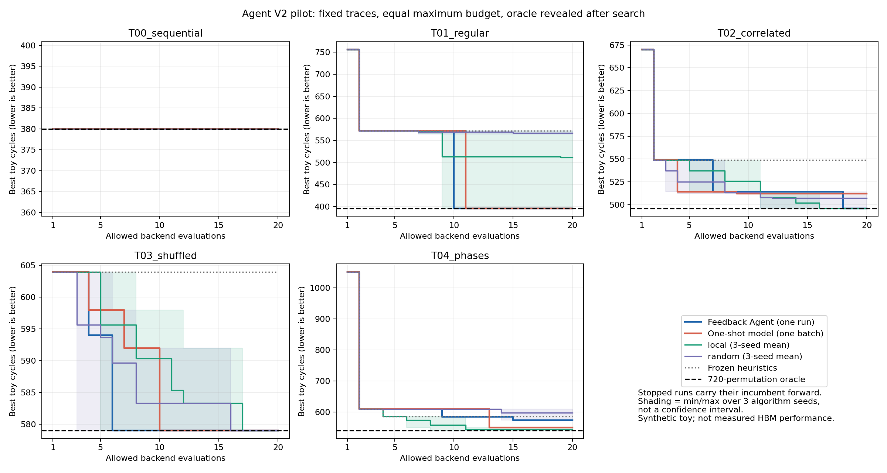

# Agent V2：固定轨迹上的反馈探索对照

> 历史报告：下文计划与命令保留当时语境。`hbm_toy` 命令须在恢复的 `v2` 快照根目录执行，见[历史复现](../../docs/development.md#historical-replay)；当前安排见[研究路线](../../docs/research-direction.md#roadmap)。

日期：2026-10-08。后端仍为 `toy-fcfs-v1`，不是 Ramulator，也不是 HBM 实测。

**四步流程已跑通，但本轮没有证明反馈 Agent 稳定优于强搜索器或一次性提案。** Agent 在 5 个任务中的 4 个达到了六位排列空间的精确最优；其中简单顺序任务的共同起点已经最优。阶段切换任务中，Agent 输给无反馈提案和三个局部搜索运行。成功调整与失败尝试均保留，不依据结果重选任务或重跑 Agent。

## 实验约定

- **固定任务：** 5 条新生成的合成轨迹，各 192 个请求。T00 是顺序对照，T01 为重排地址位后的规则步长，T02 含两个三位奇偶约束，T03 对 T02 的同一地址多重集合打乱顺序，T04 包含两种访问模式的阶段切换。它们不是从真实 KV kernel 采集的请求。
- **固定空间：** 4 个 channel、每个 channel 2 个 bank、1 位 column、2 位 row，共 6 位块地址；只允许 `swap_bits`，共 720 种排列。XOR 不在本轮空间内，精确最优仅针对此空间。每个请求 64 字节，时序和队列参数见 [protocol.json](protocol.json)。
- **预算：** 每种方法每任务最多 20 次实际后端执行；共同起点为 identity 和位顺序反转，两次都计数。缓存命中不计数，非法提案不计数，进入后端后失败计数；提案上限为 200。冻结启发式只用 2–4 次执行；Agent 在 T00 用 5 次后主动停止，其余任务均用满 20 次。曲线在停止后延续已有最佳值，不表示又执行了评价。
- **Agent：** 当前对话根据自己的反馈逐轮选择候选，普通 Python 程序仅完成 DSL 编译、验证、统计与评价；没有将自动生成候选的启发式冒充 Agent。每轮 `hypothesis` 和 `expected` 是简短可检验说明，不是能力证明本身。
- **无反馈消融：** 同一对话根据轨迹及统计，一次性为每个任务选定 18 个候选，加上两次共同起点。全部 90 个候选在任何新任务性能出现之前保存并计算 SHA-256，之后没有改动；评价顺序也已固定。
- **普通搜索器：** 冻结的 activity-packed 与 joint-conditional 启发式；随机搜索和以这些启发式起步的局部搜索，各 3 个种子。局部搜索按固定规则交换两个位，每 7 次提案尝试一次随机重启。每个种子是独立的最多 20 次运行，不把三个种子的最好结果包装成一次 20 次搜索。
- **信息与工具：** 各方法都可用同一原始请求、配置和统计；自适应方法读取自己的性能反馈，无反馈版本有意去掉这一信息。Agent 没有在搜索期间读取其他方法结果或精确枚举结果。5 个任务共用同一对话上下文，不能视为互相独立的模型运行。
- **揭示顺序：** 全部 Agent 会话关闭后，才执行冻结提案和普通搜索器；所有方法结束后再执行精确枚举。`compare` 命令检查这些状态，代码与请求快照有哈希校验；这是可追溯的实验约定，不是对文件所有者的安全隔离。

## 结果曲线与最终成绩

数值为请求完成时间，单位是玩具周期，越小越好。普通搜索器按种子 0 / 1 / 2 分别列出。

| 任务 | 冻结启发式 | 随机搜索（3 次） | 局部搜索（3 次） | 无反馈提案 | 反馈 Agent | 精确最优 |
| --- | ---: | --- | --- | ---: | ---: | ---: |
| T00 顺序对照 | 380 | 380 / 380 / 380 | 380 / 380 / 380 | 380 | 380 | 380 |
| T01 规则步长 | 572 | 565 / 572 / 564 | 565 / 396 / 572 | 396 | 396 | 396 |
| T02 地址位相关 | 549 | 496 / 512 / 514 | 496 / 496 / 496 | 512 | 496 | 496 |
| T03 访问乱序 | 604 | 579 / 579 / 579 | 579 / 579 / 579 | 579 | 579 | 579 |
| T04 阶段切换 | 586 | 609 / 574 / 609 | 540 / 540 / 550 | 550 | 574 | 540 |



图中普通搜索器曲线为三个种子的均值，阴影是最小值至最大值，不是置信区间。无反馈曲线是**预先固定的候选列表按顺序评价后的累计最好值**，不是反馈驱动的搜索。

反馈 Agent 相对无反馈提案：**1 胜、3 平、1 负**。T02 从 512 改善至 496，但三个局部搜索也全部达到 496，且分别在第 14、11、16 次执行达到；Agent 到第 18 次才达到。T03 Agent 第 6 次达到最优，无反馈第 10 次达到，但一个随机种子第 3 次就达到，不能据此宣称模型更省评价。

T01 Agent 第 10 次达到 396，无反馈第 11 次达到；局部搜索有一个种子第 9 次达到。反馈记录能解释一次成功调整，但这组数字并不支持其相对所有传统方法更高效。

T04 Agent 的 574 比无反馈的 550 高 4.36%，比精确最优 540 高 6.30%；三个局部搜索结果都优于 Agent。应保留为明确失败，而不是以“比 identity 好很多”掩盖差距。

## 可追溯的探索过程

以下编号是每个任务内的**累计后端执行次数**。完整候选、预测和结果位于 [comparison.json](comparison.json) 的 `cases.<任务>.agent.history`。

| 任务 / 调整 | 实际反馈 | Agent 后续行动与测量结果 |
| --- | --- | --- |
| T01：先按活动率安排 selector | 第 3 次为 664，劣于共同起点中的 572 | 第 5、6 次尝试提升行局部性，命中率达到约 47%，但均为 684；说明单独优化命中率不够 |
| T01：改变同一 selector 集合的 channel/bank 分工 | 第 10 次把最快变化的位用于 bank，仍约 47% 命中，却降至 396 | 第 11 次改变 column 后退回 572；第 15 次再交换 bank/column，保持相同行命中率却退回 684。这些受控修改支持“局部性与 bank 并行共同影响完成时间” |
| T02：放弃仅按单个位活动率排序 | 第 3 次为 767，第 7 次通过调整 selector 分工降至 514 | 第 18 次用奇偶组合位参与 channel，降至 496；第 19 次换另一个奇偶位又退化到 767。相关位不是一律好或坏，仍受请求时序影响 |
| T03：发现映射等价与次序差异 | 第 4、5 次更换条件等价的 bank 选择位，均为 594 | 第 6 次改变 channel 组合达到 579；后续多个候选未改善。普通随机/局部方法也容易达到相同最优，不能把平台上较容易的任务算成独有能力 |
| T04：修正“阶段内不活动的位不能用作 bank”的粗糙假设 | 第 9 次达到 585；第 15 次使用第一阶段不活动的 bank 位反而达到 574 | 第 16、19 次换 column 均退回 670。效果依赖字段组合，不能只凭单个位活动判断；但剩余探索仍未找到 540，整体决策不如对照 |

**这些过程说明 Agent 确实根据反馈调整了候选，并产生了可测量的局部改善；它们不证明这条探索路径比其他路径更好。** 无反馈提案已找到 T01 的同等结果，并在 T04 找到更好的结果，是必须同时解释的反证。

## 成本、可重复性与限制

| 项目 | 后端执行次数 |
| --- | ---: |
| 反馈 Agent（5 个任务） | 85 |
| 无反馈提案（5 个任务） | 100 |
| 冻结启发式（5 个任务） | 17 |
| 随机搜索（5 个任务 × 3 个种子） | 300 |
| 局部搜索（5 个任务 × 3 个种子） | 300 |
| 搜索合计 | **802** |
| 搜索结束后的精确参照（5 × 720） | **3600** |
| 随后重放验证，独立于搜索与精确参照 | **802** |

802 次搜索执行记录的模拟器时间合计约 0.80 秒；这不包含配置检查、统计、文件读写和模型推理。Agent 会话重叠进行，四个完整任务从初始化到关闭均约 548 秒，不能把它们相加作为模型耗时，也不能把 0.80 秒当端到端开销。模型 token、费用和隔离后的推理时间未知，保留为空。本轮不能证明总时间加速。

请求、代码和无反馈提案均冻结后才启动搜索；准确哈希与提示见协议。本轮用同一个模型对话设计任务并执行搜索，已知道生成器与旧实验，任务不是盲测；每任务只有一次 Agent 运行，不支持统计显著性或跨负载泛化结论。原有“规则发现”样例仅作开发背景，本轮新轨迹也仍然是人造任务。

精确枚举只覆盖排列，不覆盖完整可逆 XOR 矩阵；RTL 未运行，真实请求和 Ramulator 尚未接入。**“4/5 达到最优”不能外推为 Agent 已解决 HBM 地址寻优。**

## 文件和复现

选入版本管理的内容：

- `protocol.json`：任务、预算、工具约束、提示、源文件哈希和冻结提案哈希。
- `traces/T00_sequential.json` 至 `T04_phases.json`：5 个固定请求快照。
- `one_shot/`：对应 5 个任务的冻结候选列表，每个 18 个 DSL。
- `comparison.json`：45 个运行的完整候选历史、计数、度量、最佳策略，以及事后精确枚举结果。它已包含 Agent 提案和反馈，不再重复提交运行时的 `state.json` / `feedback.json` / `result.json`。
- `convergence.png` 与本报告：可分享的结果曲线与解释。

`agent/` 中的活动会话文件、逐份提案和 `features/` 是本地运行产物，默认不提交。T00 提前停止的决定可从归档的 5 次执行和关闭时间核对；其停止理由是共同起点与两种低位 selector 分工均为 380，较慢 bank 的尝试退化，这不是搜索当时的最优性证明。

冻结提案的哈希按原始文件字节计算；`.gitattributes` 对本轮 `one_shot/*.json` 禁用换行转换，保证提交和跨平台拉取后仍能核验原始承诺。不要格式化这些归档提案后继续使用原哈希。

在仓库根目录重放所有已记录的候选，并逐项核对指标、缓存和预算计数：

```powershell
python -m hbm_toy.agent_v2_report replay results/agent_v2_pilot
python -m hbm_toy.agent_v2_report render results/agent_v2_pilot
```

重放已经通过，45 个运行、802 次实际后端执行均与归档一致。画图需要已有的可选依赖 matplotlib；重放和核心实验不需要第三方包。重放确认评价器的可重复性，不代表让模型重新思考会生成同样的候选。

若重跑搜索，先创建新目录，避免覆盖已有结果：

```powershell
python -m hbm_toy.agent_v2 prepare --output results/run_agent_v2_new
# 在新目录 one_shot/ 中写入五份各 18 个候选的列表，不能提前看性能。
python -m hbm_toy.agent_v2 start --output results/run_agent_v2_new
# 按运行指南使用 session-step；全部 session-finish 后再比较。
python -m hbm_toy.agent_v2 compare --output results/run_agent_v2_new
```

如果只是复测已有无反馈批次，可复制归档的 `one_shot/`。真正的新 Agent 实验仍需要模型参与，且看过本报告后，这五条轨迹应视为开发数据；下一轮需另建冻结任务，不能再称它们为未见测试集。

## 下一步由什么证据驱动

优先诊断 T04 为什么无反馈候选和固定局部搜索都更好：Agent 的探索可能过于依赖逐个字段的解释，在看到短期失败后错过有利的组合。这个解释目前是待检验假设，应在开发任务上提出改进，再在另设任务上比较，不能继续调 T04 后把收益当作独立测试。

下一轮保持 Agent 主导决策，检验更系统的候选多样性、诊断信息和实验选择机制；为固定流程提供相同工具并计入其调用预算。随后取得真实控制器请求，并用真实时序后端复核排序。当前证据支持继续研究，但不支持宣布 Agent 已优于传统优化。
