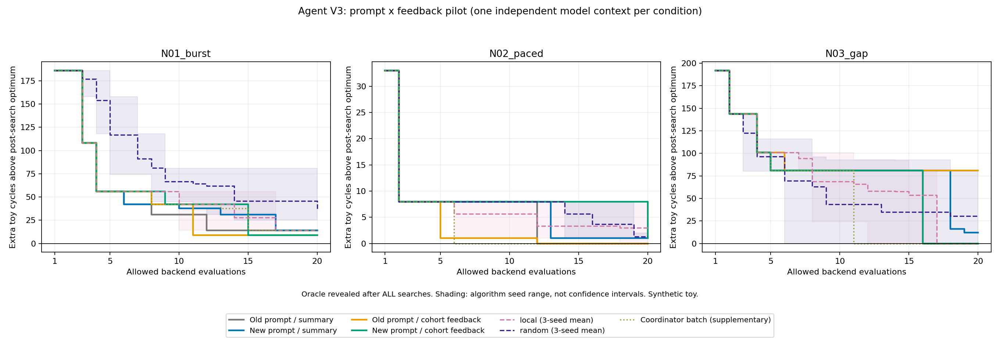

# Agent V3：分别检验提示与分批反馈

> 历史报告：下文计划与命令保留当时语境。`hbm_toy` 命令须在恢复的 `v3` 快照根目录执行，见[历史复现](../../docs/development.md#historical-replay)；当前安排见[研究路线](../../docs/research-direction.md#roadmap)，Ramulator 实际运行继续暂停。

本轮是小规模的四组对照：原提示/新提示与汇总反馈/分批反馈交叉组合。每条件每任务最多 20 次实际后端调用；四个条件使用互不继承对话、互不读取结果的独立模型上下文。

**结论：详细反馈出现了一个小幅正面信号，但改提示、加信息都没有稳定收益。** 密集任务中两个分批反馈组均达到 466，比两个汇总组及三次局部搜索的 471 好约 1.06%；所有 Agent 仍未达到该任务的精确最优 457。另一个任务中，原提示加入分批反馈后从 4308 退步到 4389，不能只挑正面结果。

## 最终结果：越小越好

| 新任务 | 原提示＋汇总 | 新提示＋汇总 | 原提示＋分批 | 新提示＋分批 | 精确最优 |
| --- | ---: | ---: | ---: | ---: | ---: |
| N01 密集请求 | 471 | 471 | **466** | **466** | 457 |
| N02 较慢请求 | **784** | 785 | **784** | 785 | 784 |
| N03 批次间隔 | **4308** | 4320 | 4389 | **4308** | 4308 |

单位是玩具周期。N03 包含固定空档；4308、4320、4389 分别对应第二批到达后再经过 212、224、293 周期全部完成。搜索目标始终是原始总完成时间，没有事后更换目标。

| 对照方法 | N01 密集 | N02 较慢 | N03 间隔 |
| --- | ---: | ---: | ---: |
| 固定启发式 | 513 | 792 | 4409 |
| 随机搜索，种子 0 / 1 / 2 | 513 / 482 / 488 | 785 / 785 / 786 | 4320 / 4308 / 4388 |
| 局部搜索，种子 0 / 1 / 2 | 471 / 471 / 471 | 785 / 792 / 784 | 4308 / 4308 / 4308 |
| 母对话预先提出的补充无反馈批次 | 471 | 784 | 4308 |

普通算法每个种子均有独立的 20 次上限，没有把三个种子的最好值包装成一次 20 次搜索。补充无反馈批次的上下文差异见下方实验边界。

## 分别看两项改动

表内数字为“修改前周期 − 修改后周期”，正数表示改善，负数表示退步。

| 改动 | N01 | N02 | N03 |
| --- | ---: | ---: | ---: |
| 只有汇总反馈时，换新提示 | 0 | −1 | −12 |
| 有分批反馈时，换新提示 | 0 | −1 | +81 |
| 使用原提示时，增加分批反馈 | +5 | 0 | −81 |
| 使用新提示时，增加分批反馈 | +5 | 0 | +12 |

**不能把“新提示有效”或“详细反馈有效”作为普遍结论。** N03 中提示与反馈的组合出现不同结果，但每格只有一次运行，无法区分稳定的交互作用与模型搜索随机性。N02 的 1 周期差距也不宜放大解释。



曲线纵轴是已找到的最好完成时间减去事后最优，仅用于展示；最优值未在搜索时提供。阴影是三个普通算法种子的最小至最大范围，不是置信区间。

## 从过程记录能看到什么

完整提案、预测及反馈在 `comparison.json` 的 `cases.<任务>.agents.<条件>.history` 中，以下编号为累计实际后端调用数。

- **N01：分批信息对应一次有效的方向调整。** 新提示/分批组在第 9 次回到先前 602 的较差方向，联合调整得到 499；第 15 次再调 channel/column 达到 466。记录明确比较前批排空与后批行命中，而没有仅按活动率排序。原提示/分批组第 11 次也找到 466；因此不能把收益归为新提示独有。原提示/汇总组第 12 次、新提示/汇总组第 17 次达到各自的 471。
- **N02：前批积压更小，不必然意味着任务更快。** 新提示/分批组共同起点为 792，第 20 次联合修改得到 785；第一批最后完成时刻从 436 变为 504，第二批到来时前批未完成请求从 7 增至 22，但总完成时间反而降低。原提示的两个组第 12 次均达到更好的 784，详细解释没有带来领先。
- **N03：停滞方向能否被替换，比“知道无积压”更关键。** 原提示/分批组第 6 次达到 4389，余下 14 次没有改善。新提示/分批组第 16 次联合修改达到 4308；原提示/汇总组也在第 16 次达到同值，新提示/汇总组第 19 次停在 4320。四组均可从原始到达时间看出长间隔，额外反馈确认边界无积压，并不自动决定正确的探索方向。

这些是可追溯的决策与测量对应关系，不是对模型内部思考机制的证明。“保留较差方向”“配对修改”等行为确实发生，但还需要独立重复，判断这些行为是否稳定提高成功率。

## 下一步由这轮证据决定

先保留本轮全部成功与失败，不继续调这三条已知轨迹。针对 N01 的小幅优势，在新的密集访问任务上做多次独立上下文重复，并继续保留有间隔和较慢访问作为对照；固定本轮提示和工具后再开始，不能按已知答案选择有利任务。

与此同时，真实请求与 Ramulator 的接入比继续反复改这份提示更有价值：需要验证约 1% 的玩具收益在更真实的时序中是否还成立。更复杂后端本身不会保证 Agent 获胜。研究主线仍是 Agent 自主诊断和实验选择，普通搜索器继续作为必须战胜或解释的强对照。

## 实验边界

- 后端仍是 `toy-fcfs-v1`，只搜索六位地址的 720 种静态排列，不能推出真实 HBM 上的收益。
- 三条新轨迹各 192 个请求，前后各 96 个。N01 每周期最多到达 8 个请求；N02 每 4 周期到达一个；N03 第二批从周期 4096 开始。三条轨迹的地址构造也不同，因此它们不是只改变注入速率的配对实验。
- N03 的长空档允许前批排空，但模拟器不会自动关闭已打开的行，也不模拟刷新，因此不能把它等同于第二批从完全冷启动状态运行。
- 输入统计、分批边界和两个启发式 DSL 对所有组相同。`phase` 组从同一次模拟得到额外分批指标，不增加后端调用；`summary` 组只获得汇总指标。
- 原提示是较短的英文提示，新提示是较长的中文探索指导。比较的是整个提示包，不是单独某一句建议的因果作用；提示长度、语言和阅读成本也有差异。
- 每组一个新上下文，组内三个任务共享上下文；每条件每任务仅一次模型运行。未做模型重复试验或显著性检验。
- 子 Agent 不读取母对话、旧实验文档、其他组、精确参照或源码。允许范围写入各自简报；这是操作约定，不是文件系统级安全隔离。
- 最多三个工作 Agent 同时运行；原提示/汇总组结束后才启动新提示/分批组。母 Agent 收到前者结果，但没有将成绩或策略传给后者。不能把会话从初始化起的墙钟时间当作各模型推理耗时。
- 补充无反馈候选由母对话在任何新任务性能揭示前固定。母对话知道旧实验复盘，其先验上下文与四组不同，所以该批次是补充参照，不是四组各自的严格无反馈消融。
- 普通启发式、随机及局部搜索仍用原冻结算法；随机/局部各三个种子。它们使用自己的总分选择候选，没有新增专门消费分批反馈的固定诊断规则。因此四组对照回答提示/反馈问题，与普通算法的比较只适用于这些具体实现。

所有 Agent 搜索结束后才运行普通对照；所有搜索方法结束后才揭示精确最优。协议、提示、简报、任务和预先提案均有哈希检查，结果不好不会更换任务或重跑该组。

## 成本与验证

| 项目 | 实际后端调用数 |
| --- | ---: |
| 四组 Agent × 三任务 × 20 次 | 240 |
| 补充无反馈批次，三任务 | 60 |
| 固定启发式，三任务 | 12 |
| 随机搜索，三任务 × 三种子 × 20 次 | 180 |
| 局部搜索，三任务 × 三种子 × 20 次 | 180 |
| 搜索合计 | **672** |
| 全部搜索结束后的精确参照，3 × 720 | **2160** |
| 另行重放验证 | **672** |

四组 Agent 共 242 个提案、240 次实际调用，额外两份为原提示/汇总组在 N03 的缓存命中；没有失败或非法提案。36 个搜索运行的指标、缓存、每步调用计数及分批反馈均重放一致。24 项自动测试通过，包含预算、失败计数、同一次模拟输出不同反馈、冻结输入和禁止提前揭示结果等检查。

搜索记录中的后端耗时合计约 0.73 秒，不包括模型推理、文件读写与全部前后处理；V3 调用的计时包含事件提取，旧普通基线计时只含其已有模拟范围。模型实际 token、费用和独立推理时间不可得，不宣称端到端加速。

## 复现与文件

```powershell
python -m hbm_toy.agent_v3_report replay results/agent_v3_pilot
python -m hbm_toy.agent_v3_report render results/agent_v3_pilot
python -m unittest discover -s tests -v
```

重放用于验证已记录候选的性能与预算，不会重新调用模型生成相同决策。绘图需要 matplotlib，核心实验只依赖 Python 标准库。

- `protocol.json`：固定协议、提示、配置与规范化内容哈希。
- `briefings/`：四个条件分别收到的提示与访问约束。
- `inputs/`、`traces/`：共同输入与三个请求快照。
- `one_shot/`：性能揭示前固定的三批补充候选。
- `execution.json`：独立上下文分配与运行窗口记录。
- `comparison.json`：完整搜索历史、分批反馈和事后精确参照。
- `convergence.png`：相对事后最优的额外周期随允许评价次数变化。

各活动会话 `sessions/` 不重复归档；其提案、反馈和停止说明包含在 `comparison.json`。现在已看过的任务不能在未来继续声称是未见测试集；`prepare` 再生成的是同三条固定轨迹。
