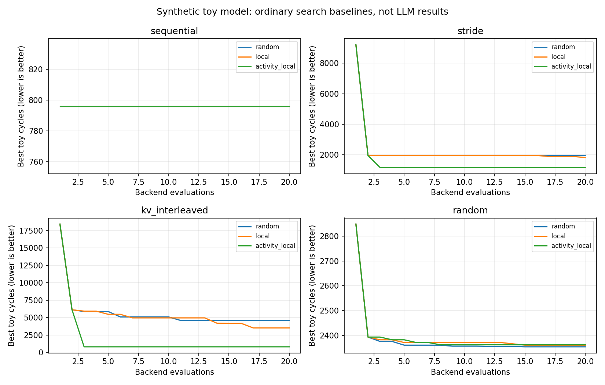

# Toy mapping benchmark

Historical address-mapping baseline; see the [current experiment index](../../docs/experiments.md) for later capabilities and results.

Synthetic requests, toy cycles; **not measured HBM performance**.
All methods below are ordinary algorithms, not LLM agents.

Budget: 20 actual backend calls per search; seeds: [0, 1, 2]; requests per trace: 768.
The two shared initial candidates consume budget. Held-out evaluations occur only after selection.

| Workload | Identity cycles | Row-XOR cycles | Activity heuristic cycles |
| --- | ---: | ---: | ---: |
| sequential | 796 | 796 | 796 |
| stride | 9208 | 1944 | 1156 |
| kv_interleaved | 18424 | 6132 | 820 |
| random | 2849 | 2393 | 2516 |

| Workload | Search | Mean best cycles (min–max) | Train speedup vs identity | Holdout speedup vs identity |
| --- | --- | ---: | ---: | ---: |
| sequential | random | 796.0 (796–796) | 1.00x | 1.00x |
| sequential | local | 796.0 (796–796) | 1.00x | 1.00x |
| sequential | activity_local | 796.0 (796–796) | 1.00x | 1.00x |
| stride | random | 1944.0 (1944–1944) | 4.74x | 4.97x |
| stride | local | 1812.3 (1549–1944) | 5.14x | 5.00x |
| stride | activity_local | 1156.0 (1156–1156) | 7.97x | 7.92x |
| kv_interleaved | random | 4600.0 (3066–6132) | 4.34x | 5.69x |
| kv_interleaved | local | 3533.7 (1549–4892) | 6.70x | 6.95x |
| kv_interleaved | activity_local | 820.0 (820–820) | 22.47x | 6.45x |
| random | random | 2353.7 (2328–2385) | 1.21x | 1.02x |
| random | local | 2360.3 (2344–2377) | 1.21x | 0.97x |
| random | activity_local | 2361.7 (2348–2377) | 1.21x | 0.98x |

`activity_local` is a hand-written bit-transition seed plus local search, NOT an AI agent.
All searchers use the same two baseline seeds; every additional heuristic evaluation is counted.
Search seeds vary proposals; each method sees the same workload seed. Results do not establish statistical significance.

Complete per-search records (DSL, metrics, trace hash, verification, cache flags, and candidate history) are stored in [benchmark.json](benchmark.json) under `runs`. Duplicate `runs/*.json` files are omitted from this archive.

